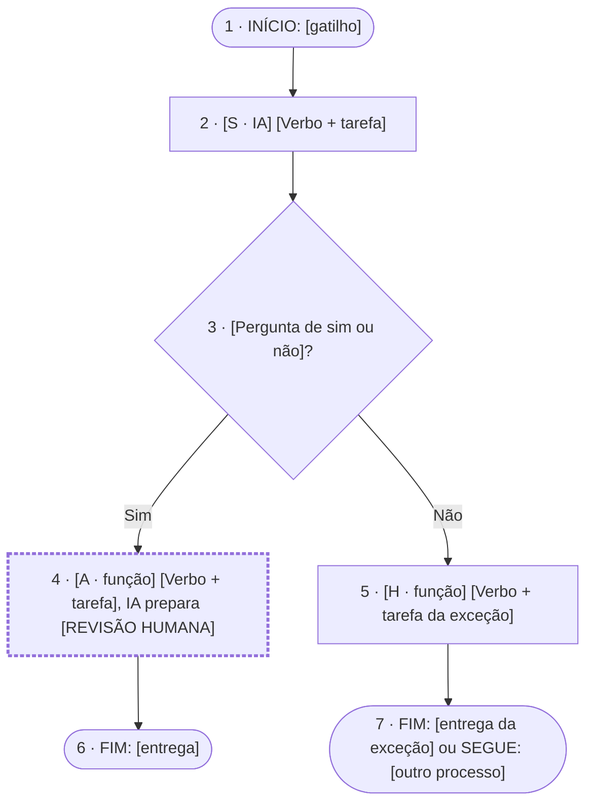

# Fluxograma: [NOME DO PROCESSO]

Setor: [UM DOS 10 SETORES] · Área: [ÁREA, SE HOUVER] · Versão: [1.0] · Atualizado em: [AAAA-MM-DD] · Dono: [FUNÇÃO E NOME]

Situação: desenho feito antes do POP. Quando o POP for escrito, este desenho passa para a seção "Fluxograma" do POP e este arquivo recebe no topo a linha "Substituído pela seção Fluxograma do POP, versão X".

Siglas: S = Substituição (a IA faz no lugar, alguém confere por amostra) · A = Auxílio (a IA prepara e a pessoa decide; caixa tracejada) · H = Humano (continua com a pessoa).

- Gatilho: [o acontecimento que inicia o processo]
- Entrega: [o que sai, para quem]
- Contagem: [n] caixas de ação e decisão · [n] S · [n] A · [n] H · [n] decisões
- Validado com quem executa: [sim, em AAAA-MM-DD, com caso anonimizado / pendente]

## Mermaid

## Em texto

1. INÍCIO: [gatilho]. Vá para 2.
2. AÇÃO [S · IA] [Verbo + tarefa]. Confere: [função], por amostra [frequência ou A DEFINIR]. Vá para 3.
3. DECISÃO: [pergunta]? Se sim, vá para 4. Se não, vá para 5.
4. AÇÃO [A · função] [Verbo + tarefa], com rascunho da IA [REVISÃO HUMANA]. Confere: [o que é conferido]. Vá para 6.
5. AÇÃO [H · função] [Verbo + tarefa da exceção]. Vá para 7.
6. FIM: [entrega].
7. FIM: [entrega da exceção] (ou SEGUE: [outro processo]).

Caminho principal em uma linha: [gatilho] → ... → [entrega].

## Em raias

| Nº | IA | Equipe | Advogado | Cliente (se agir) |
|---|---|---|---|---|
| 1 | | | | |

(No solo, a coluna Equipe é o próprio titular, em outro momento do dia.)

- Caixas por coluna: IA [n] · Equipe [n] · Advogado [n]
- Passagens de bastão mais arriscadas: [linha → linha, por quê]
- Coluna que concentra decisões demais: [qual, ou nenhuma]

## O que o desenho revelou

- Decisões que o texto não cobria: [lista]
- Exceções sem destino ou sem dono: [lista, com A DEFINIR]
- Esperas que não apareciam: [lista, com duração]
- Sugestões `[NOVO]` aprovadas ou recusadas: [lista]

## Pontos em aberto

- [A DEFINIR] [decisão do escritório] · pergunta que resolve: [...]
- [A CONFIRMAR] [informação que alguém sabe] · com quem: [...]
- [CONFERIR] [norma, prazo legal ou regra técnica a checar na fonte]

## Controle de versões

| Versão | Data | O que mudou | Quem aprovou |
|---|---|---|---|
| 1.0 | [AAAA-MM-DD] | Primeira versão | [nome] |

## Anexo: o retrato que originou o desenho

[O passo a passo de hoje, do jeito que o advogado descreveu, com o responsável de cada passo.]
