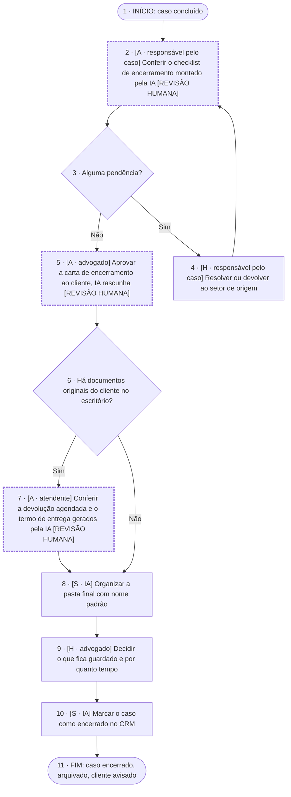

# Fluxograma de referência: encerramento e arquivamento do caso

Setor: Administrativo (ADM) · Gatilho: caso concluído (trânsito em julgado, acordo cumprido ou contrato encerrado) · Entrega: caso encerrado, arquivado, cliente avisado · Complementa o POP "Recebimento e organização de documentos" (`setor-10-administrativo.md` na biblioteca do `escrever-pop`).

Contagem: 9 caixas (7 ações e 2 decisões) · 2 S · 3 A · 2 H.

## Por que este fluxo

Caso encerrado sem fluxo deixa rastro: documento original do cliente esquecido no armário e dado pessoal guardado sem critério nenhum. O encerramento é o último contato formal com o cliente e o momento de decidir o que fica guardado. A política de guarda é decisão do escritório, à luz da LGPD (Lei 13.709/2018), e a IA só organiza.

## Mermaid

## Em texto

1. INÍCIO: caso concluído (trânsito em julgado, acordo cumprido ou contrato encerrado). Vá para 2.
2. AÇÃO [A · responsável pelo caso] Conferir o checklist de encerramento que a IA montou: pendências, originais, custas, prazos abertos [REVISÃO HUMANA]. Confere: responsável pelo caso, item por item. Vá para 3.
3. DECISÃO: há alguma pendência? Se sim, vá para 4. Se não, vá para 5.
4. AÇÃO [H · responsável pelo caso] Resolver a pendência ou devolver ao setor de origem. Volte para 2.
5. AÇÃO [A · advogado] Aprovar a carta de encerramento ao cliente; a IA rascunha [REVISÃO HUMANA]. Confere: advogado, tom e informações do caso. Vá para 6.
6. DECISÃO: há documentos originais do cliente no escritório? Se sim, vá para 7. Se não, vá para 8.
7. AÇÃO [A · atendente] Conferir a devolução agendada e o termo de entrega que a IA gerou; o cliente assina o termo [REVISÃO HUMANA]. Confere: atendente, lista de originais contra o termo. Vá para 8.
8. AÇÃO [S · IA] Organizar a pasta final com nome padrão. Confere: responsável pelo caso, por amostra. Vá para 9.
9. AÇÃO [H · advogado] Decidir o que fica guardado e por quanto tempo, conforme a política de guarda do escritório. Vá para 10.
10. AÇÃO [S · IA] Marcar o caso como encerrado no CRM. Vá para 11.
11. FIM: caso encerrado, arquivado, cliente avisado.

Caminho principal: caso concluído → checklist → sem pendência → carta ao cliente → devolução de originais → pasta final → guarda decidida → encerrado no CRM.

## Cuidados

- Se o escritório ainda não tem política de guarda escrita, o passo 9 fica `[A DEFINIR]` e o tema vai para o `codigo-do-escritorio`. A preocupação com a guarda de dado pessoal segue a LGPD (Lei 13.709/2018) `[CONFERIR]`.
- Descarte de original nunca é feito pela IA.

## Ao adaptar

- Na versão em raias, acrescente a coluna Cliente: ele assina o termo de entrega no passo 7, sem sigla.
- Em Família e em casos com criança ou saúde, a pasta final fica com acesso restrito.
