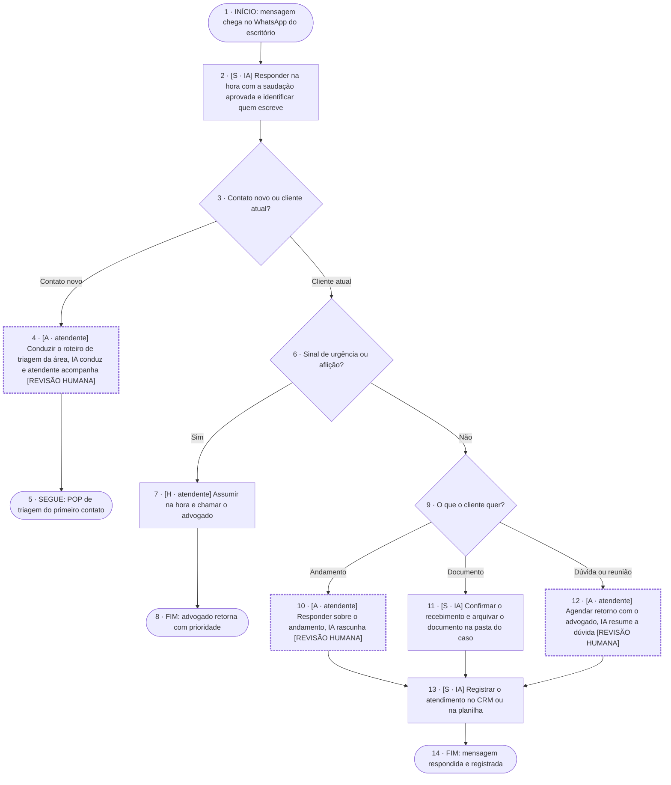

# Fluxograma de referência: mensagem nova no WhatsApp do escritório

Setor: Atendimento e triagem (ATD) · Gatilho: qualquer mensagem recebida no WhatsApp do escritório · Entrega: mensagem respondida e registrada · Complementa o POP "Triagem do primeiro contato e consulta inicial" (`setor-01-atendimento-triagem.md` na biblioteca do `escrever-pop`).

Contagem: 10 caixas (7 ações e 3 decisões) · 3 S · 3 A · 1 H.

## Por que este fluxo

É o desenho do exemplo resolvido da skill (o retrato do WhatsApp em cinco linhas). Ele funciona como uma central: separa quem escreve e o que a pessoa quer, e manda cada caso para o fluxo certo. A regra fica no topo: a resposta automática nunca dá orientação jurídica, e a pessoa sabe que está falando com o atendimento do escritório.

## Mermaid

## Em texto

1. INÍCIO: mensagem chega no WhatsApp do escritório. Vá para 2.
2. AÇÃO [S · IA] Responder na hora com a saudação aprovada e identificar quem escreve. Sem orientação jurídica; nunca se passa por advogado. Confere: atendente, por amostra [A DEFINIR a frequência]. Vá para 3.
3. DECISÃO: contato novo ou cliente atual? Se contato novo, vá para 4. Se cliente atual, vá para 6.
4. AÇÃO [A · atendente] Conduzir o roteiro de triagem da área; a IA conduz e a atendente acompanha [REVISÃO HUMANA]. Confere: atendente, e assume se a conversa sair do roteiro. Vá para 5.
5. SEGUE: POP de triagem do primeiro contato.
6. DECISÃO: há sinal de urgência ou aflição (audiência amanhã, benefício cortado, risco à pessoa)? Se sim, vá para 7. Se não, vá para 9.
7. AÇÃO [H · atendente] Assumir a conversa na hora e chamar o advogado. Vá para 8.
8. FIM: advogado retorna com prioridade.
9. DECISÃO: o que o cliente quer? Se andamento, vá para 10. Se documento, vá para 11. Se dúvida ou reunião, vá para 12.
10. AÇÃO [A · atendente] Responder sobre o andamento; a IA rascunha [REVISÃO HUMANA]. Confere: atendente, caso certo, data certa, nenhuma promessa de resultado. Vá para 13.
11. AÇÃO [S · IA] Confirmar o recebimento e arquivar o documento na pasta do caso, com nome padrão. Confere: atendente, por amostra. Vá para 13.
12. AÇÃO [A · atendente] Agendar retorno com o advogado; a IA resume a dúvida [REVISÃO HUMANA]. Confere: atendente, a agenda. Vá para 13.
13. AÇÃO [S · IA] Registrar o atendimento no CRM ou na planilha. Vá para 14.
14. FIM: mensagem respondida e registrada.

Caminho principal: mensagem → saudação e identificação → cliente atual → sem urgência → resposta pelo tipo de pedido → registro.

## Cuidados

- A resposta automática nunca dá orientação jurídica e deixa claro que é o atendimento do escritório.
- Urgência e aflição saem do automático na hora (passo 7). No solo, "a atendente assume" vira "o advogado assume".
- Mensagem em Família com sinal de violência, coação ou risco: o advogado assume e nada daquele caso entra em automação.

## Ao adaptar

- A lista de sinais de urgência do passo 6 é exemplo: escreva a do escritório.
- O registro do passo 13 não aparecia no retrato que originou o desenho; foi acrescentado porque sem ele ninguém sabe quantas mensagens chegam.
