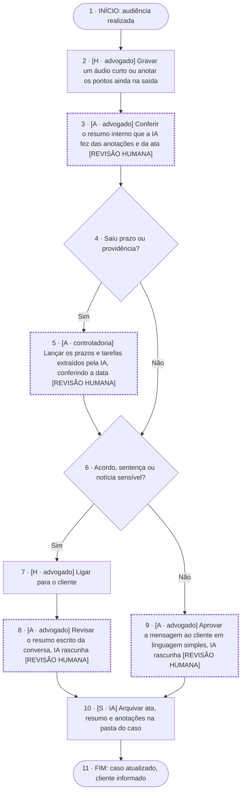

# Fluxograma de referência: depois da audiência

Setor: Audiências e diligências (AUD) · Gatilho: audiência realizada · Entrega: caso atualizado, prazos lançados, cliente informado · Complementa o POP "Preparação de audiência" (`setor-05-audiencias-diligencias.md` na biblioteca do `escrever-pop`).

Contagem: 9 caixas (7 ações e 2 decisões) · 1 S · 4 A · 2 H.

## Por que este fluxo

A preparação da audiência está no POP da biblioteca. O pós-audiência quase ninguém desenha, e é onde o escritório perde informação: o prazo que saiu na ata e o cliente que foi embora sem entender o resultado. O fluxo começa com uma anotação rápida do advogado ainda na saída, porque memória de audiência dura pouco.

## Mermaid

## Em texto

1. INÍCIO: audiência realizada. Vá para 2.
2. AÇÃO [H · advogado] Gravar um áudio curto ou anotar os pontos ainda na saída. Vá para 3.
3. AÇÃO [A · advogado] Conferir o resumo interno que a IA fez das anotações e da ata [REVISÃO HUMANA]. Confere: advogado, se o resumo bate com o que aconteceu. Vá para 4.
4. DECISÃO: saiu prazo ou providência? Se sim, vá para 5. Se não, vá para 6.
5. AÇÃO [A · controladoria] Lançar os prazos e tarefas que a IA extraiu e propôs [REVISÃO HUMANA]. Confere: controladoria, a data de cada prazo. Vá para 6.
6. DECISÃO: houve acordo, sentença ou notícia sensível? Se sim, vá para 7. Se não, vá para 9.
7. AÇÃO [H · advogado] Ligar para o cliente. Vá para 8.
8. AÇÃO [A · advogado] Revisar o resumo escrito da conversa; a IA rascunha [REVISÃO HUMANA]. Confere: advogado, se o resumo diz o que foi falado. Vá para 10.
9. AÇÃO [A · advogado] Aprovar a mensagem ao cliente em linguagem simples; a IA rascunha [REVISÃO HUMANA]. Confere: advogado, resultado descrito sem promessa. Vá para 10.
10. AÇÃO [S · IA] Arquivar ata, resumo e anotações na pasta do caso. Vá para 11.
11. FIM: caso atualizado, cliente informado.

Caminho principal: audiência → anotação na saída → resumo interno → prazos lançados → mensagem ao cliente → arquivo.

## Cuidados

- Notícia sensível é linha vermelha: o advogado liga (passo 7) antes de qualquer texto.
- Se usar transcrição de áudio, grave só as suas próprias anotações e trate o arquivo com o mesmo sigilo do processo.
- Prazo que saiu na ata é conferido por uma pessoa antes de entrar na agenda. Prazo legal: `[CONFERIR]`.

## Ao adaptar

- Em diligência sem ata, o passo 3 parte só das anotações do passo 2.
- No solo, a controladoria do passo 5 é o titular, conferindo a data em outro momento do dia.
