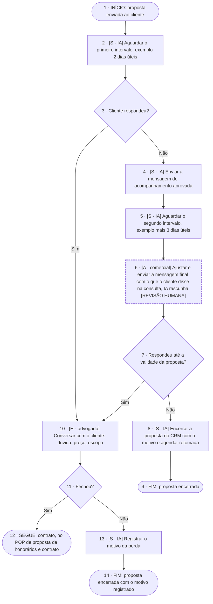

# Fluxograma de referência: acompanhamento da proposta enviada

Setor: Comercial (COM) · Gatilho: proposta enviada ao cliente · Entrega: proposta fechada (segue para o contrato) ou encerrada com o motivo registrado · Complementa o POP "Proposta de honorários e contrato" (`setor-02-comercial.md` na biblioteca do `escrever-pop`).

Contagem: 10 caixas (7 ações e 3 decisões) · 5 S · 1 A · 1 H.

## Por que este fluxo

A proposta saiu e o cliente sumiu. Sem um fluxo, o acompanhamento depende de alguém lembrar, e ninguém lembra. Aqui a IA cuida da cadência e do registro, e a conversa sobre preço continua com o advogado. As mensagens seguem o tom do código do escritório, sem pressão e sem promessa de resultado. Os intervalos são exemplo.

## Mermaid

## Em texto

1. INÍCIO: proposta enviada ao cliente. Vá para 2.
2. AÇÃO [S · IA] Aguardar o primeiro intervalo (exemplo: 2 dias úteis). Vá para 3.
3. DECISÃO: o cliente respondeu? Se sim, vá para 10. Se não, vá para 4.
4. AÇÃO [S · IA] Enviar a mensagem de acompanhamento aprovada. Confere: comercial, por amostra [A DEFINIR a frequência]. Vá para 5.
5. AÇÃO [S · IA] Aguardar o segundo intervalo (exemplo: mais 3 dias úteis). Vá para 6.
6. AÇÃO [A · comercial] Ajustar e enviar a mensagem final com o que o cliente disse na consulta; a IA rascunha [REVISÃO HUMANA]. Confere: comercial, tom, nenhuma pressão e nenhuma condição fora da política. Vá para 7.
7. DECISÃO: o cliente respondeu até a validade da proposta? Se sim, vá para 10. Se não, vá para 8.
8. AÇÃO [S · IA] Encerrar a proposta no CRM com o motivo e agendar retomada. Vá para 9.
9. FIM: proposta encerrada.
10. AÇÃO [H · advogado] Conversar com o cliente: dúvida, preço, escopo. Vá para 11.
11. DECISÃO: fechou? Se sim, vá para 12. Se não, vá para 13.
12. SEGUE: contrato, no POP de proposta de honorários e contrato.
13. AÇÃO [S · IA] Registrar o motivo da perda; ele vira dado para revisar a política de honorários. Vá para 14.
14. FIM: proposta encerrada com o motivo registrado.

Caminho principal: proposta enviada → espera → acompanhamento → espera → mensagem final → resposta → conversa com o advogado → fechou → contrato.

## Cuidados

- Desconto e condição fora da política nunca entram em mensagem automática: são decisão do advogado.
- Negociar honorário é H. A IA cuida da cadência, nunca do preço.
- As mensagens dos passos 4 e 6 seguem o tom do código do escritório. Mensagem com dado de cliente fica S só com conta profissional e regra de uso escrita; sem isso, sobe para A.

## Ao adaptar

- Os dois intervalos são exemplo: use os do código do escritório ou marque `[A DEFINIR]`.
- Os passos 2 e 5 são esperas desenhadas como ação: a IA acompanha o tempo e aciona o passo seguinte.
