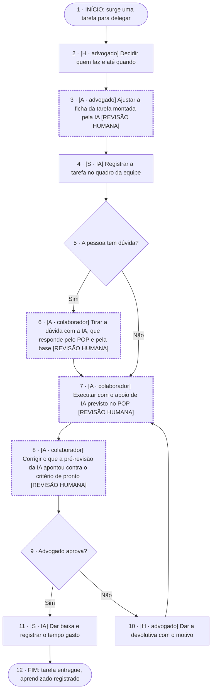

# Fluxograma de referência: delegar uma tarefa com padrão de entrega

Setor: Gestão de equipe (EQP) · Gatilho: surge uma tarefa a delegar · Entrega: tarefa entregue, tempo e aprendizado registrados · Complementa o POP "Integração de novo colaborador" (`setor-09-gestao-equipe.md` na biblioteca do `escrever-pop`).

Contagem: 10 caixas (8 ações e 2 decisões) · 2 S · 4 A · 2 H.

## Por que este fluxo

"Dificuldade de delegar" quase sempre começa no pedido: a tarefa sai sem contexto e sem critério de pronto, volta errada e o titular conclui que é mais rápido fazer sozinho. É enxugar gelo. O fluxo põe a IA para escrever a ficha da tarefa e fazer uma pré-revisão antes de a entrega chegar ao advogado.

## Mermaid

## Em texto

1. INÍCIO: surge uma tarefa para delegar. Vá para 2.
2. AÇÃO [H · advogado] Decidir quem faz e até quando. Vá para 3.
3. AÇÃO [A · advogado] Ajustar a ficha da tarefa que a IA montou: contexto, entrega esperada, modelo, prazo e critério de pronto [REVISÃO HUMANA]. Confere: advogado, em poucos minutos, se a ficha diz o que ele espera. Vá para 4.
4. AÇÃO [S · IA] Registrar a tarefa no quadro da equipe. Vá para 5.
5. DECISÃO: a pessoa tem dúvida? Se sim, vá para 6. Se não, vá para 7.
6. AÇÃO [A · colaborador] Tirar a dúvida com a IA, que responde pelo POP e pela base do setor [REVISÃO HUMANA]. Confere: colaborador; se a resposta não estiver no POP nem na base, a dúvida sobe para o advogado. Vá para 7.
7. AÇÃO [A · colaborador] Executar a tarefa com o apoio de IA previsto no POP [REVISÃO HUMANA]. Confere: colaborador, conforme o POP da tarefa. Vá para 8.
8. AÇÃO [A · colaborador] Corrigir o que a pré-revisão da IA apontou contra o critério de pronto [REVISÃO HUMANA]. Confere: colaborador, antes de a entrega chegar ao advogado. Vá para 9.
9. DECISÃO: o advogado aprova? Se sim, vá para 11. Se não, vá para 10.
10. AÇÃO [H · advogado] Dar a devolutiva com o motivo; o motivo vira regra no POP. Volte para 7.
11. AÇÃO [S · IA] Dar baixa e registrar o tempo gasto. Vá para 12.
12. FIM: tarefa entregue, aprendizado registrado.

Caminho principal: tarefa → quem faz → ficha → quadro → execução → pré-revisão → aprovação → baixa.

## Cuidados

- Dúvida que o POP e a base não respondem sobe para o advogado: a IA não completa o vazio com o que acha.
- A devolutiva do passo 10 é o que melhora o POP. Sem ela, o mesmo erro volta.
- O tempo registrado no passo 11 alimenta a `medir-retorno`, nunca a cobrança individual.

## Ao adaptar

- No solo, este fluxo só entra quando há estagiário ou primeira contratação.
- Tarefa com dado de cliente: o apoio de IA dos passos 6 a 8 só em conta profissional, conforme a regra de uso.
