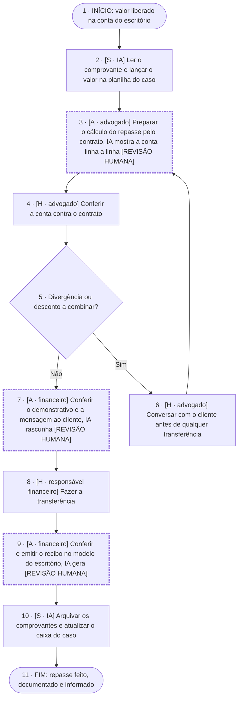

# Fluxograma de referência: valor liberado, repasse ao cliente

Setor: Financeiro e cobrança (FIN) · Gatilho: alvará, requisição de pagamento ou acordo pago, com o valor na conta do escritório · Entrega: repasse feito, documentado e informado · Complementa o POP "Cobrança de honorários e inadimplência" (`setor-06-financeiro-cobranca.md` na biblioteca do `escrever-pop`).

Contagem: 9 caixas (8 ações e 1 decisão) · 2 S · 3 A · 3 H.

## Por que este fluxo

Repasse é o momento em que o cliente mais presta atenção no escritório. Um erro de conta, ou um demonstrativo confuso, apaga anos de bom trabalho. A IA monta a conta e o demonstrativo. Conferir e transferir continua com pessoas.

## Mermaid

## Em texto

1. INÍCIO: valor liberado na conta do escritório (alvará, requisição de pagamento ou acordo pago). Vá para 2.
2. AÇÃO [S · IA] Ler o comprovante e lançar o valor na planilha do caso. Confere: financeiro, no passo 7. Vá para 3.
3. AÇÃO [A · advogado] Preparar o cálculo do repasse pelo contrato: honorários, despesas, valor do cliente; a IA mostra a conta linha a linha [REVISÃO HUMANA]. Confere: advogado, no passo 4. Vá para 4.
4. AÇÃO [H · advogado] Conferir a conta contra o contrato. Vá para 5.
5. DECISÃO: há divergência ou desconto a combinar? Se sim, vá para 6. Se não, vá para 7.
6. AÇÃO [H · advogado] Conversar com o cliente antes de qualquer transferência. Volte para 3 com o que foi combinado.
7. AÇÃO [A · financeiro] Conferir o demonstrativo e a mensagem ao cliente; a IA rascunha [REVISÃO HUMANA]. Confere: financeiro, valores iguais aos da conta aprovada e clareza do demonstrativo. Vá para 8.
8. AÇÃO [H · responsável financeiro] Fazer a transferência. Vá para 9.
9. AÇÃO [A · financeiro] Conferir e emitir o recibo no modelo do escritório; a IA gera [REVISÃO HUMANA]. Confere: financeiro, valor e dados do recibo. Vá para 10.
10. AÇÃO [S · IA] Arquivar os comprovantes e atualizar o caixa do caso. Vá para 11.
11. FIM: repasse feito, documentado e informado.

Caminho principal: valor liberado → lançamento → cálculo → conferência contra o contrato → demonstrativo → transferência → recibo → arquivo.

## Cuidados

- Transferência de dinheiro é sempre H, mesmo quando o resto do fluxo estiver redondo.
- Dado bancário do cliente não entra em prompt: a IA trabalha só com os valores.
- Desconto ou condição fora do contrato é conversa do advogado (passo 6), nunca mensagem automática.

## Ao adaptar

- A volta do passo 6 para o 3 é sugestão da biblioteca: o que foi combinado com o cliente refaz a conta antes do demonstrativo.
- No solo, advogado e responsável financeiro são a mesma pessoa. Faça a conferência do passo 4 em outro momento, nunca logo depois do cálculo.
