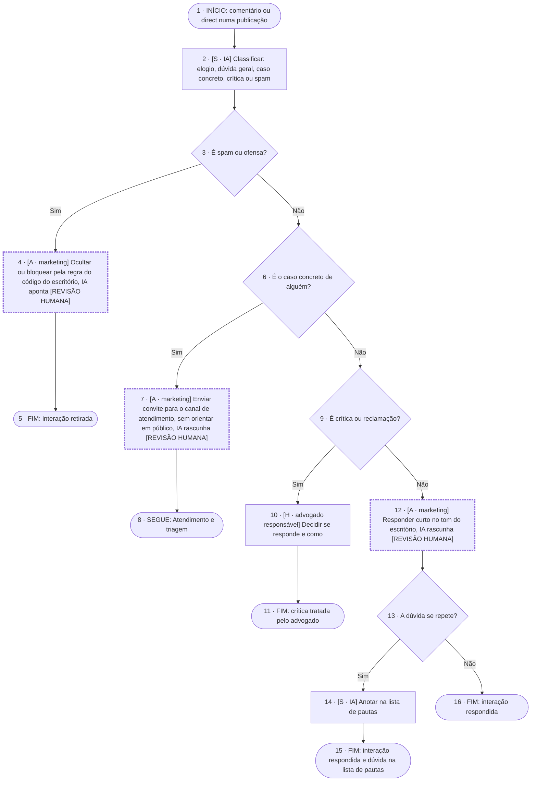

# Fluxograma de referência: comentário ou direct numa publicação

Setor: Marketing e conteúdo (MKT) · Gatilho: interação recebida numa publicação (comentário ou mensagem direta) · Entrega: interação respondida, encaminhada ou retirada, e dúvida repetida na lista de pautas · Complementa o POP "Produção de conteúdo com revisão ética" (`setor-08-marketing-conteudo.md` na biblioteca do `escrever-pop`).

Contagem: 10 caixas (6 ações e 4 decisões) · 2 S · 3 A · 1 H.

## Por que este fluxo

A publicação deu certo e começaram as perguntas: "meu caso é assim, tenho direito?". Responder ali, em público, é consulta aberta e mistura caso concreto com publicidade. O fluxo separa o caso concreto logo na primeira decisão e leva a pessoa para o atendimento, dentro das regras de publicidade da OAB (Provimento 205/2021 do Conselho Federal da OAB). As dúvidas que se repetem viram pauta.

## Mermaid

## Em texto

1. INÍCIO: comentário ou direct numa publicação. Vá para 2.
2. AÇÃO [S · IA] Classificar a interação: elogio, dúvida geral, caso concreto, crítica ou spam. Confere: marketing, por amostra. Vá para 3.
3. DECISÃO: é spam ou ofensa? Se sim, vá para 4. Se não, vá para 6.
4. AÇÃO [A · marketing] Ocultar ou bloquear pela regra escrita no código do escritório; a IA aponta [REVISÃO HUMANA]. Confere: marketing, se a interação é mesmo spam ou ofensa. Sem regra escrita: `[A DEFINIR]`. Vá para 5.
5. FIM: interação retirada.
6. DECISÃO: é o caso concreto de alguém? Se sim, vá para 7. Se não, vá para 9.
7. AÇÃO [A · marketing] Enviar convite para o canal de atendimento, sem orientar em público; a IA rascunha [REVISÃO HUMANA]. Confere: marketing, nenhuma orientação sobre o caso e nenhuma promessa. Vá para 8.
8. SEGUE: Atendimento e triagem.
9. DECISÃO: é crítica ou reclamação? Se sim, vá para 10. Se não, vá para 12.
10. AÇÃO [H · advogado responsável] Decidir se responde e como. Vá para 11.
11. FIM: crítica tratada pelo advogado.
12. AÇÃO [A · marketing] Responder curto no tom do escritório; a IA rascunha [REVISÃO HUMANA]. Confere: marketing, tom e regras de publicidade. Vá para 13.
13. DECISÃO: a dúvida se repete? Se sim, vá para 14. Se não, vá para 16.
14. AÇÃO [S · IA] Anotar na lista de pautas. Vá para 15.
15. FIM: interação respondida e dúvida na lista de pautas.
16. FIM: interação respondida.

Caminho principal: interação → classificação → dúvida geral → resposta curta revisada → pauta, se repetir.

## Cuidados

- Caso concreto nunca é respondido em público: vira convite para o atendimento.
- Crítica e reclamação são decisão do advogado responsável.
- A preocupação com publicidade e captação segue o Provimento 205/2021 do Conselho Federal da OAB `[CONFERIR]`.

## Ao adaptar

- O desvio de spam e ofensa (passos 3 a 5) vem da nota do material de origem, que tirava esses casos do fluxo na classificação; foi desenhado para não deixar seta solta.
- Se o escritório não tem regra de ocultar ou bloquear, leve o tema ao `codigo-do-escritorio`.
