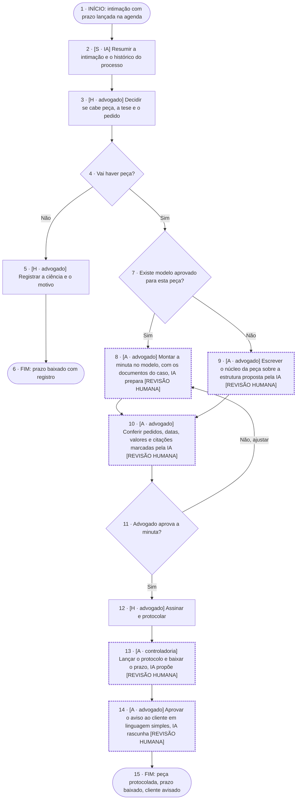

# Fluxograma de referência: da intimação à peça protocolada

Setor: Produção de peças (PEC) · Gatilho: intimação com prazo lançada na agenda · Entrega: peça protocolada, prazo baixado, cliente avisado · Complementa o POP "Elaboração de petição a partir de modelo e documentos" (`setor-03-producao-pecas.md` na biblioteca do `escrever-pop`).

Contagem: 12 caixas (9 ações e 3 decisões) · 1 S · 5 A · 3 H.

## Por que este fluxo

O advogado aparece em quase todas as caixas, e é por isso que este setor costuma ser o alvo. A IA entra para preparar o material de cada decisão, e as três decisões que importam (se cabe peça, a aprovação da minuta, a assinatura) continuam com ele. Repare na volta depois da revisão: sem ela, a minuta "quase boa" vai para o protocolo.

## Mermaid

## Em texto

1. INÍCIO: intimação com prazo lançada na agenda. Vá para 2.
2. AÇÃO [S · IA] Resumir a intimação e o histórico do processo. Confere: advogado, ao ler o resumo no passo 3. Vá para 3.
3. AÇÃO [H · advogado] Decidir se cabe peça, a tese e o pedido. Vá para 4.
4. DECISÃO: vai haver peça? Se sim, vá para 7. Se não, vá para 5.
5. AÇÃO [H · advogado] Registrar a ciência e o motivo. Vá para 6.
6. FIM: prazo baixado com registro.
7. DECISÃO: existe modelo aprovado para esta peça? Se sim, vá para 8. Se não, vá para 9.
8. AÇÃO [A · advogado] Montar a minuta no modelo, com os documentos do caso; a IA prepara [REVISÃO HUMANA]. Confere: advogado, se o modelo é o certo e se os fatos batem com os documentos. Vá para 10.
9. AÇÃO [A · advogado] Escrever o núcleo da peça sobre a estrutura proposta pela IA [REVISÃO HUMANA]. Confere: advogado. A peça aprovada vira modelo na base. Vá para 10.
10. AÇÃO [A · advogado] Conferir pedidos, datas, valores e as citações que a IA marcou para checar [REVISÃO HUMANA]. Confere: advogado lê a minuta inteira e confere cada citação na fonte. Vá para 11.
11. DECISÃO: o advogado aprova a minuta? Se sim, vá para 12. Se não, anote os ajustes e volte para 8 (ou para 9, se a peça nasceu sem modelo).
12. AÇÃO [H · advogado] Assinar e protocolar. Vá para 13.
13. AÇÃO [A · controladoria] Lançar o protocolo e baixar o prazo; a IA propõe [REVISÃO HUMANA]. Confere: controladoria, número do protocolo e prazo certo. Vá para 14.
14. AÇÃO [A · advogado] Aprovar o aviso ao cliente em linguagem simples; a IA rascunha [REVISÃO HUMANA]. Confere: advogado, tom e nenhuma promessa de resultado. Vá para 15.
15. FIM: peça protocolada, prazo baixado, cliente avisado.

Caminho principal: intimação → resumo → decisão da tese → minuta no modelo → conferência → aprovação → assinatura e protocolo → baixa → aviso ao cliente.

## Cuidados

- Escolha de tese (passo 3) e assinatura (passo 12) são linha vermelha: sempre H.
- Citação de lei e jurisprudência nunca sai sem conferência na fonte. A IA marca, a pessoa confere.
- O detalhe por tipo de peça fica no POP da peça, não no desenho.

## Ao adaptar

- O Mermaid volta sempre para 8; se o escritório escreve muitas peças sem modelo, troque o destino da volta para 9.
- Se a controladoria também protocola, o passo 12 se divide: assinar (H, advogado) e protocolar (outra caixa, com o responsável).
