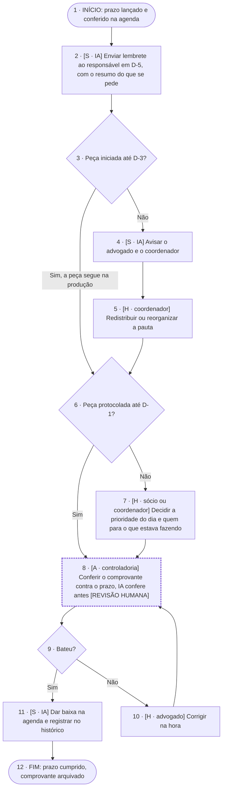

# Fluxograma de referência: do prazo lançado ao prazo cumprido

Setor: Prazos e controladoria (PRZ) · Gatilho: prazo conferido e lançado na agenda · Entrega: prazo cumprido, comprovante arquivado · Complementa o POP "Tratamento diário de publicações e intimações" (`setor-04-prazos-controladoria.md` na biblioteca do `escrever-pop`).

Contagem: 10 caixas (7 ações e 3 decisões) · 3 S · 1 A · 3 H.

## Por que este fluxo

O POP da biblioteca termina com o prazo na agenda. Este desenho começa ali e vai até o comprovante arquivado. É o fluxo dos alarmes: o que acontece quando a peça não andou e quem decide quando o tempo apertou. Os marcos D-5, D-3 e D-1 são exemplo; use os do código do escritório.

## Mermaid

## Em texto

1. INÍCIO: prazo lançado e conferido na agenda. Vá para 2.
2. AÇÃO [S · IA] Enviar lembrete ao responsável em D-5 (exemplo), com o resumo do que se pede. Vá para 3.
3. DECISÃO: a peça foi iniciada até D-3 (exemplo)? Se sim, a peça segue no fluxo de produção de peças; vá para 6. Se não, vá para 4.
4. AÇÃO [S · IA] Avisar o advogado e o coordenador. Vá para 5.
5. AÇÃO [H · coordenador] Redistribuir ou reorganizar a pauta. Vá para 6.
6. DECISÃO: a peça foi protocolada até D-1 (exemplo)? Se sim, vá para 8. Se não, vá para 7.
7. AÇÃO [H · sócio ou coordenador] Decidir a prioridade do dia e quem para o que estava fazendo. Vá para 8.
8. AÇÃO [A · controladoria] Conferir o comprovante de protocolo contra o prazo; a IA confere antes [REVISÃO HUMANA]. Confere: controladoria [A CONFIRMAR a função], processo certo, peça certa, data dentro do prazo. Vá para 9.
9. DECISÃO: bateu? Se sim, vá para 11. Se não, vá para 10.
10. AÇÃO [H · advogado] Corrigir na hora. Volte para 8 para conferir o comprovante novo.
11. AÇÃO [S · IA] Dar baixa na agenda e registrar no histórico. Vá para 12.
12. FIM: prazo cumprido, comprovante arquivado.

Caminho principal: prazo na agenda → lembrete → peça iniciada → peça protocolada → comprovante conferido → baixa.

## Cuidados

- A data do prazo continua sendo conferida por uma pessoa antes de entrar na agenda: o alarme só é confiável se o prazo de origem estiver certo. Prazo legal ou processual nunca entra de memória: `[CONFERIR]`.
- A espera da produção da peça está no rótulo da seta 3 → 6: ela segue o fluxo de produção de peças, que tem desenho próprio.

## Ao adaptar

- Troque D-5, D-3 e D-1 pelos marcos do código do escritório.
- No solo, "coordenador" e "sócio" viram o titular, com a pausa para decidir a prioridade escrita no plano de ausência.
- A volta do passo 10 para o 8 é sugestão da biblioteca: depois de corrigir, o comprovante novo passa pela mesma conferência.
