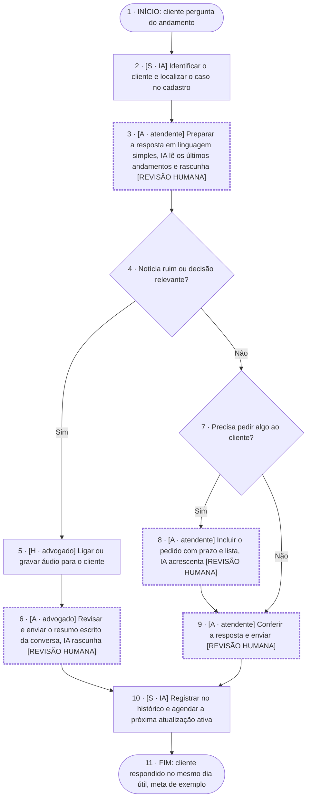

# Fluxograma de referência: "Como está o meu processo?"

Setor: Relacionamento com o cliente (REL) · Gatilho: pergunta de andamento do cliente (WhatsApp, e-mail ou ligação) · Entrega: cliente respondido e próxima atualização agendada · Complementa o POP "Atualização de andamento processual" (`setor-07-relacionamento-cliente.md` na biblioteca do `escrever-pop`).

Contagem: 9 caixas (7 ações e 2 decisões) · 2 S · 4 A · 1 H.

## Por que este fluxo

A pergunta mais repetida do escritório, e a que mais rouba o tempo do titular quando todas passam por ele. O POP da biblioteca cobre a atualização ativa, aquela que o escritório manda antes de o cliente perguntar. Este é o fluxo da resposta, quando a pergunta chega primeiro. A decisão central é a da notícia: notícia ruim não vai por texto pronto.

## Mermaid

## Em texto

1. INÍCIO: cliente pergunta do andamento, por WhatsApp, e-mail ou ligação. Vá para 2.
2. AÇÃO [S · IA] Identificar o cliente e localizar o caso no cadastro. Confere: atendente, no passo 9 (caso certo). Vá para 3.
3. AÇÃO [A · atendente] Preparar a resposta em linguagem simples; a IA lê os últimos andamentos e rascunha [REVISÃO HUMANA]. Confere: atendente, no passo 9. Vá para 4.
4. DECISÃO: é notícia ruim ou decisão relevante (sentença, indeferimento, perícia desfavorável)? Se sim, vá para 5. Se não, vá para 7.
5. AÇÃO [H · advogado] Ligar ou gravar áudio para o cliente. Vá para 6.
6. AÇÃO [A · advogado] Revisar e enviar o resumo escrito da conversa; a IA rascunha [REVISÃO HUMANA]. Confere: advogado, se o resumo diz o que foi falado. Vá para 10.
7. DECISÃO: precisa pedir algo ao cliente (documento, comparecimento, assinatura)? Se sim, vá para 8. Se não, vá para 9.
8. AÇÃO [A · atendente] Incluir o pedido com prazo e lista; a IA acrescenta [REVISÃO HUMANA]. Confere: atendente, prazo e lista certos. Vá para 9.
9. AÇÃO [A · atendente] Conferir a resposta e enviar [REVISÃO HUMANA]. Confere: caso certo, data certa, nenhuma promessa de resultado. Vá para 10.
10. AÇÃO [S · IA] Registrar no histórico e agendar a próxima atualização ativa. Vá para 11.
11. FIM: cliente respondido no mesmo dia útil (meta de exemplo; ajuste ao código do escritório).

Caminho principal: pergunta → caso localizado → rascunho da resposta → sem notícia ruim → conferência e envio → registro.

## Cuidados

- Notícia ruim é linha vermelha: ligação ou áudio do advogado, nunca texto pronto.
- A IA só lê andamento com acesso pela conta profissional do escritório, nunca pela conta pessoal de alguém da equipe.
- A meta de resposta do passo 11 é exemplo e vem do código do escritório.

## Ao adaptar

- Os passos 3 e 9 são o mesmo passo A visto em dois momentos (a IA prepara no 3, a atendente confere no 9). Na versão em raias, eles podem ficar na mesma linha se não houver decisão no meio.
- O que conta como "decisão relevante" no passo 4 precisa estar escrito nos critérios do escritório.
