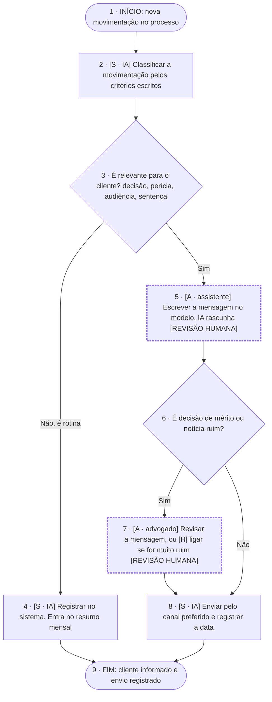

# Escrever o POP com S, A e H

> Transforma o jeito como um processo acontece hoje num roteiro que qualquer pessoa da equipe, ou a IA, consegue seguir sem perguntar para o titular. É o roteiro da equação da automação.

Regras comuns do plugin: `../../docs/regras-transversais.md` (caminho relativo à pasta desta skill). Anatomia do POP, S, A, H, linha vermelha e níveis: `../../docs/glossario.md`. Diferenças entre solo e equipe: `../../docs/trilhas.md`.

Todo POP escrito antes da IA está antigo, porque supõe uma pessoa fazendo cada passo do começo ao fim. Passar a limpo o que já existe adianta pouco: o trabalho é redesenhar o fluxo com a IA dentro.

## 1. Quando usar

**Use quando:**
- O setor-alvo está escolhido e é hora de escrever o POP de um processo dele.
- O advogado quer partir de um POP pronto da biblioteca (10 por setor e 9 por área) e adaptá-lo.
- Existe um procedimento escrito antes da IA e ele precisa ser reescrito com S, A e H.
- Uma pessoa vai ser contratada e precisa aprender o setor pelo papel (no solo, escreva o POP do setor que ela vai assumir antes de contratar).

**Não use quando:**
- Só falta marcar S, A ou H numa lista pronta: use `classificar-sah`.
- O POP está pronto e o pedido é revisar riscos, sigilo e linha vermelha: use `auditar-riscos`.
- Ainda não se sabe por qual setor começar: use `mapear-setores` (ou o `diagnostico`, para o setor-alvo provisório).
- O pedido é organizar o setor inteiro de peças (ficha de briefing, banco de modelos, caderno de teses, checklist de revisão): use `organizar-producao-de-pecas`, que chama esta skill para cada POP de peça. Para WhatsApp, triagem e régua de atualização: `organizar-atendimento-whatsapp`.
- O pedido é só o desenho (raias, revisar um fluxograma, desenhar antes de escrever): use `desenhar-fluxograma`. Testar um POP pronto: `testar-pop`. Numerar, versionar, guardar ou aposentar POPs: `gerir-pops`.

## 2. Antes de começar

1. **Leia o perfil.** Abra `escritorio/perfil.md` (trilha, porte, áreas, conta de IA, setor-alvo). Leia também, se existirem, `escritorio/01-cultura/codigo-do-escritorio.md` (tom, prazos de resposta, quem decide, o que nunca fazemos) e `escritorio/01-cultura/regra-de-uso-de-ia.md`. Sem perfil, ofereça `/inicio-automacao:comecar` ou faça o modo rápido das regras transversais.
2. **Portão.** Precisa haver um setor definido. Se o `perfil.md` não tiver `setor_alvo`, pergunte qual setor o advogado quer documentar e avise que o ideal é sair do `mapear-setores`. Se faltar o código do escritório, explique em uma frase que prazos, tom e quem decide vêm dele, ofereça o `codigo-do-escritorio` e, se ele quiser seguir, marque esses campos como `[A DEFINIR]` e registre em "Etapas puladas".
3. **Veja o que já existe.** Procure em `escritorio/03-pops/<setor>/` um POP do mesmo processo. Se houver um `fluxograma-<processo>.md` (o desenho veio antes do POP, pela `desenhar-fluxograma`), leia e use como retrato: os passos, as decisões e as exceções dele entram no POP, e o arquivo avulso recebe no topo a nota "substituído pelo POP-<SIGLA>-<NN>". Se houver, esta rodada é uma revisão: suba a versão e marque cada mudança com `[NOVO]` ou `[ALTERADO]`.
4. **Escolha a entrada.** Pergunte: "Para esse processo, você tem algo escrito? (a) Nada, vamos do zero. (b) Quero partir de um POP pronto da biblioteca. (c) Tenho um procedimento antigo e quero reescrever." Se a resposta for (b) e houver tempo, faça antes o retrato curto da entrada A (perguntas 2, 3, 4 e 6): é com ele que o POP da biblioteca é comparado.

## 3. Fluxo

### Entrada A: do zero (retrato, depois redesenho)

**Etapa A1. O retrato de hoje.** Diga ao advogado: "Agora é só o retrato de como é hoje. Não vou reescrever nem propor melhoria nesta etapa." Pergunte uma de cada vez, esperando a resposta:

1. "Qual processo do setor [SETOR] a gente vai retratar? Diga em uma frase o que ele entrega." Se o setor tiver vários, sugira o de mais horas e regra mais clara.
2. "O que faz esse processo começar? Pense na última vez: o que chegou, de quem e por qual canal?" (o gatilho)
3. "Quem participa e o que cada pessoa faz? Pode responder por função." No solo, troque por: "Em que hora do dia você faz isso, e o que fica para trás quando faz?"
4. "Me conte a sequência real, do primeiro ao último passo, do jeito que aconteceu da última vez."
5. "Onde a informação chega e onde ela fica registrada? WhatsApp, e-mail, sistema, planilha, papel?"
6. "Onde costuma travar, atrasar ou gerar retrabalho?"
7. "Quanto tempo cada etapa leva, mais ou menos? E quantas vezes por semana o processo acontece?"
8. "Quando você sabe que o processo terminou?"
9. "O que acontece quando algo foge do normal? Me dê o último exemplo."

Regras da etapa:
- **Aceite áudio transcrito ou texto corrido.** Se o advogado preferir contar de uma vez, organize o que ele disse e pergunte só o que faltou.
- Resposta vaga ("eu cuido dos prazos") vira pedido de exemplo ("e ontem, como foi?").
- Planilha paralela, ligação de toda sexta, arquivo "modelos_FINAL_v3" na máquina de uma pessoa só: anote. É assim que o retrato fica real.
- Dado de cliente na conversa: avise, não repita e siga com a versão anonimizada.

Entregue o retrato com: (1) o passo a passo numerado, com o responsável de cada passo; (2) a lista dos pontos onde trava; (3) uma estimativa de horas por semana do processo, marcada como estimativa; (4) as perguntas sem resposta, marcadas `[A CONFIRMAR]`. Numa seção separada, a marcação provisória de cada passo (S: a IA poderia fazer no lugar; A: a IA poderia preparar e a pessoa decide; H: deve continuar humano). Peça ok no retrato antes de seguir.

**Etapa A2. O redesenho com a IA dentro.** Só depois do ok. Para cada passo do retrato, pergunte e responda junto com o advogado:
- Esse passo existe só porque antes não havia outro jeito de fazer?
- Ele segue uma regra que daria para escrever num papel?
- Se a IA errar aqui, qual o tamanho do estrago, e quem percebe?
- Quem precisa continuar dono da decisão, e por quê?

Depois: elimine ou funda o que só existia por falta de outro jeito; quebre o passo grande demais (mais de duas horas ou várias decisões dentro); acrescente os passos que faltam (conferência do que a IA fez, registro, tratamento de exceção). Mire de 7 a 12 passos: menos esconde decisão, mais vira manual. Siga para a classificação (seção 4) e para o fechamento (seção 5).

### Entrada B: adaptar um POP da biblioteca

Abra `references/biblioteca/INDICE.md` e sugira o POP pela ordem de leitura: primeiro o do setor-alvo; depois, se o escritório tem área dominante, o POP da área no mesmo setor. Juntar os dois e cortar o que sobra é permitido. Leia o arquivo do POP escolhido e siga os 8 passos:

1. **Abrir lado a lado** o POP da biblioteca e o passo a passo atual (o retrato). Sem retrato, siga com `[A CONFIRMAR]` onde o jeito de hoje importar.
2. **Marcar as diferenças:** passos que só um lado tem e passos iguais com nomes diferentes.
3. **Trocar funções por pessoas.** "Se o mesmo nome aparece em todos os passos, ali está o gargalo."
4. **Ajustar gatilho, prazos e exceções** ao código do escritório. O que não se sabe fica `[A DEFINIR]`. Os prazos da biblioteca são exemplos e nunca entram como regra sem o advogado dizer que valem.
5. **Refazer a sigla** de cada passo pela árvore, considerando o estágio do escritório (seção 4). Justifique cada mudança em uma linha.
6. **Listar o que a IA precisa consultar** e ainda não existe por escrito. Essa lista é o roteiro da `montar-base`.
7. **Testar com casos reais anonimizados:** rodar o POP à mão em 3 a 5 casos antes de publicar e anotar onde ele quebrou.
8. **Publicar** (no Projeto do escritório no Claude e onde a equipe consulta), marcar a data de revisão e medir o indicador desde a primeira semana.

Antes de reescrever, faça no máximo 8 perguntas, uma por vez, só sobre o que não está no perfil: quem faz o quê na equipe; ferramentas (software jurídico, CRM, planilha, IA e tipo de conta); como o setor funciona hoje; e as perguntas da área em `references/perguntas-por-area.md`.

### Entrada C: reescrever um POP antigo

Peça o POP antigo (colado ou o caminho do arquivo). Trabalhe em três etapas e **espere o ok do advogado entre uma e outra**:

1. **Diagnóstico.** Para cada passo atual: existe só porque antes não havia outro jeito? Segue regra que cabe num papel? Qual o estrago se der errado, e quem perceberia? Quem precisa continuar dono da decisão?
2. **Marcação.** Classifique cada passo em S, A ou H pela seção 4, com justificativa de uma linha. Aponte os passos que podem ser eliminados ou fundidos e os que faltam (conferência, registro, exceções).
3. **POP novo.** Reescreva nos 12 campos (seção 5) e monte a tabela "Antes e com a IA": passo, como era antes, como fica com a IA, sigla.

## 4. Classificar cada passo (resumo do `classificar-sah`)

A classificação segue a skill `classificar-sah` (`../classificar-sah/SKILL.md`). Leia-a quando houver dúvida num passo ou quando o escritório mudou de estágio. O resumo, para aplicar passo a passo (a primeira resposta que leva a uma sigla encerra a análise):

1. Toca a linha vermelha (tese ou estratégia, notícia ruim, assinatura, cliente vulnerável, envio sem revisão)? **H**.
2. Exige decisão estratégica, julgamento ético ou conversa delicada? **H**.
3. A regra não cabe num papel? **A**.
4. O erro seria caro ou percebido tarde? **A**.
5. O resultado sai do escritório, ou mexe com dado sensível sem conferência depois? **A**. Se não: **S**.

Três regras que esta skill aplica sempre:
- **Trava por estágio.** Sem conta profissional ou sem regra de uso de IA escrita, nenhum passo com dado de cliente fica S. Sem os critérios escritos que o passo usa, ele fica A. Sem base do setor, passos de redação ficam A.
- **Na dúvida, a sigla mais humana.** H antes de A, A antes de S.
- **A sigla diz quem produz o primeiro resultado.** A conferência vai à parte, no "Confere" do passo.

## 5. Fechar o POP nos 12 campos

Use o modelo `assets/pop-modelo.md`. Cabeçalho: `POP: [NOME DO PROCESSO] · Setor · Área (se houver) · Versão · Atualizado em · Dono do POP`.

| # | Campo | Como escrever |
|---|---|---|
| 1 | Objetivo | Uma frase com o resultado entregue. Se não cabe numa frase, são dois POPs. |
| 2 | Gatilho | O acontecimento que inicia o processo. Sem gatilho, o processo depende de alguém lembrar. |
| 3 | Responsáveis | Executa, Confere e Decide, primeiro por função, depois com nomes. Inclua quem responde pelo que a IA entregou. |
| 4 | Entradas | Documentos, sistemas, modelos, listas e critérios. É daqui que sai a lista da base. |
| 5 | Passo a passo | De 7 a 12 passos, todos no formato `1. [S/A/H] Verbo + tarefa. Executa: ... Confere: ...` |
| 6 | Prazo | Do gatilho à saída, mais os prazos internos das etapas críticas. Vem do código do escritório ou fica `[A DEFINIR]`. |
| 7 | Exceções | "Situação: o que fazer". Uma para cada "e se não?" das decisões do fluxo. |
| 8 | Saída | O que foi entregue, para quem e onde ficou registrado. |
| 9 | Onde a IA entra | Resumo dos passos S e A, o que a IA consulta e em que ambiente roda (por exemplo, um Projeto no Claude com o código e os modelos do setor, em conta profissional). |
| 10 | Nunca sai sem revisão humana | Lista curta do que não avança sem conferência, "nem quando a IA acerta quase sempre". |
| 11 | Dados pessoais e sensíveis | Que dados aparecem, o que anonimizar, o que nunca entra na IA. Use `references/dados-sensiveis-por-area.md`. |
| 12 | Indicador | Um ou dois números acompanhados todo mês, com a forma de medir. Todo POP tem indicador. |

**O passo bem escrito.** Começa com verbo, leva a sigla e diz quem executa e quem confere, e o que é conferido:
- S: `3. [S] Renomear o documento no padrão do escritório. Executa: IA. Confere: assistente, por amostra no fim do dia.`
- A: `5. [A] Sugerir a data-limite com a conta à mostra. Executa: IA, com a tabela de prazos e o calendário de feriados. Confere: controller refaz a conta antes de lançar.`
- H: `6. [H] Decidir aceitar, encaminhar ou recusar o caso. Executa: advogado da área. Confere: não se aplica (decisão de quem executa; fica registrada no CRM).`

**Revisão com objeto.** Todo "Confere" diz o que a pessoa confere: refazer a conta, abrir a decisão na fonte oficial, comparar valores com a proposta, ler todas as marcadas "sem prazo", conferir nomes, datas e tom. "Revisão sem objeto vira carimbo."

**Exceções com "e se não?".** Para cada decisão do fluxo, pergunte ao advogado o caminho do "não" e escreva a resposta. "Toda exceção que você escreve é uma decisão a menos que chega até você às 19h." Exceção sem dono vira pergunta `[A DEFINIR]`.

**Prazos.** Puxe do código do escritório. Se não estiver lá, pergunte. Se o advogado não decidir, escreva `[A DEFINIR]` e, ao lado, o exemplo da biblioteca como referência ("exemplo da biblioteca: proposta até 1 dia útil após a consulta"). Prazo legal ou processual nunca entra de memória: marque `[CONFERIR]`.

**Dados.** Use a tabela de troca das regras transversais ([CLIENTE], [DOC], [PROCESSO], [BENEFÍCIO], [ENDEREÇO], [CONTATO], [FILHO 1], [CÔNJUGE 1], [EMPRESA]). Senha e credencial (gov.br, certificado digital, Meu INSS) nunca entram. Laudo completo, dado de criança ou adolescente e processo em segredo de justiça não entram sem autorização expressa do responsável.

**Indicador.** Um ou dois números por mês, mesmo anotados à mão: tempo entre gatilho e saída, retrabalho, erros pegos na revisão, casos parados. "Sem indicador, você não sabe se a IA ajudou ou só mudou o trabalho de lugar." Diga como medir e onde anotar.

**Família.** Em qualquer POP de Família, inclua a exceção obrigatória: sinal de violência doméstica, coação ou risco faz o POP parar, o advogado assume pessoalmente e nada daquele caso entra em automação.

## 6. O fluxograma

Todo POP sai com fluxograma em duas versões: código Mermaid (`flowchart TD`) e texto numerado, para quem não renderiza Mermaid. Quando o escritório tem equipe, ou quando o advogado pedir, acrescente a versão em raias (IA, Equipe, Advogado) do modelo `assets/pop-modelo.md`: ela mostra de uma vez que toda decisão e toda assinatura ficam na coluna do advogado. Para desenhar antes do POP, redesenhar ou conferir um fluxograma existente, use a `desenhar-fluxograma`.

**Regras do desenho:**
- Só três símbolos: **INÍCIO/FIM** (o gatilho e a saída), **AÇÃO** (uma tarefa, sempre com verbo) e **DECISÃO** (uma pergunta de sim ou não).
- Numere cada símbolo. Em cada AÇÃO, coloque a sigla e quem executa: `4. AÇÃO [A · assistente] Escrever a mensagem ao cliente`.
- Em cada DECISÃO, os dois caminhos: "Se sim, vá para X. Se não, vá para Y."
- Transforme as exceções do POP em decisões dentro do fluxo.
- Marque com **[REVISÃO HUMANA]** todo ponto em que nada avança sem alguém conferir.
- Não acrescente passo que não está no POP. Se faltar algum, liste à parte como sugestão.

No Mermaid: INÍCIO/FIM como `(["..."])`, AÇÃO como `["..."]`, DECISÃO como `{"..."}`, rótulos sempre entre aspas, número do símbolo no formato `1 ·` (alguns renderizadores leem `1.` no começo do rótulo como lista) e a classe `revisao` nos pontos de revisão humana. Depois do desenho, entregue: o caminho principal em uma linha, do início ao fim, e os pontos em que o fluxo ficou ambíguo, sem saída ou com decisão sem dono.

**Exemplo resolvido: atualização de andamento processual** (Relacionamento com o cliente, versão curta):

Versão em texto: 1. INÍCIO: nova movimentação. 2. AÇÃO [S · IA] Classificar. 3. DECISÃO: é relevante? Se sim, vá para 5. Se não, vá para 4. 4. AÇÃO [S · IA] Registrar no sistema; vá para 9. 5. AÇÃO [A · assistente] Escrever a mensagem [REVISÃO HUMANA]. 6. DECISÃO: é decisão de mérito ou notícia ruim? Se sim, vá para 7. Se não, vá para 8. 7. AÇÃO [A · advogado] Revisar, ou [H] ligar se for muito ruim [REVISÃO HUMANA]. 8. AÇÃO [S · IA] Enviar e registrar. 9. FIM: cliente informado. A versão completa, com resumo mensal e o passo de assumir a conversa, está em `references/biblioteca/setor-07-relacionamento-cliente.md`.

## 7. O que a IA vai precisar consultar

No fim de todo POP, monte a lista do que a IA consulta nos passos S e A: modelos, checklists, critérios escritos, tabelas, mensagens aprovadas. Para cada item: nome, passo que usa, se já existe por escrito (sim, em parte, não), onde está hoje e quem é o dono. Exemplos que aparecem muito: roteiro de triagem por área, critérios de aceite, lista de documentos por tipo de caso, tabela de prazos e calendário de feriados, critérios de movimentação relevante, modelos de mensagem por categoria, régua de cobrança, tabela interna de honorários, checklist da peça, checklist ético de publicidade, padrão de nomes e pastas. Essa lista alimenta a `montar-base`.

## 8. O que entrega e onde grava

**Entrega,** nesta ordem, para o advogado validar:
1. O POP nos 12 campos.
2. A tabela "Antes e com a IA" (quando houver retrato ou POP antigo).
3. A lista do que a IA vai precisar consultar.
4. Os pontos em aberto: `[A DEFINIR]`, `[A CONFIRMAR]` e `[CONFERIR]`, cada um com a pergunta que resolve.
5. O fluxograma em Mermaid e em texto.
6. No modo do zero, o retrato de hoje vai como anexo no fim do arquivo.

Mostre tudo, peça ajustes e só grave depois do ok.

**Código e nome.** Antes de gravar, dê o código: sigla do setor e o próximo número livre do setor em `escritorio/03-pops/00-mapa-de-pops.md` (sem mapa, comece em 01). O POP aparece como "POP-PEC-01 Petição inicial v0.1" no cabeçalho e nas conversas, com status Rascunho até passar pelo `testar-pop`. Siglas: ATD, COM, PEC, PRZ, AUD, FIN, REL, MKT, EQP, ADM (lista completa em `../../docs/pasta-do-escritorio.md`). Acrescente a linha do POP no mapa, ou ofereça a `gerir-pops` se o mapa ainda não existe.

**Onde grava:** `escritorio/03-pops/<setor>/pop-<sigla>-<nn>-<processo>.md`, com sigla em minúsculas (`pop-pec-01-peticao-inicial.md`). Pasta do setor em minúsculas e com hífen: `atendimento-e-triagem`, `comercial`, `producao-de-pecas`, `prazos-e-controladoria`, `audiencias-e-diligencias`, `financeiro-e-cobranca`, `relacionamento-com-o-cliente`, `marketing-e-conteudo`, `gestao-de-equipe`, `administrativo`. Processo em poucas palavras, sem acento (`pop-rel-01-atualizacao-de-andamento.md`). Quando o setor foi separado por área no mapa, acrescente a área ao nome do processo (`pop-viabilidade-previdenciario.md`).

**No `perfil.md`:** se o POP é do setor-alvo, marque `- [x] POP do setor-alvo com S, A e H`. Atualize `atualizado_em` e acrescente em "Histórico" uma linha: data, POP e versão gravados, caminho. Campo deixado `[A DEFINIR]` por decisão do advogado, ou teste com casos anonimizados ainda não feito, vai para "Etapas puladas".

**Antes de publicar,** ofereça: "Quer que eu rode o `auditar-riscos` neste POP antes de publicar ou automatizar? Ele revisa linha vermelha, sigilo, pontos de erro e o plano para erro."

**Sem acesso a arquivos:** entregue o POP no chat, em bloco pronto para copiar, com o caminho onde ele deveria ficar.

## 9. Trilha solo e trilha equipe

**Solo** (inclusive com estagiário ou secretária):
- Executa, Confere e Decide costumam ser a mesma pessoa. Escreva assim mesmo, com as três linhas: "o passo continua existindo".
- **Compensações para a falta de conferência independente,** escritas no próprio passo:
  - Conferência em outro momento, nunca logo depois de fazer (por exemplo, a conta do prazo feita de manhã é refeita no fim do dia).
  - Checklist escrito de revisão para cada passo A, curto o bastante para ser usado sempre.
  - A IA como segundo olhar (pedir que ela confira o próprio rascunho contra o checklist), sem nunca transformar o passo em S por isso.
  - Revisão em outro dia ou por revisor externo nas peças de maior risco, no lugar do revisor sênior.
- "O sócio aprova" vira regra escrita prévia (política de desconto, de renegociação, de temas sensíveis) ou **pausa de 24 horas** antes de decidir o que estiver fora da política.
- "A atendente assume" vira "o advogado assume": urgência e aflição vão direto para ele.
- Substituto do controller vira plano de ausência: o que espera, o que é adiado e quem é avisado em férias, audiência ou doença.
- Matriz de distribuição vira lista de tarefas pessoal. Gestão de equipe só entra se houver estagiário ou primeira contratação.
- Mensagens A que "a assistente revisa e envia" passam a ser revisadas pelo titular. A pressão para S aumenta: a regra da sigla mais humana vale do mesmo jeito.

**Equipe:**
- Funções separadas e cada ponto de revisão com nome. Revisão que ninguém sabe que é sua acaba não acontecendo.
- "Se o mesmo nome aparece em todos os passos, ali está o gargalo." Aponte e proponha repassar os passos A para quem executa, deixando o titular com decisões e conversas difíceis.
- Substituto escrito para cada função crítica (controller, quem confere prazo), "nunca quem estiver livre".
- Pasta restrita e controle de acesso por pessoa para saúde, criança e criminal.

## 10. Erros que esta skill evita

| Erro | Consequência | Como a skill evita |
|---|---|---|
| Passar a limpo o POP antigo | O fluxo continua supondo uma pessoa em cada passo | As quatro perguntas por passo antes de reescrever |
| Melhorar durante o retrato | O POP descreve um escritório que não existe | Retrato primeiro, ok, redesenho depois |
| Quase tudo S | A equipe para de olhar e o erro aparece no cliente | Árvore do `classificar-sah` e sigla mais humana na dúvida |
| Revisão-carimbo | Aprova sem ler por causa da fila | Todo "Confere" diz o que é conferido |
| IA sem base | Tese genérica, tom errado, modelo de outro escritório | Entradas e lista do que a IA consulta |
| Esquecer exceções | Toda exceção volta para o advogado | "E se não?" em cada decisão do fluxograma |
| Copiar sem adaptar | Papel que ninguém segue | Os 8 passos e o teste com casos anonimizados |
| Prazo de exemplo virando regra | Prazo que ninguém decidiu | Prazo do código ou `[A DEFINIR]` |
| POP sem indicador | Não se sabe se a IA ajudou | Campo 12 obrigatório |

## 11. Próximo passo

O POP v0.1 ainda é rascunho. O caminho até ele virar habilidade, nesta ordem:

1. `desenhar-fluxograma`, se o advogado quiser as raias ou se o desenho revelou dúvidas.
2. `testar-pop`: checklist de qualidade, teste de mesa com quem não escreveu, teste com a IA em três casos e piloto. Sai a versão 1.0.
3. `auditar-riscos`, antes de publicar ou automatizar.
4. `gerir-pops`: publicar como vigente, registrar no mapa, guardar e colocar no Projeto no Claude.
5. `montar-base`, com a lista do que a IA vai consultar.
6. `desenhar-automacao`: checklist de prontidão, nível-meta 3 e uma instrução para cada passo S e A.
7. `pop-para-skill`: transformar o POP vigente e as instruções numa habilidade que segue os passos, para em cada A e nunca executa um H. Ofereça com esta frase: "Quando este POP estiver testado, quer que eu transforme ele numa habilidade do Claude? Assim, quando você ou a equipe pedirem esse trabalho, o Claude segue o POP passo a passo."
8. De volta à `desenhar-automacao` para subir ao nível 4, quando o processo rodar bem à mão no nível 3 por uma a duas semanas.

## Referências desta skill

- `assets/pop-modelo.md`: o modelo em branco dos 12 campos. Use em toda entrada.
- `references/biblioteca/INDICE.md`: a lista dos 19 POPs, com setor, área e contagem S, A e H. Leia na entrada B.
- `references/biblioteca/*.md`: cada POP de referência completo. Abra só o escolhido.
- `references/perguntas-por-area.md`: perguntas de contexto e cuidados por área. Leia na entrada B quando o POP for de área.
- `references/dados-sensiveis-por-area.md`: que dado aparece em cada área e o cuidado antes da IA. Leia ao preencher o campo 11.
