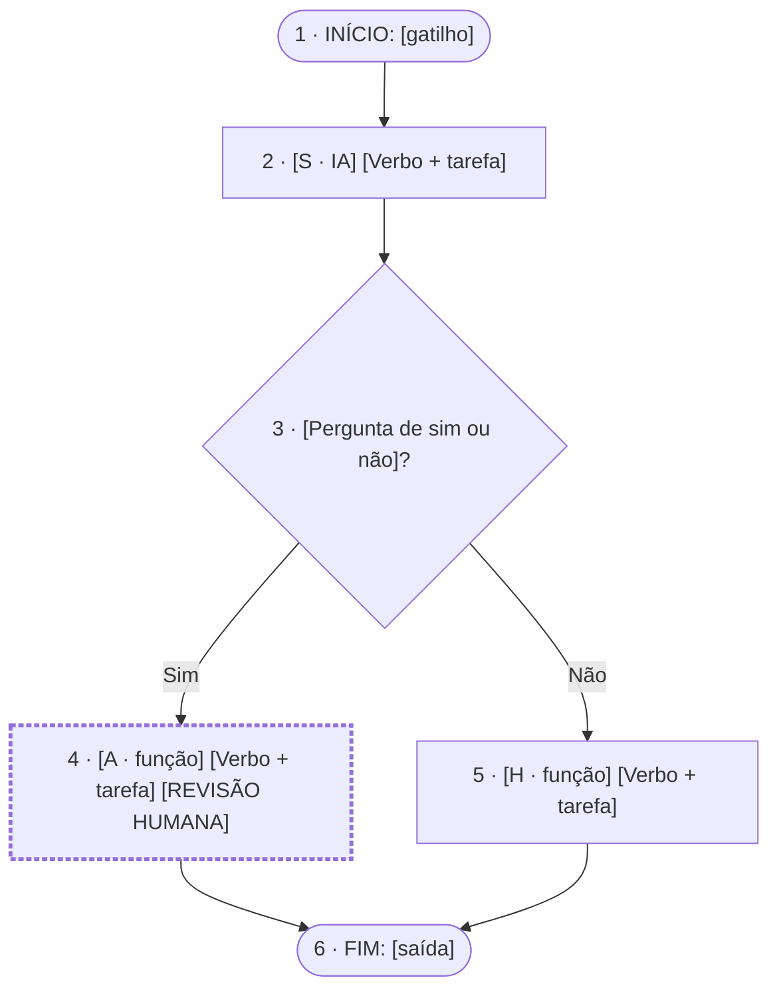

# POP-[SIGLA]-[NN] [NOME DO PROCESSO]

Setor: [UM DOS 10 SETORES] · Área: [ÁREA, SE HOUVER] · Versão: [0.1 no rascunho, 1.0 na publicação] · Atualizado em: [AAAA-MM-DD] · Dono do POP: [FUNÇÃO E NOME] · Status: [Rascunho | Em teste | Vigente | Em revisão | Aposentado] · Próxima revisão: [AAAA-MM-DD]

Siglas: S = Substituição (a IA faz no lugar, alguém confere por amostra ou nas exceções) · A = Auxílio (a IA prepara, resume, rascunha ou revisa, e a pessoa decide) · H = Humano (continua com a pessoa; a IA pode preparar o terreno).

## 1. Objetivo

[Uma frase com o resultado que o processo entrega. Se não cabe numa frase, são dois POPs.]

## 2. Gatilho

[O acontecimento que faz o processo começar: uma mensagem, uma publicação, um vencimento, uma data fixa.]

## 3. Responsáveis

- Executa: [função] ([nome])
- Confere: [função] ([nome])
- Decide: [função] ([nome])
- Responde pelo que a IA entregou: [função] ([nome])

## 4. Entradas

- [Documento, sistema, modelo, lista ou critério] · [onde está]
- ...

## 5. Passo a passo com S, A e H

1. [S/A/H] [Verbo + tarefa]. Executa: [IA, função ou nome]. Confere: [quem] e [o que confere].
2. [S/A/H] [Verbo + tarefa]. Executa: [...]. Confere: [...].
3. ...

(De 7 a 12 passos. Passo H: "Confere: não se aplica" ou quem dá a segunda leitura, quando houver.)

## 6. Prazo

- Do gatilho à saída: [prazo do código do escritório ou A DEFINIR]
- Prazos internos das etapas críticas: [etapa: prazo]

## 7. Exceções

- [Situação]: [o que fazer e quem decide].
- ...

## 8. Saída

[O que foi entregue, para quem e onde ficou registrado.]

## 9. Onde a IA entra

- Passos S: [o que a IA faz].
- Passos A: [o que a IA prepara].
- O que a IA consulta: [modelos, checklists, critérios].
- Ambiente: [por exemplo, Projeto no Claude com o código do escritório e os modelos do setor] · Conta: [profissional ou de equipe; conferir na configuração da conta].

## 10. Nunca sai sem revisão humana

- [Item]
- ...

## 11. Dados pessoais e sensíveis

- Dados que aparecem: [quais].
- O que anonimizar antes da IA: [quais trocas da tabela padrão].
- O que nunca entra na IA: [senha e credencial sempre; laudo completo, dado de criança ou adolescente e processo em segredo de justiça só com autorização expressa do responsável].
- Onde guardar e quem acessa: [pasta, acesso restrito quando couber].

## 12. Indicador

- [Número 1]: como medir [...], onde anotar [...], todo mês.
- [Número 2, se houver].

---

## Antes e com a IA

| Passo | Como era antes da IA | Como fica com a IA | Sigla |
|---|---|---|---|
| | | | |

## O que a IA vai precisar consultar

| Item (modelo, checklist, critério) | Passo que usa | Existe por escrito? (sim, em parte, não) | Onde está hoje | Dono |
|---|---|---|---|---|
| | | | | |

(Esta lista vai para a `montar-base`.)

## Pontos em aberto

- [A DEFINIR] [decisão do escritório que falta] · pergunta que resolve: [...]
- [A CONFIRMAR] [informação que alguém sabe] · com quem: [...]
- [CONFERIR] [norma, prazo legal ou regra técnica a checar na fonte]

## Controle de versões

| Versão | Data | O que mudou | Por quê | Quem aprovou | Equipe avisada ou treinada em |
|---|---|---|---|---|---|
| 0.1 | [AAAA-MM-DD] | Primeiro rascunho | Início do POP | | |

Revisar este POP: na revisão periódica do setor, depois de cada erro repetido pego na revisão e sempre que alguém entrar ou sair do setor. Teste com 3 a 5 casos reais anonimizados: [feito em AAAA-MM-DD / pendente].

## Fluxograma

**Em texto:**
1. INÍCIO: [gatilho].
2. AÇÃO [S · IA] [verbo + tarefa]. Vá para 3.
3. DECISÃO: [pergunta]? Se sim, vá para 4. Se não, vá para 5.
4. AÇÃO [A · função] [verbo + tarefa] [REVISÃO HUMANA]. Vá para 6.
5. AÇÃO [H · função] [verbo + tarefa]. Vá para 6.
6. FIM: [saída].

Caminho principal em uma linha: [gatilho] → ... → [saída].

Pontos ambíguos, sem saída ou com decisão sem dono: [lista].

**Em raias (quem faz o quê):** uma linha por passo; na linha de cada passo A, a caixa de revisão na coluna de quem revisa. No solo, a coluna Equipe é o titular em outro momento do dia.

| # | IA | Equipe | Advogado(a) |
|---|---|---|---|
| 1 | [S] [verbo + tarefa] | Revisão: [o que confere, por amostra] | |
| 2 | [A] [verbo + tarefa] | | Revisão: [o que confere] |
| 3 | | | [H] [verbo + tarefa] |

## Anexo: retrato de hoje (só quando o POP nasceu do zero)

[O passo a passo como acontecia antes do redesenho, com responsável por passo, pontos de trava, estimativa de horas por semana e a marcação provisória S, A e H.]
