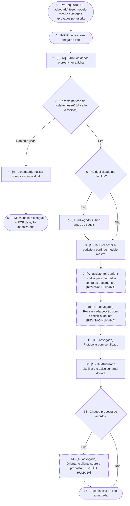

# POP: Demandas de massa com petição padrão

Setor: Produção de peças · Área: Cível (demandas de massa) · Versão: biblioteca 1.0 · Atualizado em: [A DEFINIR ao adaptar] · Dono do POP: [A DEFINIR]

> POP de referência da biblioteca, escrito para um escritório genérico de 3 a 10 pessoas. 11 passos: 4 S, 4 A, 3 H. Prazos são exemplos e só valem depois que o escritório decidir. O indicador é sugestão da biblioteca (o material de origem não trazia indicador para os POPs de área). Para usar, adapte pela entrada B do `escrever-pop`. "O Judiciário tem olhado com atenção ações repetidas com petição genérica, e a assinatura é sua": cada petição é revisada por um advogado antes do protocolo e traz os fatos e documentos do próprio cliente.

## 1. Objetivo

Volume alto com qualidade de caso individual: cada petição com os fatos e documentos daquele cliente, tudo controlado em lote.

## 2. Gatilho

Tese aprovada para um problema recorrente e chegada de novo cliente com esse problema.

## 3. Responsáveis

- Executa: assistentes (entrada, ficha, preenchimento e controle).
- Confere: assistente (fatos personalizados contra os documentos); advogado do lote (cada petição, toda dúvida de enquadramento).
- Decide: advogado do lote (tese, modelo-mestre, critérios, revisão de cada petição).

## 4. Entradas

- Modelo-mestre aprovado.
- Critérios escritos de enquadramento.
- Documentos de cada cliente.
- Planilha de controle do lote.
- Checklist do lote e decisões já recebidas, organizadas.

## 5. Passo a passo com S, A e H

1. [H] Aprovar tese, modelo-mestre e critérios de enquadramento. Feito uma vez e revisado a cada decisão relevante. "Sem isso escrito, não existe lote." Executa: advogado do lote. Confere: não se aplica.
2. [S] Preencher a ficha de entrada a partir dos documentos. Executa: IA. Confere: assistente, por amostra.
3. [A] Classificar o enquadramento: encaixa, não encaixa ou dúvida, com o motivo. Executa: IA. Confere: dúvida vai sempre ao advogado; assistente confere os "encaixa" pelos critérios escritos.
4. [S] Checar duplicidade na planilha do lote. Executa: IA. Confere: se achar duplicidade, o advogado olha antes de seguir.
5. [S] Preencher a petição a partir do modelo-mestre (dados, datas, valores, documentos). Executa: IA. Confere: passo 7.
6. [A] Personalizar os fatos daquele cliente. Executa: IA. Confere: assistente confere contra os documentos do cliente.
7. [H] Revisar cada petição com o checklist do lote. Executa: advogado do lote. Confere: não se aplica.
8. [H] Protocolar com o certificado do advogado. Executa: advogado. Confere: não se aplica.
9. [S] Controlar o lote (status, audiências, decisões, acordos, aviso semanal do que mudou). Executa: IA. Confere: advogado do lote lê o aviso semanal.
10. [A] Analisar as propostas de acordo (resumo × faixa aprovada). Executa: IA. Confere: advogado orienta; quem aceita é o cliente.
11. [A] Atualizar o modelo-mestre: a IA resume as decisões relevantes e sugere ajuste. Executa: IA. Confere: advogado decide cada ajuste.

## 6. Prazo

Exemplo (meta sugerida): petição pronta para revisão em até 3 dias úteis depois da documentação; revisão do lote em dias fixos. No escritório: [A DEFINIR, do código do escritório].

## 7. Exceções

- Caso que não encaixa: sai do lote e segue o POP de ação indenizatória.
- Decisão desfavorável recorrente: suspender as entradas até revisar a tese.
- Duplicidade encontrada: o advogado decide antes de seguir.

## 8. Saída

Petições protocoladas uma a uma, revisadas, e lote controlado.

## 9. Onde a IA entra

- Passos S: ficha, duplicidade, preenchimento, controle do lote.
- Passos A: enquadramento, personalização dos fatos, análise de acordos, atualização do modelo-mestre.
- O que a IA consulta: modelo-mestre, critérios escritos de enquadramento, checklist do lote, decisões recebidas organizadas.
- Ambiente: Projeto no Claude com a base do lote, em conta profissional.

## 10. Nunca sai sem revisão humana

- Cada petição.
- Toda classificação marcada como "dúvida".
- Qualquer alteração no modelo-mestre.
- Toda resposta a proposta de acordo.

## 11. Dados pessoais e sensíveis

- Dados que aparecem: volume alto concentra dados pessoais de muitos clientes (documentos, faturas, dados bancários).
- Anonimizar: o que vai para a IA, sempre que o dado não for necessário ao preenchimento; tirar conta e cartão.
- Acesso: restringir quem da equipe acessa a planilha do lote.
- Nunca na IA: certificado digital e senhas.

## 12. Indicador (sugestão da biblioteca)

- Petições devolvidas na revisão do advogado (devolvidas ÷ revisadas no mês).
- Casos de "dúvida" no enquadramento (contagem no mês; muitos indicam critério mal escrito).

## Na trilha solo

- O titular revisa cada petição. Com volume, a fadiga empurra para pular a revisão: fixe um teto de petições por bloco de revisão [A DEFINIR] e nunca protocole sem o checklist do lote.
- A planilha do lote fica com acesso só do titular e de quem ele autorizar.

## Fluxograma

Fluxograma do material ("sem perder o caso individual"), completado com os passos do POP.

**Em texto:**
0. Pré-requisito: [H · advogado] tese, modelo-mestre e critérios aprovados por escrito. Sem isso, não existe lote.
1. INÍCIO: novo caso chega ao lote.
2. AÇÃO [S · IA] Extrair os dados e preencher a ficha. Vá para 3.
3. DECISÃO [A · a IA classifica]: encaixa na tese do modelo-mestre? Se sim, vá para 6. Se não ou dúvida, vá para 4.
4. AÇÃO [H · advogado] Analisar como caso individual. Vá para 5.
5. FIM: sai do lote e segue o POP de ação indenizatória.
6. DECISÃO: há duplicidade na planilha? Se sim, vá para 7. Se não, vá para 8.
7. AÇÃO [H · advogado] Olhar antes de seguir. Vá para 8.
8. AÇÃO [S · IA] Preencher a petição a partir do modelo-mestre. Vá para 9.
9. AÇÃO [A · assistente] Conferir os fatos personalizados contra os documentos [REVISÃO HUMANA]. Vá para 10.
10. AÇÃO [H · advogado] Revisar cada petição com o checklist do lote [REVISÃO HUMANA]. Vá para 11.
11. AÇÃO [H · advogado] Protocolar com certificado. Vá para 12.
12. AÇÃO [S · IA] Atualizar a planilha e o aviso semanal do lote. Vá para 13.
13. DECISÃO: chegou proposta de acordo? Se sim, vá para 14. Se não, vá para 15.
14. AÇÃO [A · advogado] Orientar o cliente sobre a proposta; quem aceita é o cliente [REVISÃO HUMANA]. Vá para 15.
15. FIM: planilha do lote atualizada.

Ponto em aberto do desenho: a atualização do modelo-mestre (passo 11 do POP) e a suspensão por decisão desfavorável recorrente correm fora do caso a caso, na revisão do lote em dias fixos.

Caminho principal: caso novo → ficha → encaixa → sem duplicidade → petição → fatos do cliente → revisão → protocolo → controle do lote.
