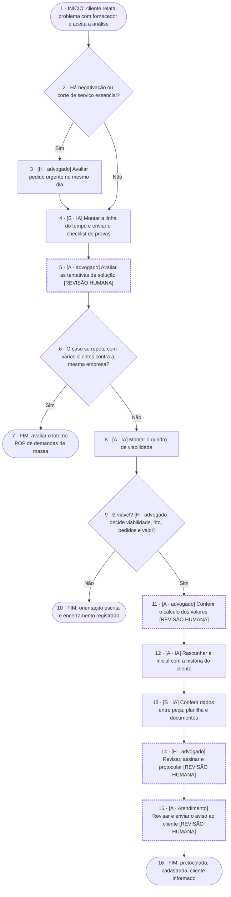

# POP: Ação indenizatória de consumo

Setor: Produção de peças · Área: Consumidor · Versão: biblioteca 1.0 · Atualizado em: [A DEFINIR ao adaptar] · Dono do POP: [A DEFINIR]

> POP de referência da biblioteca, escrito para um escritório genérico de 3 a 10 pessoas. 10 passos: 3 S, 5 A, 2 H. Prazos são exemplos e só valem depois que o escritório decidir. O indicador é sugestão da biblioteca (o material de origem não trazia indicador para os POPs de área). Regra de rito, prazo e precedente nunca entram de memória [CONFERIR]. Para usar, adapte pela entrada B do `escrever-pop`.

## 1. Objetivo

Transformar a reclamação do cliente numa ação com fatos em ordem, prova para cada fato e valor de pedido que o escritório consegue justificar.

## 2. Gatilho

O cliente relata problema com fornecedor (cobrança indevida, produto com defeito, serviço não prestado, negativação, voo cancelado) e aceita a análise.

## 3. Responsáveis

- Executa: Atendimento (recebe e organiza).
- Confere: Atendimento ou assistente (dados entre peça, planilha e documentos); advogado (cálculo e inicial).
- Decide: advogado (viabilidade, rito, valor, assinatura).

## 4. Entradas

- Relato do cliente.
- Prints, protocolos de atendimento.
- Faturas e comprovantes.
- Contrato ou termo de adesão.
- Reclamação prévia (SAC, ouvidoria, Procon, plataforma).
- Comprovante de negativação.
- Modelos por tipo de problema, checklist de provas por tipo e checklist de revisão.

## 5. Passo a passo com S, A e H

1. [S] Montar a linha do tempo (data, canal, protocolo, resposta do fornecedor) a partir do relato e dos prints. Executa: IA. Confere: Atendimento confere datas e protocolos nos prints.
2. [S] Enviar o checklist de provas pelo tipo de problema ("preciso do print da tela de cancelamento e da fatura de abril"). Executa: IA. Confere: Atendimento confere se o tipo de problema está certo.
3. [A] Avaliar as tentativas de solução já feitas (SAC, ouvidoria, Procon, plataforma). Executa: IA organiza. Confere: advogado avalia se vale mais uma via antes da ação.
4. [A] Montar o quadro de viabilidade (falha, dano, prova de cada um, pontos fracos). Executa: IA. Confere: advogado, no passo 5.
5. [H] Decidir viabilidade, rito (Juizado ou vara comum), pedidos e valor da causa, com o cliente entendendo o que ganha e o que arrisca. Executa: advogado. Confere: não se aplica.
6. [A] Calcular os valores (cobranças indevidas e danos materiais, com a origem de cada um). Executa: IA. Confere: advogado confere a conta e decide se e como pedir devolução.
7. [A] Rascunhar a inicial contando a história do cliente, com os fatos e as datas dele. Executa: IA. Confere: advogado, no passo 9.
8. [S] Conferir os dados (nome e CNPJ da ré, datas, protocolos, valores) entre peça, planilha e documentos. Executa: IA. Confere: assistente corrige cada divergência apontada.
9. [H] Revisar, assinar e protocolar, com leitura integral e precedentes conferidos na fonte. Executa: advogado. Confere: não se aplica.
10. [A] Avisar o cliente: número, próximos passos, o que fazer se o fornecedor o procurar diretamente. Executa: IA rascunha. Confere: Atendimento ou advogado revisa antes de enviar.

## 6. Prazo

Exemplo (meta sugerida): inicial em até 5 dias úteis depois das provas completas. No escritório: [A DEFINIR, do código do escritório].

## 7. Exceções

- Negativação ou corte de serviço essencial: avaliar pedido urgente no mesmo dia.
- Acordo oferecido antes da ação: levar ao cliente.
- Caso que se repete com vários clientes contra a mesma empresa: avaliar lote (POP de demandas de massa).
- Caso inviável no quadro de viabilidade: orientação escrita ao cliente e encerramento registrado (sugestão da biblioteca).

## 8. Saída

Ação protocolada, cadastrada na controladoria, cliente informado.

## 9. Onde a IA entra

- Passos S: linha do tempo, checklist de provas, conferência de dados.
- Passos A: tentativas de solução, quadro de viabilidade, cálculo, rascunho, aviso ao cliente.
- O que a IA consulta: modelos por tipo de problema (cobrança, negativação, aéreo, produto), checklist de provas por tipo, checklist de revisão.
- Ambiente: Projeto no Claude com a base de Consumidor, em conta profissional.

## 10. Nunca sai sem revisão humana

- Decisão de ajuizar.
- Valor da causa.
- Pedidos.
- A peça.
- Cada precedente.

## 11. Dados pessoais e sensíveis

- Dados que aparecem: faturas e extratos com dados bancários e de consumo; plano de saúde vira dado sensível.
- Anonimizar: [CLIENTE], [DOC], [CONTATO]; tirar número de conta e de cartão antes da IA; conta profissional; mínimo necessário.
- Nunca na IA: senha de aplicativo ou de banco que apareça em print.

## 12. Indicador (sugestão da biblioteca)

- Tempo das provas completas ao protocolo (média do mês).
- Divergências de dados pegas na conferência do passo 8 (contagem no mês).

## Na trilha solo

- Com volume, o titular separa um horário fixo para a leitura integral (passo 9), longe do horário em que rascunha.
- Quando o mesmo problema se repete com vários clientes, avalie o POP de massa antes de multiplicar peças uma a uma.

## Fluxograma

Desenhado a partir dos passos (o material não trazia fluxograma deste POP).

**Em texto:**
1. INÍCIO: cliente relata problema com fornecedor e aceita a análise.
2. DECISÃO: há negativação ou corte de serviço essencial? Se sim, vá para 3. Se não, vá para 4.
3. AÇÃO [H · advogado] Avaliar pedido urgente no mesmo dia. Vá para 4.
4. AÇÃO [S · IA] Montar a linha do tempo e enviar o checklist de provas. Vá para 5.
5. AÇÃO [A · advogado] Avaliar as tentativas de solução [REVISÃO HUMANA]. Vá para 6.
6. DECISÃO: o caso se repete com vários clientes contra a mesma empresa? Se sim, vá para 7. Se não, vá para 8.
7. FIM: avaliar o lote no POP de demandas de massa.
8. AÇÃO [A · IA] Montar o quadro de viabilidade. Vá para 9.
9. DECISÃO [H · advogado]: é viável? Se sim, vá para 11. Se não, vá para 10.
10. FIM: orientação escrita e encerramento registrado.
11. AÇÃO [A · advogado] Conferir o cálculo dos valores [REVISÃO HUMANA]. Vá para 12.
12. AÇÃO [A · IA] Rascunhar a inicial com a história do cliente. Vá para 13.
13. AÇÃO [S · IA] Conferir dados entre peça, planilha e documentos. Vá para 14.
14. AÇÃO [H · advogado] Revisar, assinar e protocolar [REVISÃO HUMANA]. Vá para 15.
15. AÇÃO [A · Atendimento] Revisar e enviar o aviso ao cliente [REVISÃO HUMANA]. Vá para 16.
16. FIM: ação protocolada, cadastrada na controladoria, cliente informado.

Ponto em aberto do desenho: o acordo oferecido antes da ação (exceção) pode aparecer em qualquer ponto; quem leva ao cliente é o advogado [A DEFINIR em que momento o fluxo para].

Caminho principal: relato → linha do tempo e provas → tentativas → viabilidade → cálculo → inicial → conferência → protocolo → aviso.
