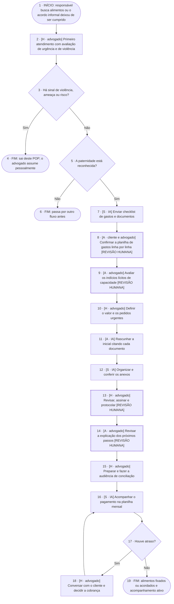

# POP: Ação de alimentos

Setor: Produção de peças · Área: Família · Versão: biblioteca 1.0 · Atualizado em: [A DEFINIR ao adaptar] · Dono do POP: [A DEFINIR]

> POP de referência da biblioteca, escrito para um escritório genérico de 3 a 10 pessoas. 12 passos: 3 S, 4 A, 5 H. Prazos são exemplos e só valem depois que o escritório decidir. O indicador é sugestão da biblioteca (o material de origem não trazia indicador para os POPs de área). Percentual de alimentos e regra legal nunca entram de memória; a IA não sugere percentual [CONFERIR]. Para usar, adapte pela entrada B do `escrever-pop`.

**Alerta de Família:** se surgir relato ou sinal de violência doméstica, ameaça ou risco para a cliente ou os filhos, o POP para. O advogado assume pessoalmente e avalia medidas de proteção; só depois o caso volta ao fluxo. Nenhuma etapa desse atendimento é automatizada.

## 1. Objetivo

Pedir um valor demonstrável (os gastos reais da criança de um lado, a capacidade de quem paga do outro) e acompanhar o pagamento depois da fixação.

## 2. Gatilho

Mãe, pai ou responsável busca alimentos, ou o acordo informal deixou de ser cumprido.

## 3. Responsáveis

- Executa: assistente (comprovantes, planilha e documentos).
- Confere: cliente (cada linha da planilha de gastos); advogado (planilha, indícios, inicial, mensagens).
- Decide: advogado (atendimento, valor, estratégia e audiência).

## 4. Entradas

- Certidão de nascimento.
- Comprovantes de gastos (escola, saúde, alimentação, moradia, transporte, atividades).
- Informações de trabalho, renda e padrão de vida de quem paga.
- Histórico de pagamentos informais.
- Modelo de inicial, modelo de planilha de gastos e mensagens padrão por etapa.

## 5. Passo a passo com S, A e H

1. [H] Fazer o primeiro atendimento: escuta, avaliação de urgência (a criança está sem escola? sem plano?) e atenção a sinal de violência. Executa: advogado. Confere: não se aplica.
2. [S] Enviar o checklist de gastos e documentos, mais um modelo para anotar despesas sem comprovante. Executa: IA. Confere: assistente confere o envio.
3. [A] Montar a planilha de gastos por categoria, com média mensal. Executa: IA. Confere: o cliente confirma cada linha e o advogado revisa.
4. [A] Organizar os indícios de capacidade de quem paga, só de fonte lícita (holerite antigo, empresa, bens, redes abertas). Executa: IA. Confere: advogado avalia o que é prova útil.
5. [H] Definir o valor e os pedidos urgentes. "A IA não sugere percentual." O valor é proposta do advogado. Executa: advogado. Confere: não se aplica.
6. [A] Rascunhar a inicial a partir do modelo, da planilha e da ficha, citando cada documento. Executa: IA. Confere: advogado, no passo 8.
7. [S] Organizar e conferir os anexos (todo documento citado está anexado). Executa: IA. Confere: assistente confere a lista de anexos contra a peça.
8. [H] Revisar, assinar e protocolar, com leitura integral. Executa: advogado. Confere: não se aplica.
9. [A] Explicar os próximos passos ao cliente (audiência, citação, o que esperar). Executa: IA rascunha. Confere: advogado revisa, porque expectativa mal colocada gera cliente frustrado.
10. [H] Preparar e fazer a audiência de conciliação. A IA pode montar um roteiro com a faixa; o limite é combinado entre advogado e cliente antes. Executa: advogado. Confere: não se aplica.
11. [S] Acompanhar o pagamento: planilha mensal com o que o cliente informa e aviso da IA em caso de atraso. Executa: IA. Confere: assistente, a cada aviso de atraso.
12. [H] Decidir sobre a cobrança: o advogado conversa com o cliente e decide a medida. Executa: advogado. Confere: não se aplica.

## 6. Prazo

Exemplo (meta sugerida): inicial em até 5 dias úteis depois da planilha aprovada; em urgência, o advogado define no primeiro atendimento. No escritório: [A DEFINIR, do código do escritório].

## 7. Exceções

- Violência ou ameaça: o POP para; o advogado assume pessoalmente, sem automação.
- Paternidade não reconhecida: passa por outro fluxo antes.
- Devedor em outro estado ou no exterior: avaliar competência e estratégia antes da peça.
- Cliente que não confirma a planilha: a inicial não avança até a confirmação (sugestão da biblioteca).

## 8. Saída

Ação protocolada, audiência feita, alimentos fixados ou acordados, planilha de acompanhamento ativa.

## 9. Onde a IA entra

- Passos S: checklist, anexos, controle de pagamento.
- Passos A: planilha de gastos, indícios de capacidade, rascunho da inicial, mensagem de próximos passos.
- O que a IA consulta: modelo de inicial, modelo de planilha de gastos, mensagens padrão por etapa.
- Ambiente: Projeto no Claude com a base de Família, em conta profissional. Nada de IA no primeiro atendimento.

## 10. Nunca sai sem revisão humana

- Valor pedido.
- Inicial.
- Faixa de acordo.
- Qualquer orientação ao cliente sobre o que fazer diante do atraso.

## 11. Dados pessoais e sensíveis

- Dados que aparecem: dados da criança, muitas vezes com dado de saúde (tratamento, terapia, medicação); renda e dados de quem paga.
- Anonimizar: [CLIENTE], [FILHO 1], [ALIMENTANTE]; sem escola e sem endereço; conta profissional.
- Nunca na IA: relato de violência; dado de saúde da criança além do que o pedido exige, sem autorização expressa do responsável.
- Não fazer buscas sobre a outra parte além do que o cliente trouxe e do que é público e lícito.

## 12. Indicador (sugestão da biblioteca)

- Tempo da planilha aprovada ao protocolo (média do mês).
- Atrasos de pagamento avisados ao cliente no mesmo mês em que ocorreram (avisados ÷ atrasos).

## Na trilha solo

- O titular faz todos os H. A planilha de gastos (passo 3) ganha uma conferência a mais: a confirmação do cliente linha por linha substitui a segunda pessoa.
- O acompanhamento do pagamento precisa de dono durante a ausência do titular [A DEFINIR].

## Fluxograma

Desenhado a partir dos passos (o material não trazia fluxograma deste POP).

**Em texto:**
1. INÍCIO: responsável busca alimentos ou o acordo informal deixou de ser cumprido.
2. AÇÃO [H · advogado] Primeiro atendimento com avaliação de urgência e de violência. Vá para 3.
3. DECISÃO: há sinal de violência, ameaça ou risco? Se sim, vá para 4. Se não, vá para 5.
4. FIM: sai deste POP; o advogado assume pessoalmente.
5. DECISÃO: a paternidade está reconhecida? Se sim, vá para 7. Se não, vá para 6.
6. FIM: passa por outro fluxo antes.
7. AÇÃO [S · IA] Enviar checklist de gastos e documentos. Vá para 8.
8. AÇÃO [A · cliente e advogado] Confirmar a planilha de gastos linha por linha [REVISÃO HUMANA]. Vá para 9.
9. AÇÃO [A · advogado] Avaliar os indícios lícitos de capacidade [REVISÃO HUMANA]. Vá para 10.
10. AÇÃO [H · advogado] Definir o valor e os pedidos urgentes. Vá para 11.
11. AÇÃO [A · IA] Rascunhar a inicial citando cada documento. Vá para 12.
12. AÇÃO [S · IA] Organizar e conferir os anexos. Vá para 13.
13. AÇÃO [H · advogado] Revisar, assinar e protocolar [REVISÃO HUMANA]. Vá para 14.
14. AÇÃO [A · advogado] Revisar a explicação dos próximos passos [REVISÃO HUMANA]. Vá para 15.
15. AÇÃO [H · advogado] Preparar e fazer a audiência de conciliação. Vá para 16.
16. AÇÃO [S · IA] Acompanhar o pagamento na planilha mensal. Vá para 17.
17. DECISÃO: houve atraso? Se sim, vá para 18. Se não, vá para 19.
18. AÇÃO [H · advogado] Conversar com o cliente e decidir a cobrança. Volte para 16.
19. FIM: alimentos fixados ou acordados e acompanhamento ativo.

Caminho principal: atendimento → checklist → planilha confirmada → indícios → valor → inicial → anexos → protocolo → próximos passos → audiência → acompanhamento.
