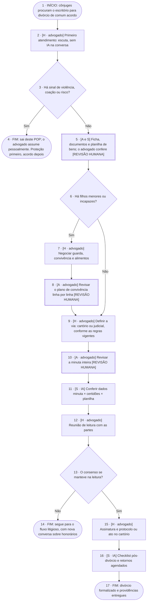

# POP: Divórcio consensual, com e sem filhos

Setor: Produção de peças · Área: Família · Versão: biblioteca 1.0 · Atualizado em: [A DEFINIR ao adaptar] · Dono do POP: [A DEFINIR]

> POP de referência da biblioteca, escrito para um escritório genérico de 3 a 10 pessoas. 12 passos: 3 S, 4 A, 5 H. Em Família, o H aparece mais e em passos inegociáveis. Prazos são exemplos e só valem depois que o escritório decidir. O indicador é sugestão da biblioteca (o material de origem não trazia indicador para os POPs de área). Regras da via (cartório ou judicial) e do regime de bens sempre conferidas na fonte [CONFERIR]. Para usar, adapte pela entrada B do `escrever-pop`.

**Alerta de Família:** se surgir relato ou sinal de violência doméstica, ameaça ou risco para a cliente ou os filhos, o POP para. O advogado assume pessoalmente e avalia medidas de proteção; só depois o caso volta ao fluxo. Nenhuma etapa desse atendimento é automatizada.

## 1. Objetivo

Formalizar o divórcio decidido, com partilha, guarda, convivência e alimentos bem resolvidos, sem transformar acordo em briga por falha de redação.

## 2. Gatilho

Um ou os dois cônjuges procuram o escritório para divórcio de comum acordo.

## 3. Responsáveis

- Executa: assistente (documentos, planilha de bens e agenda).
- Confere: advogado (ficha, planilha, plano de convivência, minuta).
- Decide: advogado (atendimento, via, negociação e leitura com as partes).

## 4. Entradas

- Certidão de casamento atualizada.
- Documentos pessoais.
- Certidões dos filhos.
- Pacto antenupcial, se houver.
- Documentos de bens e dívidas.
- Renda, para os alimentos.
- Modelos de petição, escritura e plano de convivência, e a lista das cláusulas que o escritório sempre revisa.

## 5. Passo a passo com S, A e H

1. [H] Fazer o primeiro atendimento: escuta sem pressa; checar se o consenso é real e se há violência ou pressão de uma parte sobre a outra. "Nada de IA na sala." Executa: advogado. Confere: não se aplica.
2. [A] Organizar as anotações na ficha do caso (a partir das anotações ou de transcrição autorizada). Executa: IA. Confere: advogado confere fatos, filhos, bens e o que foi combinado.
3. [S] Enviar e conferir o checklist de documentos (conforme filhos e bens) e listar o que falta. Executa: IA. Confere: assistente, por amostra.
4. [A] Montar a planilha de bens e dívidas (data de aquisição, forma de pagamento). Executa: IA. Confere: advogado define a partilha conforme o regime.
5. [H] Definir a via (cartório ou judicial) conforme filhos e regras vigentes, conferidas na fonte. Executa: advogado. Confere: não se aplica.
6. [H] Negociar guarda, convivência e alimentos em reunião conduzida pelo advogado; prevalece o interesse das crianças. "Essa conversa não se terceiriza." Executa: advogado. Confere: não se aplica.
7. [A] Redigir o plano de convivência (dias, feriados, férias, aniversários, viagens, comunicação). Executa: IA. Confere: advogado revisa linha por linha.
8. [A] Redigir a minuta (petição, escritura ou acordo); a IA aponta as cláusulas que costumam gerar briga (despesas extraordinárias, reajuste). Executa: IA. Confere: advogado lê a minuta inteira e decide cada cláusula apontada.
9. [S] Conferir os dados minuta × certidões × planilha (nomes, datas, matrículas, placas, valores). Executa: IA. Confere: assistente corrige cada divergência apontada.
10. [H] Fazer a reunião de leitura: o advogado lê, explica cada cláusula e colhe ajustes. Executa: advogado. Confere: não se aplica.
11. [H] Assinar e protocolar, ou realizar o ato no cartório, sempre com o advogado. Executa: advogado. Confere: não se aplica.
12. [S] Cuidar das providências finais: checklist pós-divórcio (averbação, transferência de bens, cadastros, plano de saúde) e retornos agendados. Executa: IA. Confere: assistente confere cada item do checklist.

## 6. Prazo

Exemplo (meta sugerida): minuta em até 7 dias úteis depois do acordo fechado e da documentação completa. "Em Família, o ritmo das partes manda mais do que a meta." No escritório: [A DEFINIR, do código do escritório].

## 7. Exceções

- Violência ou coação: o POP para; o advogado assume pessoalmente, sem automação.
- Consenso que desmonta na leitura: fluxo litigioso, com nova conversa sobre honorários.
- Bens no exterior, empresa ou patrimônio complexo: avaliar apoio especializado.
- Sem filhos menores ou incapazes: guarda, convivência e plano de convivência não se aplicam; o advogado define o que resta do passo 6 [A DEFINIR].

## 8. Saída

Divórcio formalizado, providências entregues e retornos agendados.

## 9. Onde a IA entra

- Passos S: checklist, conferência de dados, pós-divórcio.
- Passos A: ficha, planilha de bens, plano de convivência, minuta.
- O que a IA consulta: modelos de petição, escritura e plano de convivência; lista das cláusulas que o escritório sempre revisa.
- Ambiente: Projeto no Claude com a base de Família, em conta profissional. Nada de IA no primeiro atendimento.

## 10. Nunca sai sem revisão humana

- Escolha da via.
- Tudo sobre guarda, convivência e alimentos.
- A minuta inteira.
- Mensagens de andamento às partes.

## 11. Dados pessoais e sensíveis

- Dados que aparecem: dados de crianças e adolescentes (proteção reforçada na LGPD), saúde mental, vícios, violência, finanças do casal.
- Anonimizar: [CÔNJUGE 1], [CÔNJUGE 2], [FILHO 1]; tirar CPF, endereço e escola.
- Nunca na IA: qualquer relato de violência; dado de criança além do que a minuta exige, sem autorização expressa do responsável.
- Transcrição do atendimento só com autorização das partes.

## 12. Indicador (sugestão da biblioteca)

- Minutas que voltam com ajuste na reunião de leitura (com ajuste ÷ minutas lidas no mês).
- Tempo do acordo fechado à minuta pronta (média do mês).

## Na trilha solo

- O titular faz todos os H, como em qualquer porte. O que muda é a conferência dos dados (passo 9): com estagiária, é ela; sem ninguém, o titular confere num dia diferente da redação.
- O sinal de violência não espera: o titular para o fluxo na hora, mesmo com a agenda cheia.

## Fluxograma

Fluxograma do material ("com as duas portas de saída"), completado com os passos do POP.

**Em texto:**
1. INÍCIO: cônjuges procuram o escritório para divórcio de comum acordo.
2. AÇÃO [H · advogado] Primeiro atendimento, com escuta e sem IA na conversa. Vá para 3.
3. DECISÃO: há sinal de violência, coação ou risco? Se sim, vá para 4. Se não, vá para 5.
4. FIM: sai deste POP; o advogado assume pessoalmente. Proteção primeiro, acordo depois.
5. AÇÃO [A e S] Ficha, documentos e planilha de bens, com conferência do advogado [REVISÃO HUMANA]. Vá para 6.
6. DECISÃO: há filhos menores ou incapazes? Se sim, vá para 7. Se não, vá para 9.
7. AÇÃO [H · advogado] Negociar guarda, convivência e alimentos. Vá para 8.
8. AÇÃO [A · advogado] Revisar o plano de convivência linha por linha [REVISÃO HUMANA]. Vá para 9.
9. AÇÃO [H · advogado] Definir a via, conforme as regras vigentes. Vá para 10.
10. AÇÃO [A · advogado] Revisar a minuta inteira [REVISÃO HUMANA]. Vá para 11.
11. AÇÃO [S · IA] Conferir dados minuta × certidões × planilha. Vá para 12.
12. AÇÃO [H · advogado] Reunião de leitura com as partes. Vá para 13.
13. DECISÃO: o consenso se manteve na leitura? Se sim, vá para 15. Se não, vá para 14.
14. FIM: segue para o fluxo litigioso, com nova conversa sobre honorários.
15. AÇÃO [H · advogado] Assinatura e protocolo ou ato no cartório. Vá para 16.
16. AÇÃO [S · IA] Checklist pós-divórcio e retornos agendados. Vá para 17.
17. FIM: divórcio formalizado e providências entregues.

Caminho principal: atendimento → sem sinal de risco → ficha e planilha → guarda e convivência (com filhos) → via → minuta → conferência → leitura → assinatura → pós-divórcio.
