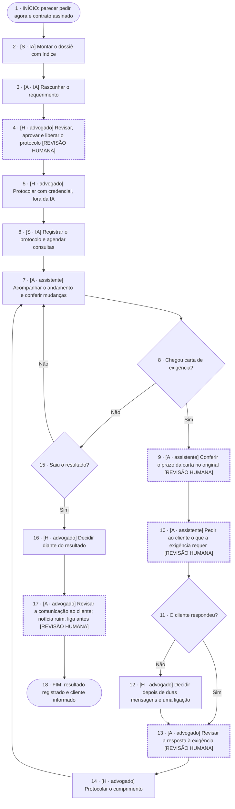

# POP: Requerimento administrativo e exigência

Setor: Prazos e controladoria · Área: Previdenciário · Versão: biblioteca 1.0 · Atualizado em: [A DEFINIR ao adaptar] · Dono do POP: [A DEFINIR]

> POP de referência da biblioteca, escrito para um escritório genérico de 3 a 10 pessoas. 12 passos: 2 S, 6 A, 4 H. Prazos são exemplos e só valem depois que o escritório decidir. O indicador é sugestão da biblioteca (o material de origem não trazia indicador para os POPs de área). Regra de benefício e prazo do INSS nunca entram de memória: conferir na fonte [CONFERIR]. Para usar, adapte pela entrada B do `escrever-pop`.

## 1. Objetivo

Protocolar o requerimento completo na primeira vez e responder às exigências sem perder o prazo do INSS, mantendo o cliente informado.

## 2. Gatilho

Parecer com a decisão "pedir agora" e contrato assinado.

## 3. Responsáveis

- Executa: assistente (monta o dossiê e acompanha).
- Confere: assistente (índice, prazo da carta no original); advogado (requerimento, resposta à exigência).
- Decide: advogado (revisa, protocola e decide diante do resultado).

## 4. Entradas

- Parecer de viabilidade.
- Documentos conferidos no POP de viabilidade.
- Procuração e documentos exigidos para atuar no INSS.
- Modelo de requerimento ou de petição de encaminhamento.
- Checklist por benefício e mensagens padrão por etapa.

## 5. Passo a passo com S, A e H

1. [S] Montar o dossiê na ordem do checklist, com PDF por tipo e índice. Executa: IA. Confere: assistente confere índice × arquivos.
2. [A] Redigir o requerimento ou a petição de encaminhamento a partir do modelo e do parecer, destacando os períodos e documentos-chave. Executa: IA rascunha. Confere: advogado, no passo 3.
3. [H] Revisar e aprovar o requerimento (nenhum documento de fora) e liberar o protocolo. Executa: advogado. Confere: não se aplica.
4. [H] Protocolar no Meu INSS ou no canal do escritório. Acesso com credencial é sempre feito por pessoa; senha do cliente nunca entra em conversa com IA. Executa: advogado ou pessoa autorizada. Confere: não se aplica.
5. [S] Registrar o protocolo: a IA lê o comprovante, preenche a planilha ou o software (número, data, tipo) e agenda as consultas de acompanhamento. Executa: IA. Confere: assistente confere número e data contra o comprovante.
6. [A] Acompanhar o andamento: a assistente consulta e salva print ou PDF; a IA compara com a consulta anterior, atualiza o status e avisa mudanças. Executa: assistente e IA. Confere: assistente lê cada mudança apontada.
7. [A] Ler a carta de exigência: a IA lista os itens e o prazo da carta. Executa: IA. Confere: assistente confere o prazo no original antes de lançar.
8. [A] Pedir ao cliente o que a exigência requer, com data-limite interna anterior ao prazo do INSS. Executa: IA rascunha. Confere: assistente revisa e envia.
9. [A] Montar a resposta à exigência: a IA organiza os documentos e rascunha a manifestação. Executa: IA. Confere: advogado revisa a manifestação inteira.
10. [H] Protocolar o cumprimento da exigência, com o mesmo cuidado do passo 4. Executa: advogado ou pessoa autorizada. Confere: não se aplica.
11. [H] Decidir diante do resultado. Deferido: conferir se saiu como esperado. Indeferido: recurso administrativo, novo requerimento ou ação, e conversa com o cliente. Executa: advogado. Confere: não se aplica.
12. [A] Comunicar o cliente. Executa: IA rascunha. Confere: advogado revisa; se a notícia for ruim, o advogado liga antes de qualquer mensagem.

## 6. Prazo

O prazo da carta de exigência, conferido por pessoa no original [CONFERIR]. Meta interna: alguns dias úteis de folga antes dele (número [A DEFINIR] pelo escritório).

## 7. Exceções

- Cliente que some na exigência: duas mensagens e uma ligação registradas, e o advogado decide.
- Exigência indevida: o advogado decide se cumpre, contesta ou faz os dois.
- Divergência entre o prazo lido pela IA e o do original: vale o original, e a divergência é registrada (sugestão da biblioteca).

## 8. Saída

Requerimento protocolado, exigências cumpridas no prazo, resultado registrado e cliente informado com o próximo passo.

## 9. Onde a IA entra

- Passos S: dossiê, registro do protocolo.
- Passos A: rascunho do requerimento, comparação de status, leitura da carta, pedido ao cliente, resposta à exigência, mensagem de resultado.
- O que a IA consulta: modelos de requerimento, checklist por benefício, mensagens padrão por etapa.
- Ambiente: Projeto no Claude com a base do Previdenciário, em conta profissional. O acesso ao Meu INSS fica fora da IA.

## 10. Nunca sai sem revisão humana

- Requerimento.
- Resposta à exigência.
- Prazo lançado na agenda.
- Mensagem de resultado ao cliente.

## 11. Dados pessoais e sensíveis

- Dados que aparecem: os mesmos da viabilidade (laudos, atestados, CID, NIT, renda) e o número do benefício.
- Anonimizar: [CLIENTE], [DOC], [BENEFÍCIO], [ENDEREÇO] em tudo que não for o protocolo em si.
- Nunca na IA: credenciais gov.br e senhas do cliente, em nenhuma ferramenta de IA.
- Prints de consulta guardados só na pasta do caso.

## 12. Indicador (sugestão da biblioteca)

- Exigências cumpridas dentro da meta interna (cumpridas no prazo interno ÷ exigências do mês).
- Requerimentos com exigência por documento que faltou no dossiê (contagem no mês).

## Na trilha solo

- O titular é quem protocola e quem confere o prazo: confira o prazo da carta no original em um momento diferente do lançamento.
- Plano de ausência: quem consulta o andamento e as cartas durante férias, audiência ou doença [A DEFINIR].

## Fluxograma

Desenhado a partir dos passos (o material não trazia fluxograma deste POP).

**Em texto:**
1. INÍCIO: parecer "pedir agora" e contrato assinado.
2. AÇÃO [S · IA] Montar o dossiê com índice. Vá para 3.
3. AÇÃO [A · IA] Rascunhar o requerimento. Vá para 4.
4. AÇÃO [H · advogado] Revisar, aprovar e liberar o protocolo [REVISÃO HUMANA]. Vá para 5.
5. AÇÃO [H · advogado] Protocolar com credencial, fora da IA. Vá para 6.
6. AÇÃO [S · IA] Registrar o protocolo e agendar consultas. Vá para 7.
7. AÇÃO [A · assistente] Acompanhar o andamento e conferir mudanças. Vá para 8.
8. DECISÃO: chegou carta de exigência? Se sim, vá para 9. Se não, vá para 15.
9. AÇÃO [A · assistente] Conferir o prazo da carta no original [REVISÃO HUMANA]. Vá para 10.
10. AÇÃO [A · assistente] Pedir ao cliente o que a exigência requer [REVISÃO HUMANA]. Vá para 11.
11. DECISÃO: o cliente respondeu? Se sim, vá para 13. Se não, vá para 12.
12. AÇÃO [H · advogado] Decidir depois de duas mensagens e uma ligação registradas. Vá para 13.
13. AÇÃO [A · advogado] Revisar a resposta à exigência [REVISÃO HUMANA]. Vá para 14.
14. AÇÃO [H · advogado] Protocolar o cumprimento. Volte para 7.
15. DECISÃO: saiu o resultado? Se sim, vá para 16. Se não, volte para 7.
16. AÇÃO [H · advogado] Decidir diante do resultado. Vá para 17.
17. AÇÃO [A · advogado] Revisar a comunicação ao cliente; notícia ruim, liga antes [REVISÃO HUMANA]. Vá para 18.
18. FIM: resultado registrado e cliente informado com o próximo passo.

Ponto em aberto do desenho: a exigência indevida (cumprir, contestar ou os dois) é decisão do advogado no símbolo 13.

Caminho principal: parecer → dossiê → requerimento revisado → protocolo → acompanhamento → resultado → decisão → comunicação.
