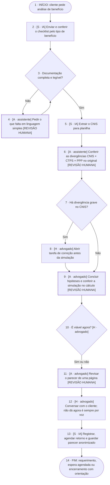

# POP: Análise de viabilidade de benefício

Setor: Atendimento e triagem · Área: Previdenciário · Versão: biblioteca 1.0 · Atualizado em: [A DEFINIR ao adaptar] · Dono do POP: [A DEFINIR]

> POP de referência da biblioteca, escrito para um escritório genérico de 3 a 10 pessoas. 11 passos: 4 S, 5 A, 2 H. Prazos são exemplos e só valem depois que o escritório decidir. O indicador é sugestão da biblioteca (o material de origem não trazia indicador para os POPs de área). Regra de benefício, carência e tempo de contribuição nunca entram de memória: conferir na fonte [CONFERIR]. Para usar, adapte pela entrada B do `escrever-pop`.

## 1. Objetivo

Dizer ao cliente, com base em documento, se o benefício cabe agora, mais para frente ou se o melhor é outro caminho, antes de qualquer protocolo.

## 2. Gatilho

O cliente fechou a consulta ou o contrato de análise prévia, e o escritório recebeu o primeiro lote de documentos.

## 3. Responsáveis

- Executa: assistente ou estagiária (organiza e confere).
- Confere: assistente (documentos e divergências); advogado (simulação e parecer).
- Decide: advogado (viabilidade, estratégia e conversa com o cliente).

## 4. Entradas

- CNIS com remunerações.
- CTPS (todas as páginas com vínculo e anotações).
- Carnês e guias.
- PPP e LTCAT (atividade especial).
- Documentos rurais.
- Laudos e atestados (incapacidade).
- Ficha com o pedido do cliente em palavras simples.
- Checklists por tipo de benefício e regras de simulação registradas na base.

## 5. Passo a passo com S, A e H

1. [S] Enviar o checklist de documentos pelo tipo de benefício (aposentadoria, incapacidade, BPC, pensão). Executa: IA escolhe o checklist na base e monta a mensagem no tom do escritório. Confere: assistente confere o tipo de benefício e dispara.
2. [S] Receber, renomear e conferir o que chegou. Executa: IA classifica, renomeia e lista o que falta e o que veio ilegível. Confere: assistente, por amostra.
3. [A] Pedir o que falta, em linguagem de cliente, dizendo onde conseguir cada documento. Executa: IA rascunha. Confere: assistente ajusta e envia.
4. [S] Extrair o CNIS para planilha (vínculos, datas, remunerações, indicadores de pendência). "Nada de digitar CNIS à mão." Executa: IA. Confere: assistente compara uma amostra da planilha com o CNIS original.
5. [A] Cruzar CNIS × CTPS e demais documentos e apontar divergências (vínculo sem saída, período fora do CNIS, remuneração abaixo do mínimo, contribuição concomitante). Executa: IA aponta. Confere: assistente confere cada divergência no documento original.
6. [A] Levantar hipóteses de períodos especiais, rurais ou de teses, com a página do indício. Executa: IA levanta. Confere: advogado conclui sobre cada hipótese.
7. [A] Simular cenários de tempo e carência com as regras registradas na base. Executa: IA. Confere: advogado confere no software ou na planilha de cálculo.
8. [H] Decidir viabilidade e estratégia: pedir agora, esperar, corrigir o CNIS antes, ir ao judicial ou não seguir. "Tem nome e OAB." Executa: advogado. Confere: não se aplica.
9. [A] Redigir o parecer em uma página, sem juridiquês. Executa: IA rascunha. Confere: advogado revisa o texto inteiro e cada número.
10. [H] Conversar com o cliente: explicar, alinhar a expectativa e apresentar a proposta de honorários do requerimento ou da ação. "Não dá agora" é sempre por voz. Executa: advogado. Confere: não se aplica.
11. [S] Registrar e alimentar a base: ficha atualizada, retorno agendado se a estratégia for esperar, parecer anonimizado guardado como referência. Executa: IA. Confere: assistente confere o registro e o agendamento.

## 6. Prazo

Exemplo (meta sugerida): parecer em até 5 dias úteis depois da documentação completa. No escritório: [A DEFINIR, do código do escritório].

## 7. Exceções

- Urgência de saúde ou financeira: o advogado avalia um caminho rápido no mesmo dia.
- Documento só em papel: digitalizar antes de qualquer etapa com IA.
- Divergência grave no CNIS: vira tarefa de correção antes da simulação.
- Documentação que não completa depois dos pedidos: o advogado decide se analisa com o que tem ou encerra com orientação escrita [A DEFINIR].

## 8. Saída

Parecer entregue, conversa registrada e caso encaminhado a requerimento, espera agendada ou encerramento com orientação escrita.

## 9. Onde a IA entra

- Passos S: checklist, recebimento e renomeação, extração do CNIS, registro.
- Passos A: pedido do que falta, cruzamento, hipóteses, simulação, parecer.
- O que a IA consulta: checklists por benefício, regras de simulação revisadas pelo advogado, 2 ou 3 pareceres bons como exemplo de tom.
- Ambiente: Projeto no Claude com o código do escritório e a base do Previdenciário, em conta profissional.

## 10. Nunca sai sem revisão humana

- Resultado da simulação.
- Conclusão de viabilidade.
- Qualquer número de tempo ou valor estimado que vá ao cliente.

## 11. Dados pessoais e sensíveis

- Dados que aparecem: laudos, atestados e CID (dado de saúde, sensível pela LGPD), NIT, renda, vínculos.
- Anonimizar: nome, CPF, NIT e endereço ([CLIENTE], [DOC], [ENDEREÇO]); guardar só o necessário.
- Nunca na IA: senha gov.br ou do Meu INSS; laudo completo sem autorização expressa do responsável.
- Parecer guardado como referência sempre anonimizado.

## 12. Indicador (sugestão da biblioteca)

- Tempo da documentação completa ao parecer entregue (média do mês).
- Simulações corrigidas na conferência do advogado (corrigidas ÷ feitas no mês).

## Na trilha solo

- Com estagiária, ela faz os passos de conferência de documentos; sem ninguém, o titular confere as divergências do passo 5 num momento separado da simulação.
- A simulação (passo 7) é conferida no software de cálculo, nunca só lendo a resposta da IA.

## Fluxograma

Fluxograma do material, completado com os passos e exceções do POP.

**Em texto:**
1. INÍCIO: cliente pede análise de benefício.
2. AÇÃO [S · IA] Enviar e conferir o checklist pelo tipo de benefício. Vá para 3.
3. DECISÃO: documentação completa e legível? Se sim, vá para 5. Se não, vá para 4.
4. AÇÃO [A · assistente] Pedir o que falta em linguagem simples [REVISÃO HUMANA]. Volte para 3.
5. AÇÃO [S · IA] Extrair o CNIS para planilha. Vá para 6.
6. AÇÃO [A · assistente] Conferir as divergências no original [REVISÃO HUMANA]. Vá para 7.
7. DECISÃO: há divergência grave no CNIS? Se sim, vá para 8. Se não, vá para 9.
8. AÇÃO [H · advogado] Abrir tarefa de correção antes da simulação. Vá para 9.
9. AÇÃO [A · advogado] Concluir hipóteses e conferir a simulação no cálculo [REVISÃO HUMANA]. Vá para 10.
10. DECISÃO [H · advogado]: é viável agora? Nos dois casos, vá para 11 (o parecer registra a estratégia: pedir agora, esperar, corrigir, judicial ou não seguir).
11. AÇÃO [A · advogado] Revisar o parecer de uma página [REVISÃO HUMANA]. Vá para 12.
12. AÇÃO [H · advogado] Conversar com o cliente. Vá para 13.
13. AÇÃO [S · IA] Registrar, agendar retorno e guardar parecer anonimizado. Vá para 14.
14. FIM: requerimento, espera agendada ou encerramento com orientação escrita.

Caminho principal: pedido de análise → checklist → documentação completa → CNIS → divergências → simulação conferida → decisão → parecer → conversa → registro.
