# POP: Defesa da empresa em reclamatória

Setor: Produção de peças · Área: Trabalhista (lado da empresa) · Versão: biblioteca 1.0 · Atualizado em: [A DEFINIR ao adaptar] · Dono do POP: [A DEFINIR]

> POP de referência da biblioteca, escrito para um escritório genérico de 3 a 10 pessoas. 10 passos: 2 S, 5 A, 3 H. Prazos são exemplos e só valem depois que o escritório decidir. O indicador é sugestão da biblioteca (o material de origem não trazia indicador para os POPs de área). Prazo processual e precedente nunca entram de memória [CONFERIR]. Para usar, adapte pela entrada B do `escrever-pop`.

## 1. Objetivo

Chegar à audiência com contestação sólida, documentos certos, risco por pedido estimado e faixa de acordo aprovada pelo cliente.

## 2. Gatilho

A empresa encaminha a notificação, ou a controladoria identifica a citação.

## 3. Responsáveis

- Executa: controladoria (cadastra); assistente (organiza os documentos com o RH).
- Confere: controladoria (audiência e prazos no tribunal); assistente (cruzamento pedidos × documentos).
- Decide: advogado (estratégia, risco, peça e audiência); faixa de acordo aprovada com o sócio ou gestor da empresa cliente.

## 4. Entradas

- Inicial e documentos do reclamante.
- Notificação.
- Documentos da empresa: contrato, ficha de registro, ponto, holerites, advertências, rescisão.
- Contato do RH e do preposto.
- Modelos de contestação por pedido e histórico de acordos anonimizado.

## 5. Passo a passo com S, A e H

1. [A] Cadastrar audiência e prazos: a IA extrai partes, data e valor da causa. Executa: IA. Confere: controladoria confere no sistema do tribunal e lança.
2. [S] Resumir a inicial pedido a pedido (pedido, fundamento, período, valor). Executa: IA. Confere: advogado, ao ler a inicial no passo 5.
3. [S] Pedir os documentos ao RH, com lista específica por pedido e mensagem com data-limite interna. Executa: IA. Confere: assistente confere a lista contra o resumo da inicial.
4. [A] Cruzar pedidos × documentos: onde a documentação sustenta, onde é fraca ou não existe. Executa: IA. Confere: assistente confere cada cruzamento no documento.
5. [H] Estimar o risco de cada pedido, classificado e justificado pela experiência com aquela vara e aquele tipo de pedido. Executa: advogado. Confere: não se aplica.
6. [A] Simular cenários de acordo, com faixas a partir dos valores e do risco definido. Executa: IA. Confere: advogado confere a conta.
7. [H] Aprovar a faixa de acordo com o cliente. Executa: advogado, com o sócio ou o gestor da empresa. Confere: não se aplica (aprovação registrada por escrito).
8. [A] Rascunhar a contestação com impugnação específica e o documento que sustenta cada argumento. Executa: IA. Confere: advogado, no passo 9.
9. [H] Revisar, assinar e protocolar, com leitura integral e precedentes conferidos na fonte. Executa: advogado. Confere: não se aplica.
10. [A] Preparar o preposto: a IA monta o roteiro de pontos; o treino é do advogado, em conversa. Executa: IA e advogado. Confere: advogado revisa o roteiro antes da conversa.

## 6. Prazo

Exemplo (meta sugerida): documentos do RH com folga confortável; contestação pronta alguns dias antes da audiência. Os números são definidos com o cliente empresarial e registrados no contrato ou acordo de atendimento [A DEFINIR].

## 7. Exceções

- Empresa que não envia os documentos: aviso escrito sobre o risco.
- Pedido de valor alto ou com repercussão para outros empregados: reunião antes da contestação.
- Divergência entre os dados extraídos pela IA e o sistema do tribunal: vale o tribunal (sugestão da biblioteca).

## 8. Saída

Contestação protocolada, faixa de acordo aprovada por escrito, preposto preparado.

## 9. Onde a IA entra

- Passos S: resumo da inicial, pedido de documentos ao RH.
- Passos A: leitura da notificação, cruzamento, simulação, rascunho da contestação, roteiro do preposto.
- O que a IA consulta: modelos de contestação por pedido, histórico de acordos anonimizado.
- Ambiente: Projeto no Claude com a base do Trabalhista, em conta profissional.

## 10. Nunca sai sem revisão humana

- Classificação de risco.
- Faixa de acordo.
- Contestação.
- Orientação ao preposto.

## 11. Dados pessoais e sensíveis

- Dados que aparecem: dados de empregados que não são clientes do escritório (salário, ponto, advertências, saúde).
- Anonimizar: na IA, reclamante e demais empregados ([EMPREGADO 1], [DOC]); só o necessário.
- Guarda e descarte: combinar com o cliente empresarial e registrar.
- Nunca na IA: dado de saúde de empregado além do que o pedido exige.

## 12. Indicador (sugestão da biblioteca)

- Contestações prontas com a folga combinada (prontas no prazo interno ÷ audiências do mês).
- Pedidos sem documento de defesa por falta de envio do RH (contagem no mês).

## Na trilha solo

- O titular faz a conferência dos cruzamentos: separe um bloco para isso antes de estimar o risco, nunca no mesmo momento.
- A faixa de acordo é registrada por escrito com o cliente empresarial, porque não há sócio interno para validar.

## Fluxograma

Desenhado a partir dos passos (o material não trazia fluxograma deste POP).

```mermaid
flowchart TD
  I1(["1 · INÍCIO: notificação encaminhada ou citação identificada"])
  P2["2 · [A · controladoria] Conferir no tribunal e lançar audiência e prazos [REVISÃO HUMANA]"]
  P3["3 · [S · IA] Resumir a inicial pedido a pedido"]
  P4["4 · [S · IA] Pedir documentos ao RH com data-limite interna"]
  D5{"5 · A empresa enviou os documentos?"}
  P6["6 · [H · advogado] Avisar por escrito sobre o risco"]
  P7["7 · [A · assistente] Conferir o cruzamento pedidos × documentos [REVISÃO HUMANA]"]
  P8["8 · [H · advogado] Estimar o risco de cada pedido"]
  D9{"9 · Há pedido de valor alto ou com repercussão?"}
  P10["10 · [H · advogado] Reunião com a empresa antes da contestação"]
  P11["11 · [A · advogado] Conferir a simulação de acordo [REVISÃO HUMANA]"]
  P12["12 · [H · advogado e empresa] Aprovar a faixa de acordo por escrito"]
  P13["13 · [A · IA] Rascunhar a contestação com o documento de cada argumento"]
  P14["14 · [H · advogado] Revisar, assinar e protocolar [REVISÃO HUMANA]"]
  P15["15 · [A · advogado] Revisar o roteiro e treinar o preposto [REVISÃO HUMANA]"]
  F16(["16 · FIM: contestação protocolada e preposto preparado"])
  I1 --> P2 --> P3 --> P4 --> D5
  D5 -->|Não| P6 --> P7
  D5 -->|Sim| P7
  P7 --> P8 --> D9
  D9 -->|Sim| P10 --> P11
  D9 -->|Não| P11
  P11 --> P12 --> P13 --> P14 --> P15 --> F16
  classDef revisao stroke-width:3px,stroke-dasharray:4 2
  class P2,P7,P11,P14,P15 revisao
```

**Em texto:**
1. INÍCIO: notificação encaminhada ou citação identificada.
2. AÇÃO [A · controladoria] Conferir no tribunal e lançar audiência e prazos [REVISÃO HUMANA]. Vá para 3.
3. AÇÃO [S · IA] Resumir a inicial pedido a pedido. Vá para 4.
4. AÇÃO [S · IA] Pedir documentos ao RH com data-limite interna. Vá para 5.
5. DECISÃO: a empresa enviou os documentos? Se sim, vá para 7. Se não, vá para 6.
6. AÇÃO [H · advogado] Avisar por escrito sobre o risco. Vá para 7.
7. AÇÃO [A · assistente] Conferir o cruzamento pedidos × documentos [REVISÃO HUMANA]. Vá para 8.
8. AÇÃO [H · advogado] Estimar o risco de cada pedido. Vá para 9.
9. DECISÃO: há pedido de valor alto ou com repercussão para outros empregados? Se sim, vá para 10. Se não, vá para 11.
10. AÇÃO [H · advogado] Reunião com a empresa antes da contestação. Vá para 11.
11. AÇÃO [A · advogado] Conferir a simulação de acordo [REVISÃO HUMANA]. Vá para 12.
12. AÇÃO [H · advogado e empresa] Aprovar a faixa de acordo por escrito. Vá para 13.
13. AÇÃO [A · IA] Rascunhar a contestação com o documento de cada argumento. Vá para 14.
14. AÇÃO [H · advogado] Revisar, assinar e protocolar [REVISÃO HUMANA]. Vá para 15.
15. AÇÃO [A · advogado] Revisar o roteiro e treinar o preposto [REVISÃO HUMANA]. Vá para 16.
16. FIM: contestação protocolada, faixa aprovada por escrito, preposto preparado.

Caminho principal: notificação → cadastro conferido → resumo da inicial → documentos do RH → cruzamento → risco → simulação → faixa aprovada → contestação → protocolo → preposto.
