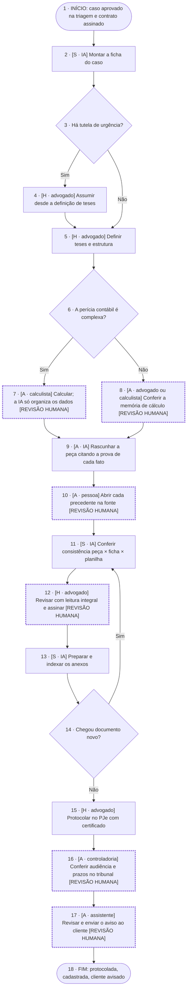

# POP: Reclamatória com cálculo preliminar

Setor: Produção de peças · Área: Trabalhista (lado do trabalhador) · Versão: biblioteca 1.0 · Atualizado em: [A DEFINIR ao adaptar] · Dono do POP: [A DEFINIR]

> POP de referência da biblioteca, escrito para um escritório genérico de 3 a 10 pessoas. 11 passos: 3 S, 5 A, 3 H. Prazos são exemplos e só valem depois que o escritório decidir. O indicador é sugestão da biblioteca (o material de origem não trazia indicador para os POPs de área). Premissa de cálculo, súmula e precedente nunca entram de memória [CONFERIR]. Para usar, adapte pela entrada B do `escrever-pop`.

## 1. Objetivo

Inicial com pedidos amarrados à prova e valor de cada pedido a partir de uma memória de cálculo defensável.

## 2. Gatilho

Caso aprovado na triagem de provas e contrato assinado.

## 3. Responsáveis

- Executa: assistente ou estagiária (ficha, anexos e conferências).
- Confere: advogado ou calculista (cálculo); controladoria (prazos e audiência no sistema do tribunal).
- Decide: advogado (teses, revisão, assinatura e protocolo).

## 4. Entradas

- Matriz de prova.
- Planilha de holerites.
- Linha do tempo.
- Documentos do caso.
- Modelos de reclamatória e de pedidos.
- Premissas de cálculo adotadas pelo escritório e checklist de revisão.

## 5. Passo a passo com S, A e H

1. [S] Montar a ficha do caso (qualificação, contrato, salário, datas, pedidos aprovados), que alimenta peça e cálculo. Executa: IA. Confere: assistente confere contra a matriz e os documentos.
2. [H] Definir teses e estrutura: ordem, fundamentos, pedido principal ou subsidiário. Executa: advogado. Confere: não se aplica.
3. [A] Fazer o cálculo preliminar: memória em planilha com cada premissa escrita (divisor, adicional, período, reflexos). Executa: IA. Confere: advogado ou calculista confere no software ou na planilha.
4. [A] Rascunhar a peça a partir do modelo, da ficha e da matriz, citando a prova de cada fato com o número do documento. Executa: IA. Confere: advogado, no passo 7.
5. [A] Pesquisar jurisprudência: a IA sugere linhas e precedentes. Executa: IA. Confere: uma pessoa abre cada decisão na fonte. "Precedente que ninguém abriu não entra."
6. [S] Conferir a consistência peça × ficha × planilha (nomes, datas, salário, valores). Executa: IA. Confere: assistente corrige cada divergência apontada.
7. [H] Revisar e assinar: leitura integral com o checklist de qualidade. Executa: advogado. Confere: não se aplica.
8. [S] Preparar os anexos: nomear, ordenar, indexar na ordem da peça. Executa: IA. Confere: assistente confere que todo documento citado está anexado.
9. [H] Protocolar no PJe com o certificado do advogado. Executa: advogado. Confere: não se aplica.
10. [A] Cadastrar processo e prazos: a IA lê o comprovante e a notificação e sugere. Executa: IA. Confere: controladoria confere audiência e prazos no sistema do tribunal antes de lançar.
11. [A] Avisar o cliente: número, próximos passos, o que guardar até a audiência. Executa: IA rascunha. Confere: assistente ou advogado revisa antes de enviar.

## 6. Prazo

Exemplo (meta sugerida): inicial em até 10 dias úteis depois do contrato, ou antes se houver risco de prescrição. No escritório: [A DEFINIR, do código do escritório].

## 7. Exceções

- Tutela de urgência: o advogado assume desde o passo 2.
- Perícia contábil complexa: vai ao calculista, e a IA só organiza os dados.
- Documento novo depois da peça pronta: volta ao passo 6.
- Precedente que não abre na fonte: sai da peça (sugestão da biblioteca).

## 8. Saída

Peça protocolada, processo e audiência cadastrados, cliente avisado.

## 9. Onde a IA entra

- Passos S: ficha, consistência, anexos.
- Passos A: memória de cálculo, rascunho, pesquisa, cadastro de prazos, mensagem ao cliente.
- O que a IA consulta: modelos por pedido, premissas de cálculo adotadas, checklist de revisão.
- Ambiente: Projeto no Claude com a base do Trabalhista, em conta profissional. Certificado digital nunca entra na IA.

## 10. Nunca sai sem revisão humana

- A peça inteira.
- O cálculo.
- Cada precedente.
- Prazos lançados.

## 11. Dados pessoais e sensíveis

- Dados que aparecem: qualificação, salário, documentos do contrato; pedido ligado a doença, acidente ou assédio segue os cuidados da triagem.
- Anonimizar: [CLIENTE], [EMPRESA], [DOC], terceiros citados; na peça, só o dado de saúde que o pedido exige.
- Nunca na IA: certificado digital e senha do PJe; laudo completo sem autorização expressa do responsável.

## 12. Indicador (sugestão da biblioteca)

- Tempo do contrato ao protocolo (média do mês).
- Ajustes pedidos na revisão final, por tipo (cálculo, fato, precedente, forma).

## Na trilha solo

- O titular confere o próprio cálculo: refaça a conta no software em outro momento, sem olhar o resultado da IA antes.
- A leitura integral (passo 7) acontece em outro dia nas peças de valor alto, ou com revisor externo.

## Fluxograma

Desenhado a partir dos passos (o material não trazia fluxograma deste POP).

**Em texto:**
1. INÍCIO: caso aprovado na triagem e contrato assinado.
2. AÇÃO [S · IA] Montar a ficha do caso. Vá para 3.
3. DECISÃO: há tutela de urgência? Se sim, vá para 4. Se não, vá para 5.
4. AÇÃO [H · advogado] Assumir desde a definição de teses. Vá para 5.
5. AÇÃO [H · advogado] Definir teses e estrutura. Vá para 6.
6. DECISÃO: a perícia contábil é complexa? Se sim, vá para 7. Se não, vá para 8.
7. AÇÃO [A · calculista] Calcular, com a IA só organizando os dados [REVISÃO HUMANA]. Vá para 9.
8. AÇÃO [A · advogado ou calculista] Conferir a memória de cálculo [REVISÃO HUMANA]. Vá para 9.
9. AÇÃO [A · IA] Rascunhar a peça citando a prova de cada fato. Vá para 10.
10. AÇÃO [A · pessoa] Abrir cada precedente na fonte [REVISÃO HUMANA]. Vá para 11.
11. AÇÃO [S · IA] Conferir consistência peça × ficha × planilha. Vá para 12.
12. AÇÃO [H · advogado] Revisar com leitura integral e assinar [REVISÃO HUMANA]. Vá para 13.
13. AÇÃO [S · IA] Preparar e indexar os anexos. Vá para 14.
14. DECISÃO: chegou documento novo? Se sim, volte para 11. Se não, vá para 15.
15. AÇÃO [H · advogado] Protocolar no PJe com certificado. Vá para 16.
16. AÇÃO [A · controladoria] Conferir audiência e prazos no tribunal [REVISÃO HUMANA]. Vá para 17.
17. AÇÃO [A · assistente] Revisar e enviar o aviso ao cliente [REVISÃO HUMANA]. Vá para 18.
18. FIM: peça protocolada, processo cadastrado, cliente avisado.

Caminho principal: contrato → ficha → teses → cálculo → rascunho → precedentes → consistência → revisão e assinatura → anexos → protocolo → cadastro → aviso.
