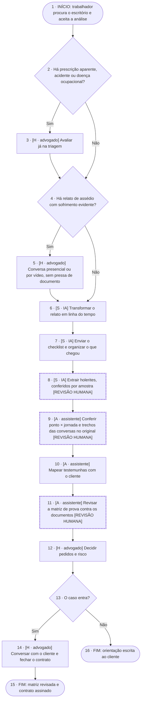

# POP: Triagem e organização de provas do reclamante

Setor: Atendimento e triagem · Área: Trabalhista (lado do trabalhador) · Versão: biblioteca 1.0 · Atualizado em: [A DEFINIR ao adaptar] · Dono do POP: [A DEFINIR]

> POP de referência da biblioteca, escrito para um escritório genérico de 3 a 10 pessoas. 10 passos: 4 S, 4 A, 2 H. Prazos são exemplos e só valem depois que o escritório decidir. O indicador é sugestão da biblioteca (o material de origem não trazia indicador para os POPs de área). Prazo prescricional e regra técnica nunca entram de memória [CONFERIR]. Para usar, adapte pela entrada B do `escrever-pop`.

## 1. Objetivo

Sair do relato solto do trabalhador e chegar a uma matriz que mostra, pedido por pedido, que prova existe, onde ela está e o que falta, antes de decidir se o caso entra.

## 2. Gatilho

O trabalhador procura o escritório (depois da demissão ou durante o contrato) e aceita a análise.

## 3. Responsáveis

- Executa: Atendimento (recebe o relato e os documentos); assistente ou estagiária (organiza).
- Confere: assistente (holerites, ponto, matriz contra os documentos).
- Decide: advogado (pedidos, risco e conversa com o cliente).

## 4. Entradas

- Relato do cliente (texto ou áudio).
- CTPS, contrato, holerites.
- Cartões de ponto ou registros de jornada.
- TRCT e guias, extrato do FGTS.
- Conversas de WhatsApp e e-mails, fotos.
- Atestados.
- Nomes de testemunhas.
- Checklists por pedido e modelo de matriz de prova aprovado.

## 5. Passo a passo com S, A e H

1. [S] Transformar o relato em linha do tempo: o áudio de 12 minutos vira admissão, funções, jornada, episódios, saída. Executa: IA. Confere: assistente lê a linha do tempo junto com o cliente ou com o relato original.
2. [S] Enviar o checklist de documentos conforme o relato (horas extras, insalubridade, assédio, acidente). Executa: IA. Confere: assistente confere se o checklist bate com os pedidos do relato.
3. [S] Organizar o que chegou (tipo, período, nome padrão) e apontar lacunas, como "faltam holerites de março a junho". Executa: IA. Confere: assistente, por amostra.
4. [S] Extrair os holerites para planilha (salário, rubricas, horas extras pagas, adicionais, descontos, mês a mês). Executa: IA. Confere: assistente compara uma amostra com o original.
5. [A] Comparar cartão de ponto × jornada relatada (horários sempre iguais, intervalos, meses sem registro). Executa: IA aponta. Confere: assistente confere cada apontamento e anota.
6. [A] Separar o que importa nas conversas (data, hora, remetente). O arquivo original exportado fica guardado sem alteração, porque é ele que vai para o processo. Executa: IA. Confere: assistente confere cada trecho no arquivo original.
7. [A] Mapear as testemunhas: quem é e o que presenciou, segundo o cliente. Contato com testemunha é sempre feito por pessoa. Executa: IA organiza. Confere: assistente confirma com o cliente.
8. [A] Montar a matriz de prova (pedido, prova, onde está, força, lacuna). Executa: IA preenche. Confere: assistente revisa contra os documentos.
9. [H] Decidir o caso: pedidos que seguem e que ficam fora, e o risco, incluindo a sucumbência para o cliente. Executa: advogado. Confere: não se aplica.
10. [H] Conversar com o cliente: o que entra e por quê, expectativa de prazo e de valor, fechar o contrato. Executa: advogado. Confere: não se aplica.

## 6. Prazo

Exemplo (meta sugerida): matriz em até 3 dias úteis depois da documentação completa. No escritório: [A DEFINIR, do código do escritório]. A prescrição é conferida pelo advogado no primeiro contato, antes de qualquer meta [CONFERIR].

## 7. Exceções

- Acidente ou doença ocupacional: o advogado entra já na triagem.
- Assédio com sofrimento evidente: conversa presencial ou por vídeo, sem pressa de pedir documento.
- Cliente ainda empregado: cuidado redobrado com o que ele traz da empresa, com orientação do advogado.
- Prescrição aparente no primeiro contato: o advogado avalia antes de qualquer outro passo.

## 8. Saída

Matriz revisada, decisão registrada, contrato assinado ou orientação escrita.

## 9. Onde a IA entra

- Passos S: linha do tempo do relato, checklist, organização dos documentos, holerites.
- Passos A: ponto × jornada, conversas, testemunhas, matriz de prova.
- O que a IA consulta: checklists por pedido, modelo de matriz aprovado.
- Ambiente: Projeto no Claude com a base do Trabalhista, em conta profissional. Transcrição de áudio só com consentimento do cliente.

## 10. Nunca sai sem revisão humana

- Decisão sobre os pedidos.
- Avaliação de risco.
- Valor estimado informado ao cliente.

## 11. Dados pessoais e sensíveis

- Dados que aparecem: atestados, laudos e relatos de assédio (saúde e foro íntimo); conversas com dados de terceiros (colegas, chefes); salários de terceiros.
- Anonimizar: o cliente e também os terceiros ([CLIENTE], [EMPRESA], [COLEGA 1]); conta profissional; mínimo necessário.
- Nunca na IA: o arquivo original da conversa (fica intacto e fora da IA, porque é a prova); trabalhe sobre cópia.
- Contato com testemunha nunca automatizado.

## 12. Indicador (sugestão da biblioteca)

- Tempo da documentação completa à matriz revisada (média do mês).
- Lacunas de prova descobertas depois do contrato (contagem no mês).

## Na trilha solo

- Com estagiária, ela organiza e confere; sem ninguém, o titular revisa a matriz em outro momento, com o checklist por pedido aberto.
- A conversa sobre risco (passo 10) continua com o titular, sem roteiro automático.

## Fluxograma

Desenhado a partir dos passos (o material não trazia fluxograma deste POP).

**Em texto:**
1. INÍCIO: trabalhador procura o escritório e aceita a análise.
2. DECISÃO: há prescrição aparente, acidente ou doença ocupacional? Se sim, vá para 3. Se não, vá para 4.
3. AÇÃO [H · advogado] Avaliar já na triagem. Vá para 4.
4. DECISÃO: há relato de assédio com sofrimento evidente? Se sim, vá para 5. Se não, vá para 6.
5. AÇÃO [H · advogado] Conversa presencial ou por vídeo, sem pressa de pedir documento. Vá para 6.
6. AÇÃO [S · IA] Transformar o relato em linha do tempo. Vá para 7.
7. AÇÃO [S · IA] Enviar o checklist e organizar o que chegou. Vá para 8.
8. AÇÃO [S · IA] Extrair holerites, conferidos por amostra [REVISÃO HUMANA]. Vá para 9.
9. AÇÃO [A · assistente] Conferir ponto × jornada e trechos das conversas no original [REVISÃO HUMANA]. Vá para 10.
10. AÇÃO [A · assistente] Mapear testemunhas com o cliente. Vá para 11.
11. AÇÃO [A · assistente] Revisar a matriz de prova contra os documentos [REVISÃO HUMANA]. Vá para 12.
12. AÇÃO [H · advogado] Decidir pedidos e risco. Vá para 13.
13. DECISÃO: o caso entra? Se sim, vá para 14. Se não, vá para 16.
14. AÇÃO [H · advogado] Conversar com o cliente e fechar o contrato. Vá para 15.
15. FIM: matriz revisada, decisão registrada, contrato assinado.
16. FIM: decisão registrada e orientação escrita ao cliente.

Caminho principal: relato → linha do tempo → documentos → holerites → ponto e conversas → testemunhas → matriz → decisão → contrato.
