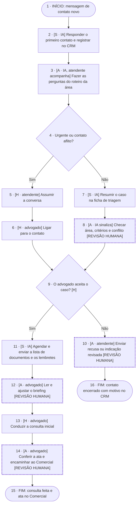

# POP: Triagem do primeiro contato e consulta inicial

Setor: Atendimento e triagem · Área: todas · Versão: biblioteca 1.0 · Atualizado em: [A DEFINIR ao adaptar] · Dono do POP: [A DEFINIR]

> POP de referência da biblioteca, escrito para um escritório genérico com equipe. 12 passos: 5 S, 5 A, 2 H. Prazos são exemplos e só valem depois que o escritório decidir. Para usar, adapte pela entrada B do `escrever-pop`.

## 1. Objetivo

Responder todo contato novo com rapidez, entender o caso, decidir se o escritório atende e chegar à consulta inicial com o caso organizado.

## 2. Gatilho

Mensagem de quem ainda não é cliente (WhatsApp, site, e-mail, telefone, indicação).

## 3. Responsáveis

- Executa: atendente (triagem e agenda).
- Confere: atendente, no fechamento do dia, o que a IA registrou e respondeu.
- Decide: advogado da área (aceite e condução da consulta).

## 4. Entradas

- Mensagem do contato.
- Roteiro de triagem por área.
- Critérios de aceite (do código do escritório).
- Lista de documentos por tipo de caso.
- Agenda.

## 5. Passo a passo com S, A e H

1. [S] Responder o primeiro contato com boas-vindas no tom do escritório, horário e próximo passo, inclusive fora do expediente. Executa: IA, a partir de modelo aprovado; nunca dá orientação jurídica nem se apresenta como advogado. Confere: atendente, por amostra no fechamento do dia [A DEFINIR tamanho da amostra].
2. [S] Registrar o contato no CRM ou na planilha (nome, canal, origem, área provável, data). Executa: IA. Confere: atendente, no fechamento do dia.
3. [A] Fazer as perguntas do roteiro da área, uma de cada vez. Executa: IA. Confere: atendente acompanha a conversa e assume se ela sai do roteiro ou se o contato demonstra aflição.
4. [S] Organizar as respostas no resumo do caso (fatos, datas, documentos, o que a pessoa quer). Executa: IA, na ficha de triagem padrão. Confere: atendente, junto com o passo 5.
5. [A] Checar área, critérios de aceite e conflito de interesse, com alertas (prescrição aparente, fora da área, parte contrária já cliente). Executa: IA sinaliza. Confere: atendente lê os alertas e leva ao advogado.
6. [H] Decidir aceitar, encaminhar ou recusar o caso. Executa: advogado da área. Confere: não se aplica (decisão registrada no CRM).
7. [A] Responder quem não será atendido, com recusa cordial ou indicação. Executa: IA rascunha. Confere: atendente lê o texto inteiro, confere tom e ausência de orientação jurídica, e envia.
8. [S] Agendar a consulta e enviar a confirmação com a lista de documentos. Executa: IA, com a agenda e a lista da base. Confere: atendente, por amostra.
9. [S] Enviar lembretes na véspera e no dia da consulta. Executa: IA. Confere: atendente, quando houver remarcação.
10. [A] Preparar o briefing de uma página para o advogado (resumo, dúvidas, alertas, perguntas sugeridas). Executa: IA. Confere: advogado lê e ajusta antes da consulta.
11. [H] Conduzir a consulta inicial (escuta, análise, orientação, expectativa realista). Executa: advogado. Confere: não se aplica.
12. [A] Registrar a ata no modelo e encaminhar ao Comercial. Executa: IA, a partir das anotações ou de transcrição feita com consentimento do cliente. Confere: advogado confere fatos, pedidos e combinados antes do encaminhamento.

## 6. Prazo

Exemplo: primeira resposta imediata, retorno humano no mesmo dia útil, consulta em até 5 dias úteis. No escritório: [A DEFINIR, do código do escritório].

## 7. Exceções

- Urgência (prisão, liminar, prazo correndo, violência doméstica): pula a fila e vai ao advogado por telefone.
- Contato aflito ou vulnerável: a atendente assume a conversa.
- Parte contrária de cliente atual: a triagem para e o advogado decide.
- Advogado recusa o caso: recusa cordial ou indicação, revisada (passo 7), e motivo registrado no CRM.

## 8. Saída

Caso aceito, consulta feita e ata no Comercial; ou contato encerrado com o motivo registrado no CRM.

## 9. Onde a IA entra

- Passos S: resposta inicial, registro no CRM, resumo do caso, agendamento e lembretes.
- Passos A: roteiro de triagem, checagem de critérios e conflito, recusa, briefing, ata.
- O que a IA consulta: roteiro de triagem por área, critérios de aceite, lista de documentos por tipo de caso.
- Ambiente: Projeto no Claude com o código do escritório, em conta profissional. A pessoa sabe que fala com o atendimento do escritório; a IA nunca se passa por advogado.

## 10. Nunca sai sem revisão humana

- Aceitar ou recusar o caso.
- Frase que pareça orientação jurídica ou estimativa de resultado.
- Mensagem de recusa.
- Ata da consulta.

## 11. Dados pessoais e sensíveis

- Dados que aparecem: nome, contato, relato do problema, às vezes dado de saúde, de criança ou de violência.
- Anonimizar: nome por [CLIENTE], telefone e e-mail por [CONTATO] em tudo o que não precisar do dado (resumo para teste, briefing guardado como exemplo).
- Nunca na IA: relato de violência (vai direto ao advogado); senha e credencial.
- Gravação ou transcrição da consulta só com consentimento.

## 12. Indicador

- Tempo do primeiro contato à primeira resposta humana (medir pelo CRM, média do mês).
- Proporção de contatos que chegam à consulta (consultas ÷ contatos novos do mês).

---

## Antes e com a IA

| Passo | Como era antes da IA | Como fica com a IA | Sigla |
|---|---|---|---|
| Primeiro contato | Respondido quando alguém vê, muitas vezes no dia seguinte | Resposta na hora, no tom do escritório, com o próximo passo | S |
| Triagem | Perguntas de cabeça, diferentes a cada atendente | Roteiro escrito conduzido pela IA, com a atendente acompanhando | A |
| Preparar a consulta | O advogado descobre o caso quando o cliente senta na frente dele | Briefing de uma página com resumo, alertas e perguntas | A |
| Consulta inicial | Advogado conduz | Continua com o advogado, agora com mais tempo para ouvir | H |

## Na trilha solo

- "A atendente assume" vira "o advogado assume": urgência e aflição vão direto para ele.
- Os passos 1, 2 e 8 são conferidos pelo titular num horário fixo do dia, nunca logo depois de a IA responder.
- A recusa (passo 7) é lida no dia seguinte, com o checklist de tom, antes de enviar.

## Fluxograma

Fluxograma do material, completado com os passos do POP.

**Em texto:**
1. INÍCIO: mensagem de contato novo.
2. AÇÃO [S · IA] Responder o primeiro contato e registrar no CRM. Vá para 3.
3. AÇÃO [A · IA, atendente acompanha] Fazer as perguntas do roteiro da área. Vá para 4.
4. DECISÃO: urgente ou contato aflito? Se sim, vá para 5. Se não, vá para 7.
5. AÇÃO [H · atendente] Assumir a conversa. Vá para 6.
6. AÇÃO [H · advogado] Ligar para o contato. Vá para 9.
7. AÇÃO [S · IA] Resumir o caso na ficha de triagem. Vá para 8.
8. AÇÃO [A · IA sinaliza] Checar área, critérios e conflito [REVISÃO HUMANA]. Vá para 9.
9. DECISÃO: o advogado aceita o caso? Se sim, vá para 11. Se não, vá para 10.
10. AÇÃO [A · atendente] Enviar recusa ou indicação revisada [REVISÃO HUMANA]. Vá para 16.
11. AÇÃO [S · IA] Agendar, enviar a lista de documentos e os lembretes. Vá para 12.
12. AÇÃO [A · advogado] Ler e ajustar o briefing [REVISÃO HUMANA]. Vá para 13.
13. AÇÃO [H · advogado] Conduzir a consulta inicial. Vá para 14.
14. AÇÃO [A · advogado] Conferir a ata e encaminhar ao Comercial [REVISÃO HUMANA]. Vá para 15.
15. FIM: consulta feita e ata no Comercial.
16. FIM: contato encerrado com motivo no CRM.

Caminho principal: contato novo → resposta e registro → roteiro → resumo e checagem → aceite → agenda → briefing → consulta → ata no Comercial.
