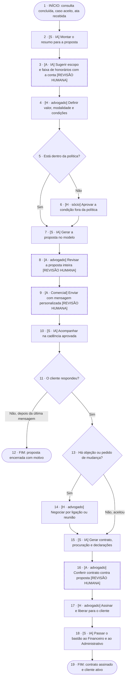

# POP: Proposta de honorários e contrato

Setor: Comercial · Área: todas · Versão: biblioteca 1.0 · Atualizado em: [A DEFINIR ao adaptar] · Dono do POP: [A DEFINIR]

> POP de referência da biblioteca, escrito para um escritório genérico com equipe. 12 passos: 5 S, 4 A, 3 H. Prazos são exemplos e só valem depois que o escritório decidir. Para usar, adapte pela entrada B do `escrever-pop`.

## 1. Objetivo

Transformar a consulta em contrato assinado, com proposta clara, preço coerente com a política do escritório e acompanhamento que não depende da memória de ninguém.

## 2. Gatilho

Consulta inicial concluída com caso aceito e ata recebida do Atendimento.

## 3. Responsáveis

- Executa: Comercial ou secretaria (monta, envia e acompanha).
- Confere: advogado responsável (proposta e contrato).
- Decide: advogado responsável (preço e condições); sócio, no que estiver fora da política.

## 4. Entradas

- Ata da consulta.
- Tabela interna de honorários (com a tabela da seccional da OAB como referência).
- Modelos de proposta e de contrato por área.
- Política de desconto e parcelamento.
- Mensagens de acompanhamento aprovadas.

## 5. Passo a passo com S, A e H

1. [S] Montar o resumo para a proposta a partir da ata (o que o cliente quer, o que o escritório fará, o que fica de fora). Executa: IA. Confere: advogado, junto com o passo 2.
2. [A] Sugerir escopo e faixa de honorários pela tabela interna e por casos parecidos, mostrando a conta. Executa: IA. Confere: advogado usa como ponto de partida e refaz a conta.
3. [H] Definir valor, modalidade (fixo, êxito ou misto) e condições. Executa: advogado; fora da política, sócio. Confere: não se aplica (decisão registrada na ficha).
4. [S] Gerar a proposta no modelo (escopo, exclusões, valores, forma de pagamento, validade). Executa: IA. Confere: passo 5.
5. [A] Revisar a proposta: valores iguais em todo o texto, escopo igual à ata, validade, nenhuma promessa de resultado. Executa: IA aponta. Confere: advogado lê a proposta inteira e aprova.
6. [A] Enviar a proposta com mensagem personalizada que retoma a consulta. Executa: IA rascunha. Confere: Comercial ajusta o tom e envia.
7. [S] Acompanhar em datas fixas com mensagens aprovadas, parando quando o cliente responde (exemplo: 2, 5 e 10 dias). Executa: IA. Confere: Comercial, no relatório semanal.
8. [H] Negociar objeção de preço, desconto ou mudança de escopo. Executa: advogado, por ligação ou reunião. Confere: não se aplica.
9. [S] Gerar o contrato de honorários com os dados da proposta, mais procuração e declarações. Executa: IA. Confere: passo 10.
10. [A] Conferir contrato contra proposta e listar divergências. Executa: IA aponta. Confere: advogado revisa as cláusulas uma a uma.
11. [H] Assinar e liberar o envio para assinatura do cliente. Executa: advogado. Confere: não se aplica.
12. [S] Passar o bastão: cobrança cadastrada no Financeiro, pasta e lista de documentos no Administrativo, boas-vindas ao cliente. Executa: IA. Confere: Comercial confere os três registros.

## 6. Prazo

Exemplo: proposta até 1 dia útil após a consulta; validade definida no modelo. No escritório: [A DEFINIR, do código do escritório].

## 7. Exceções

- Só êxito ou condição fora da política: exige o sócio antes do envio.
- Gratuidade ou parcelamento longo: seguem a política escrita, sem improviso.
- Cliente mudo depois da última mensagem da cadência: proposta encerrada com motivo e lembrete para retomar.
- Divergência entre contrato e proposta (passo 10): volta ao passo 9 antes de qualquer assinatura (sugestão da biblioteca).

## 8. Saída

Contrato assinado pelas duas partes, cobrança cadastrada e cliente ativo; ou proposta encerrada com o motivo da perda.

## 9. Onde a IA entra

- Passos S: resumo, proposta no modelo, cadência de acompanhamento, contrato, passagem do bastão.
- Passos A: faixa de preço, revisão da proposta, mensagem de envio, conferência do contrato.
- O que a IA consulta: tabela interna, modelos de proposta e contrato, histórico de propostas, mensagens aprovadas.
- Ambiente: Projeto no Claude com o código e os modelos do setor. Valores e dados só em conta profissional.

## 10. Nunca sai sem revisão humana

- Valor final e condições.
- Cláusulas do contrato.
- Frase que soe como promessa de resultado.

## 11. Dados pessoais e sensíveis

- Dados que aparecem: dados pessoais e de contato do cliente, valores, condições de pagamento, resumo do caso.
- Anonimizar: nome e documentos ao usar propostas antigas como referência de faixa ([CLIENTE], [DOC]).
- Nunca na IA: dados bancários do cliente além do necessário; senha e credencial.
- Histórico de propostas guardado sem dado de cliente quando servir de base para a faixa de preço.

## 12. Indicador

- Consultas que viram contrato (contratos ÷ consultas do mês).
- Tempo da consulta à proposta enviada (média do mês) e motivos de perda (contagem por motivo).

---

## Antes e com a IA

| Passo | Como era antes da IA | Como fica com a IA | Sigla |
|---|---|---|---|
| Escrever a proposta | Copiada de uma proposta antiga, trocando nome e valor | Gerada no modelo a partir da ata, com escopo e exclusões | S |
| Acompanhamento | Depende de alguém lembrar; na maioria das vezes, ninguém lembra | Cadência fixa com mensagens aprovadas, que para quando o cliente responde | S |
| Conferir o contrato | Leitura rápida antes de assinar | IA compara com a proposta e aponta divergências, advogado revisa | A |
| Definir o preço | Advogado decide | Continua com o advogado, partindo de uma faixa calculada | H |

## Na trilha solo

- "Fora da política, o sócio aprova" vira política escrita de desconto e parcelamento, ou pausa de 24 horas antes de responder a uma condição fora dela.
- A revisão da proposta (passo 5) é feita em outro momento do dia, não logo depois de gerar.

## Fluxograma

Desenhado a partir dos passos (o material não trazia fluxograma deste POP).

**Em texto:**
1. INÍCIO: consulta concluída, caso aceito, ata recebida.
2. AÇÃO [S · IA] Montar o resumo para a proposta. Vá para 3.
3. AÇÃO [A · IA] Sugerir escopo e faixa com a conta [REVISÃO HUMANA]. Vá para 4.
4. AÇÃO [H · advogado] Definir valor, modalidade e condições. Vá para 5.
5. DECISÃO: está dentro da política? Se sim, vá para 7. Se não, vá para 6.
6. AÇÃO [H · sócio] Aprovar a condição fora da política. Vá para 7.
7. AÇÃO [S · IA] Gerar a proposta no modelo. Vá para 8.
8. AÇÃO [A · advogado] Revisar a proposta inteira [REVISÃO HUMANA]. Vá para 9.
9. AÇÃO [A · Comercial] Enviar com mensagem personalizada [REVISÃO HUMANA]. Vá para 10.
10. AÇÃO [S · IA] Acompanhar na cadência aprovada. Vá para 11.
11. DECISÃO: o cliente respondeu? Se sim, vá para 13. Se não, depois da última mensagem, vá para 12.
12. FIM: proposta encerrada com motivo e lembrete para retomar.
13. DECISÃO: há objeção ou pedido de mudança? Se sim, vá para 14. Se não, vá para 15.
14. AÇÃO [H · advogado] Negociar por ligação ou reunião. Vá para 15.
15. AÇÃO [S · IA] Gerar contrato, procuração e declarações. Vá para 16.
16. AÇÃO [A · advogado] Conferir contrato contra proposta [REVISÃO HUMANA]. Vá para 17.
17. AÇÃO [H · advogado] Assinar e liberar para o cliente. Vá para 18.
18. AÇÃO [S · IA] Passar o bastão. Vá para 19.
19. FIM: contrato assinado, cobrança cadastrada, cliente ativo.

Caminho principal: ata → resumo → faixa → preço → proposta revisada → envio → acompanhamento → contrato conferido → assinatura → bastão.
