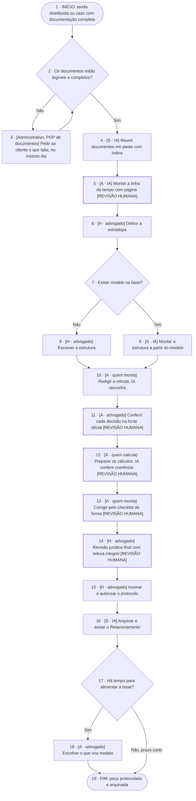

# POP: Elaboração de petição a partir de modelo e documentos

Setor: Produção de peças · Área: todas · Versão: biblioteca 1.0 · Atualizado em: [A DEFINIR ao adaptar] · Dono do POP: [A DEFINIR]

> POP de referência da biblioteca, escrito para um escritório genérico com equipe. 12 passos: 3 S, 6 A, 3 H (o maior número de A da biblioteca). Prazos são exemplos e só valem depois que o escritório decidir. Para usar, adapte pela entrada B do `escrever-pop`.

## 1. Objetivo

Entregar a peça no padrão do escritório, com fatos conferidos nos documentos e fundamentação verificada na fonte, dentro do prazo interno.

## 2. Gatilho

Tarefa distribuída pela controladoria, ou caso novo com documentação completa.

## 3. Responsáveis

- Executa: júnior ou estagiário (monta a minuta).
- Confere: advogado responsável; revisor sênior nas peças de maior risco.
- Decide: advogado responsável (estratégia e assinatura).

## 4. Entradas

- Documentos organizados do caso.
- Ata da consulta.
- Modelo da peça na base.
- Teses aprovadas pelo escritório.
- Checklist da peça.

## 5. Passo a passo com S, A e H

1. [S] Reunir os documentos em pasta com índice, nome padrão e ordem cronológica. Executa: IA, a partir da pasta do Administrativo. Confere: quem monta a minuta, ao abrir a pasta.
2. [A] Montar a linha do tempo com documento e página de cada fato. Executa: IA. Confere: quem monta a minuta confere os fatos centrais no documento e na página citados.
3. [H] Definir a estratégia: tese, pedidos, urgência e o que fica de fora de propósito. Executa: advogado. Confere: não se aplica.
4. [S] Selecionar o modelo e montar a estrutura (endereçamento, qualificação, tópicos com dados do caso). Executa: IA, na base. Confere: quem monta a minuta, no passo 5.
5. [A] Redigir a minuta de fatos e direito a partir da linha do tempo, da tese e das teses aprovadas. Executa: IA rascunha. Confere: quem monta a minuta reescreve o que for preciso.
6. [A] Pesquisar e conferir jurisprudência. Executa: IA localiza e resume. Confere: advogado abre cada decisão na fonte oficial; nenhuma citação entra sem isso.
7. [A] Preparar os cálculos. Executa: quem calcula no escritório faz; a IA organiza os dados. Confere: IA confere a coerência e quem calculou revisa os apontamentos.
8. [A] Revisar a forma pelo checklist: pedidos coerentes com a causa de pedir, valor da causa, documentos citados e anexados, nomes e números iguais, português. Executa: IA aponta. Confere: quem monta a minuta corrige cada apontamento.
9. [H] Fazer a revisão jurídica final com leitura integral. Executa: advogado. Confere: revisor sênior, nas peças de risco.
10. [H] Assinar e autorizar o protocolo. Executa: advogado. Confere: não se aplica.
11. [S] Arquivar e avisar: versão final, registro no sistema, aviso ao Relacionamento. Executa: IA. Confere: quem protocolou.
12. [A] Alimentar a base com trechos e argumentos que valem virar modelo. Executa: IA sugere. Confere: advogado escolhe o que entra.

## 6. Prazo

Exemplo: minuta pronta 3 dias úteis antes do prazo interno; revisão final até a véspera dele. No escritório: [A DEFINIR, do código do escritório]. O prazo processual vem da controladoria, conferido por pessoa.

## 7. Exceções

- Prazo curto ou urgência: pula o passo 12, nunca a revisão final.
- Caso sem modelo: o advogado escreve a estrutura e a peça já nasce candidata a modelo.
- Documento ilegível ou faltando: volta ao Administrativo, que aciona o cliente no mesmo dia.
- Decisão citada que não abre na fonte oficial: sai da peça (sugestão da biblioteca).

## 8. Saída

Peça protocolada, versão final arquivada, cliente avisado e base atualizada.

## 9. Onde a IA entra

- Passos S: pasta de documentos, estrutura a partir do modelo, arquivamento e aviso.
- Passos A: linha do tempo, minuta, apoio na pesquisa, coerência dos cálculos, conferência de forma, curadoria da base.
- O que a IA consulta: modelos de peça, teses aprovadas, checklist da peça.
- Ambiente: Projeto no Claude com o código, os modelos e as teses. Documento em conta profissional, anonimizado quando o dado não for necessário.

## 10. Nunca sai sem revisão humana

- Citação de jurisprudência, doutrina ou lei sem conferência na fonte.
- Pedidos e valor da causa.
- A peça inteira, lida por quem assina.

## 11. Dados pessoais e sensíveis

- Dados que aparecem: qualificação das partes, documentos do caso, às vezes dado de saúde, de criança ou de processo criminal.
- Anonimizar: nome, documentos, endereço e número do processo em tudo que não precisar do dado; trecho que vira modelo na base sempre anonimizado.
- Nunca na IA sem autorização expressa do responsável: laudo completo, dado de criança ou adolescente, processo em segredo de justiça.
- Na peça, só o dado sensível que o pedido exige.

## 12. Indicador

- Rodadas de revisão por peça (média do mês).
- Erros pegos na revisão final, por tipo (fato, citação, cálculo, forma).

---

## Antes e com a IA

| Passo | Como era antes da IA | Como fica com a IA | Sigla |
|---|---|---|---|
| Achar o modelo | Procurar na pasta "modelos_FINAL_v3" ou pedir para um colega | Modelo certo puxado da base, já com os dados do caso | S |
| Fatos | Ler todos os documentos e escrever do zero | Linha do tempo com referência de página, conferida antes da minuta | A |
| Revisão de forma | Depende do cansaço de quem revisa às 18h | Checklist aplicado pela IA em toda peça, correção humana | A |
| Estratégia e assinatura | Advogado | Continua com o advogado, com mais tempo para a tese | H |

## Na trilha solo

- Sem revisor sênior: a revisão final das peças de maior risco é feita em outro dia, ou por revisor externo.
- O checklist de forma (passo 8) é aplicado sempre, mesmo quando a peça "parece pronta"; a IA confere o próprio rascunho como segundo olhar.

## Fluxograma

Desenhado a partir dos passos (o material não trazia fluxograma deste POP).

**Em texto:**
1. INÍCIO: tarefa distribuída ou caso com documentação completa.
2. DECISÃO: os documentos estão legíveis e completos? Se sim, vá para 4. Se não, vá para 3.
3. AÇÃO [Administrativo, POP de documentos] Pedir ao cliente o que falta, no mesmo dia. Volte para 2.
4. AÇÃO [S · IA] Reunir os documentos em pasta com índice. Vá para 5.
5. AÇÃO [A · IA] Montar a linha do tempo com página [REVISÃO HUMANA]. Vá para 6.
6. AÇÃO [H · advogado] Definir a estratégia. Vá para 7.
7. DECISÃO: existe modelo na base? Se sim, vá para 9. Se não, vá para 8.
8. AÇÃO [H · advogado] Escrever a estrutura. Vá para 10.
9. AÇÃO [S · IA] Montar a estrutura a partir do modelo. Vá para 10.
10. AÇÃO [A · quem monta] Redigir a minuta, com rascunho da IA. Vá para 11.
11. AÇÃO [A · advogado] Conferir cada decisão na fonte oficial [REVISÃO HUMANA]. Vá para 12.
12. AÇÃO [A · quem calcula] Preparar os cálculos [REVISÃO HUMANA]. Vá para 13.
13. AÇÃO [A · quem monta] Corrigir pelo checklist de forma [REVISÃO HUMANA]. Vá para 14.
14. AÇÃO [H · advogado] Revisão jurídica final [REVISÃO HUMANA]. Vá para 15.
15. AÇÃO [H · advogado] Assinar e autorizar o protocolo. Vá para 16.
16. AÇÃO [S · IA] Arquivar e avisar o Relacionamento. Vá para 17.
17. DECISÃO: há tempo para alimentar a base? Se sim, vá para 18. Se não, vá para 19.
18. AÇÃO [A · advogado] Escolher o que vira modelo. Vá para 19.
19. FIM: peça protocolada, arquivada, cliente avisado.

O símbolo 3 é tratado no POP de recebimento de documentos do Administrativo, com a sigla de lá.

Caminho principal: tarefa → pasta → linha do tempo → estratégia → estrutura → minuta → jurisprudência → cálculos → forma → revisão final → assinatura → arquivo.
