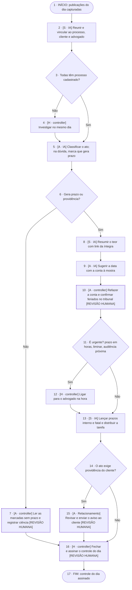

# POP: Tratamento diário de publicações e intimações

Setor: Prazos e controladoria · Área: todas · Versão: biblioteca 1.0 · Atualizado em: [A DEFINIR ao adaptar] · Dono do POP: [A DEFINIR]

> POP de referência da biblioteca, escrito para um escritório genérico com equipe. 10 passos: 5 S, 3 A, 2 H. Prazos são exemplos e só valem depois que o escritório decidir. Para usar, adapte pela entrada B do `escrever-pop`.

## 1. Objetivo

Nenhuma publicação sem dono e nenhum prazo lançado sem conferência humana.

## 2. Gatilho

Todo dia útil, em horário fixo (exemplo: 8h).

## 3. Responsáveis

- Executa: controller (trata as publicações e assina o controle do dia).
- Confere: controller refaz a conta de cada prazo; o advogado do processo recebe a tarefa e lê a íntegra.
- Decide: sócio responde pelo procedimento.

## 4. Entradas

- Publicações capturadas (sistema ou diários).
- Intimações nos sistemas dos tribunais.
- Processos ativos com responsável.
- Tabela de prazos.
- Calendário de feriados e suspensões.
- Matriz de distribuição.

## 5. Passo a passo com S, A e H

1. [S] Reunir publicações e intimações do dia numa lista única, sem duplicidade. Executa: IA. Confere: controller compara o total capturado com o total da lista.
2. [S] Vincular cada uma a processo, cliente e advogado. Executa: IA; publicação sem processo cadastrado vira alerta imediato. Confere: controller trata os alertas.
3. [A] Classificar o ato e indicar se gera prazo ou providência; na dúvida, a IA marca "gera prazo". Executa: IA. Confere: controller lê todas as marcadas "sem prazo".
4. [S] Resumir o teor para o advogado, com link da íntegra. Executa: IA; o resumo é uso interno. Confere: a íntegra é lida por quem cumpre o ato.
5. [A] Sugerir a data-limite com a conta à mostra (termo inicial, dias úteis, feriados, suspensões). Executa: IA, com a tabela de prazos e o calendário. Confere: controller refaz a conta antes de aceitar a data.
6. [S] Lançar na agenda o prazo interno e o fatal (exemplo: interno 2 dias úteis antes). Executa: IA, só o que o controller conferiu. Confere: controller, no fechamento do dia (passo 10).
7. [S] Distribuir a tarefa pela matriz de distribuição, com resumo, prazos e link. Executa: IA. Confere: advogado do processo confirma o recebimento.
8. [A] Avisar o cliente quando o ato exige providência dele (documento, comparecimento, perícia). Executa: IA rascunha. Confere: Relacionamento revisa e envia.
9. [H] Tratar o urgente na hora (prazo em horas, liminar, audiência próxima), ligando para o advogado. Executa: controller. Confere: não se aplica.
10. [H] Fechar o controle do dia: capturadas × tratadas, lançamentos conferidos, assinatura. Executa: controller, com o relatório montado pela IA. Confere: sócio, por amostra [A DEFINIR frequência].

## 6. Prazo

Exemplo: concluído até as 11h do mesmo dia útil. No escritório: [A DEFINIR, do código do escritório]. Contagem de prazo processual: sempre conferida na fonte [CONFERIR].

## 7. Exceções

- Processo não cadastrado: investigação no mesmo dia.
- Feriado local ou suspensão: confirmar no site do tribunal antes de lançar.
- Falha na captura: consulta manual nos tribunais principais.
- Controller ausente: substituto definido por escrito, nunca "quem estiver livre".
- Conta da IA diferente da conta do controller: vale a do controller, e a divergência é anotada para o indicador (sugestão da biblioteca).

## 8. Saída

Tudo vinculado, classificado e distribuído; prazos interno e fatal lançados; controle do dia assinado.

## 9. Onde a IA entra

- Passos S: leitura, vínculo, resumo, lançamento do que foi conferido, distribuição.
- Passos A: classificação do ato, sugestão de data, aviso ao cliente.
- O que a IA consulta: tabela de prazos, calendário de feriados e suspensões, matriz de distribuição. Sempre mostra a conta.
- Ambiente: Projeto no Claude com o código e as tabelas do setor, em conta profissional.

## 10. Nunca sai sem revisão humana

- Data do prazo fatal.
- Publicação marcada "sem prazo".
- Caso urgente.

## 11. Dados pessoais e sensíveis

- Dados que aparecem: nomes das partes, número do processo, teor de decisões, às vezes dado de saúde ou de criança.
- Anonimizar: no resumo usado fora do sistema do escritório, [CLIENTE] e [PROCESSO].
- Nunca na IA sem autorização expressa do responsável: publicação de processo em segredo de justiça.
- Senha e certificado de acesso aos sistemas dos tribunais nunca entram na IA.

## 12. Indicador

- Tratadas ÷ capturadas (meta: todas).
- Divergências na conferência da data (quantas vezes a conta do controller diferiu da sugestão da IA, por mês).

---

## Antes e com a IA

| Passo | Como era antes da IA | Como fica com a IA | Sigla |
|---|---|---|---|
| Ler e vincular | Uma por uma, a manhã inteira | Lista pronta, vinculada ao processo e ao responsável | S |
| Calcular a data | Conta feita de cabeça ou em calculadora, uma vez só | IA sugere com a conta à mostra e o controller refaz. Conferência dupla | A |
| Distribuir | Mensagem solta no grupo da equipe | Tarefa com resumo, prazos e link para o responsável certo | S |
| Assinar o controle | Raramente existia | Controller fecha o dia e assina | H |

## Na trilha solo

- A conferência dupla do passo 5 perde a independência. Compensação: refazer a conta num segundo momento do dia (por exemplo, a sugestão da manhã é conferida no fechamento), com o checklist da contagem, e manter o passo como A.
- A matriz de distribuição vira lista de tarefas pessoal.
- Substituto do controller vira plano de ausência: quem consulta as publicações em férias, audiência ou doença [A DEFINIR].

## Fluxograma

Fluxograma do material, completado com os passos e exceções do POP.

**Em texto:**
1. INÍCIO: publicações do dia capturadas.
2. AÇÃO [S · IA] Reunir e vincular ao processo, cliente e advogado. Vá para 3.
3. DECISÃO: todas têm processo cadastrado? Se sim, vá para 5. Se não, vá para 4.
4. AÇÃO [H · controller] Investigar no mesmo dia. Vá para 5.
5. AÇÃO [A · IA] Classificar o ato; na dúvida, marca que gera prazo. Vá para 6.
6. DECISÃO: gera prazo ou providência? Se sim, vá para 8. Se não, vá para 7.
7. AÇÃO [A · controller] Ler as marcadas sem prazo e registrar ciência [REVISÃO HUMANA]. Vá para 16.
8. AÇÃO [S · IA] Resumir o teor com link da íntegra. Vá para 9.
9. AÇÃO [A · IA] Sugerir a data com a conta à mostra. Vá para 10.
10. AÇÃO [A · controller] Refazer a conta e confirmar feriados no tribunal [REVISÃO HUMANA]. Vá para 11.
11. DECISÃO: é urgente? Se sim, vá para 12. Se não, vá para 13.
12. AÇÃO [H · controller] Ligar para o advogado na hora. Vá para 13.
13. AÇÃO [S · IA] Lançar prazos interno e fatal e distribuir a tarefa. Vá para 14.
14. DECISÃO: o ato exige providência do cliente? Se sim, vá para 15. Se não, vá para 16.
15. AÇÃO [A · Relacionamento] Revisar e enviar o aviso ao cliente [REVISÃO HUMANA]. Vá para 16.
16. AÇÃO [H · controller] Fechar e assinar o controle do dia [REVISÃO HUMANA]. Vá para 17.
17. FIM: tudo vinculado, prazos lançados, controle assinado.

O símbolo 4 é exceção do POP (processo não cadastrado), tratada por pessoa.

Caminho principal: captura → vínculo → classificação → resumo → data sugerida → conta refeita → lançamento e distribuição → controle assinado.
