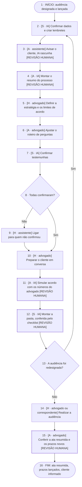

# POP: Preparação de audiência

Setor: Audiências e diligências · Área: todas · Versão: biblioteca 1.0 · Atualizado em: [A DEFINIR ao adaptar] · Dono do POP: [A DEFINIR]

> POP de referência da biblioteca, escrito para um escritório genérico com equipe. 11 passos: 3 S, 5 A, 3 H. Prazos são exemplos e só valem depois que o escritório decidir. Para usar, adapte pela entrada B do `escrever-pop`.

## 1. Objetivo

Chegar à audiência com o cliente preparado, testemunhas confirmadas, roteiro pronto e logística resolvida, sem correria na véspera.

## 2. Gatilho

Audiência designada e lançada na agenda pela controladoria.

## 3. Responsáveis

- Executa: assistente (logística e contatos).
- Confere: advogado da audiência (resumo, roteiro, ata); assistente (pasta, pelo checklist).
- Decide: advogado da audiência (estratégia e limites de acordo, com o cliente). O correspondente, quando houver, recebe a pasta completa.

## 4. Entradas

- Peças e documentos do processo.
- Rol de testemunhas.
- Dados da audiência (data, modalidade, link ou endereço).
- Checklist por tipo de audiência.
- Autorização do cliente para os limites de acordo.

## 5. Passo a passo com S, A e H

1. [S] Confirmar os dados da audiência e criar os lembretes (exemplo: 7, 2 e 1 dia antes). Executa: IA. Confere: assistente confere data, modalidade e link ou endereço.
2. [A] Avisar o cliente: o que acontece, data, formato, o que levar, como se comportar. Executa: IA rascunha a partir do modelo. Confere: assistente confere os dados e envia.
3. [A] Montar o resumo do processo: alegações, pontos controvertidos, o que provar. Executa: IA. Confere: advogado confere com os autos.
4. [H] Definir a estratégia: o que provar, perguntas-chave, postura, limites de acordo autorizados. Executa: advogado. Confere: não se aplica.
5. [A] Preparar o roteiro de perguntas para partes e testemunhas. Executa: IA sugere. Confere: advogado ajusta.
6. [S] Confirmar as testemunhas (contato, endereço ou intimação, link, registro). Executa: IA. Confere: assistente liga para quem não confirmou.
7. [H] Conversar com o cliente para prepará-lo. A testemunha recebe orientação sobre o ato, nunca sobre o conteúdo do depoimento. Executa: advogado. Confere: não se aplica.
8. [A] Simular cenários de acordo com os números do advogado. Executa: IA calcula. Confere: advogado confere a conta e decide os limites com o cliente.
9. [S] Montar a pasta: resumo, roteiro, documentos, procuração, carta de preposição ou substabelecimento. Executa: IA. Confere: assistente, pelo checklist do tipo de audiência.
10. [H] Realizar a audiência. Executa: advogado ou correspondente. Confere: não se aplica.
11. [A] Fechar o pós-audiência: ata em linguagem simples, próximos passos, prazos novos. Executa: IA. Confere: advogado confere a ata; controladoria lança os prazos com conferência; Relacionamento envia ao cliente.

## 6. Prazo

Exemplo: pasta completa e cliente preparado até 2 dias úteis antes. No escritório: [A DEFINIR, do código do escritório].

## 7. Exceções

- Redesignação: reinicia no passo 1.
- Correspondente: pasta e alinhamento até 2 dias antes (exemplo).
- Testemunha impedida: o advogado decide o pedido no mesmo dia.
- Testemunha que não confirma depois da ligação: o advogado decide se pede intimação ou substituição [A DEFINIR].

## 8. Saída

Audiência realizada, ata resumida, prazos lançados e cliente informado.

## 9. Onde a IA entra

- Passos S: lembretes, confirmação de testemunhas, pasta.
- Passos A: aviso ao cliente, resumo do processo, roteiro, simulação de acordo, resumo da ata.
- O que a IA consulta: checklist por tipo de audiência, modelos de mensagem.
- Ambiente: Projeto no Claude com o código e os modelos do setor, em conta profissional.

## 10. Nunca sai sem revisão humana

- Estratégia e limites de acordo.
- Orientação a cliente e testemunha.
- Resumo da ata enviado ao cliente.

## 11. Dados pessoais e sensíveis

- Dados que aparecem: dados das partes e das testemunhas (contato, endereço), teor do processo, valores de acordo.
- Anonimizar: nomes de testemunhas e partes no resumo e no roteiro usados como exemplo; [CONTATO] e [ENDEREÇO] fora da agenda.
- Nunca na IA: dado de processo em segredo de justiça sem autorização expressa do responsável.
- Limites de acordo autorizados pelo cliente ficam só na pasta do caso.

## 12. Indicador

- Audiências com pasta completa no prazo interno (completas ÷ realizadas no mês).
- Adiamentos por falha de preparação (contagem no mês).

---

## Antes e com a IA

| Passo | Como era antes da IA | Como fica com a IA | Sigla |
|---|---|---|---|
| Resumo do processo | Releitura dos autos na véspera | Resumo com pontos controvertidos, conferido com calma | A |
| Testemunhas | Ligação de última hora para saber se a pessoa vai | Confirmação registrada com antecedência, ligação só para quem não respondeu | S |
| Preparar o cliente | Conversa rápida no corredor do fórum | Mensagem explicativa antes e conversa com o advogado | H |

## Na trilha solo

- O correspondente é mais provável no solo: a pasta completa (passo 9) e o alinhamento antes da audiência ganham peso.
- O titular faz a logística e a conferência: separe um horário fixo para conferir a pasta pelo checklist, longe do dia da audiência.

## Fluxograma

Desenhado a partir dos passos (o material não trazia fluxograma deste POP).

**Em texto:**
1. INÍCIO: audiência designada e lançada.
2. AÇÃO [S · IA] Confirmar dados e criar lembretes. Vá para 3.
3. AÇÃO [A · assistente] Avisar o cliente, com rascunho da IA [REVISÃO HUMANA]. Vá para 4.
4. AÇÃO [A · IA] Montar o resumo do processo [REVISÃO HUMANA]. Vá para 5.
5. AÇÃO [H · advogado] Definir a estratégia e os limites de acordo. Vá para 6.
6. AÇÃO [A · advogado] Ajustar o roteiro de perguntas. Vá para 7.
7. AÇÃO [S · IA] Confirmar testemunhas. Vá para 8.
8. DECISÃO: todas confirmaram? Se sim, vá para 10. Se não, vá para 9.
9. AÇÃO [H · assistente] Ligar para quem não confirmou. Vá para 10.
10. AÇÃO [H · advogado] Preparar o cliente em conversa. Vá para 11.
11. AÇÃO [A · IA] Simular acordo com os números do advogado [REVISÃO HUMANA]. Vá para 12.
12. AÇÃO [S · IA] Montar a pasta, conferida pelo checklist [REVISÃO HUMANA]. Vá para 13.
13. DECISÃO: a audiência foi redesignada? Se sim, volte para 2. Se não, vá para 14.
14. AÇÃO [H · advogado ou correspondente] Realizar a audiência. Vá para 15.
15. AÇÃO [A · advogado] Conferir a ata resumida e os prazos novos [REVISÃO HUMANA]. Vá para 16.
16. FIM: ata resumida, prazos lançados, cliente informado.

O símbolo 9 é a conferência do passo 6 do POP (a ligação é sempre de uma pessoa).

Caminho principal: audiência lançada → lembretes → aviso → resumo → estratégia → roteiro → testemunhas → preparo do cliente → pasta → audiência → pós-audiência.
