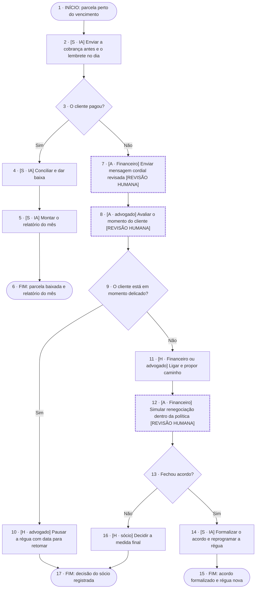

# POP: Cobrança de honorários e inadimplência

Setor: Financeiro e cobrança · Área: todas · Versão: biblioteca 1.0 · Atualizado em: [A DEFINIR ao adaptar] · Dono do POP: [A DEFINIR]

> POP de referência da biblioteca, escrito para um escritório genérico com equipe. 11 passos: 6 S, 3 A, 2 H. Prazos são exemplos e só valem depois que o escritório decidir. Para usar, adapte pela entrada B do `escrever-pop`.

## 1. Objetivo

Receber em dia sem desgastar a relação com o cliente, com régua clara e escalonamento definido.

## 2. Gatilho

Vencimento de parcela. A régua começa antes do vencimento.

## 3. Responsáveis

- Executa: Financeiro.
- Confere: Financeiro (valores e divergências); advogado é consultado antes de qualquer contato mais firme.
- Decide: sócio (renegociação fora da política e medidas finais).

## 4. Entradas

- Contratos com as condições de pagamento.
- Extrato ou relatório de recebimentos.
- Régua de cobrança escrita.
- Modelos de mensagem aprovados.
- Política de renegociação.

## 5. Passo a passo com S, A e H

1. [S] Emitir e enviar as cobranças do mês (exemplo: 5 dias antes do vencimento). Executa: IA. Confere: Financeiro, por amostra.
2. [S] Enviar o lembrete no dia do vencimento. Executa: IA, com mensagem aprovada. Confere: Financeiro, no relatório semanal.
3. [S] Conciliar os recebimentos (extrato × parcelas) e dar baixa. Executa: IA. Confere: Financeiro, nas divergências.
4. [S] Listar os inadimplentes (valor, dias em atraso, histórico, situação do processo). Executa: IA. Confere: Financeiro, antes do passo 5.
5. [A] Enviar a primeira cobrança depois do atraso, cordial e considerando o histórico (exemplo: D+3). Executa: IA rascunha. Confere: Financeiro revisa o tom e o valor e envia.
6. [A] Consultar o advogado antes de subir o tom: houve notícia ruim recente? doença? desemprego? Executa: IA monta a ficha. Confere: advogado responde e diz se a régua segue ou pausa.
7. [H] Ligar para o cliente para entender e propor um caminho. Executa: Financeiro ou advogado. Confere: não se aplica.
8. [A] Simular a renegociação dentro da política. Executa: IA calcula. Confere: Financeiro confere a conta e propõe; fora da política, o sócio aprova.
9. [S] Formalizar o acordo no modelo e reprogramar a régua. Executa: IA. Confere: Financeiro confere os valores.
10. [H] Decidir a medida final (notificação, renúncia, cobrança judicial), dentro das regras éticas. Executa: sócio, ouvindo o advogado. Confere: não se aplica.
11. [S] Montar o relatório do mês (previsto × recebido, inadimplência, acordos). Executa: IA. Confere: sócio lê.

## 6. Prazo

Exemplo de régua: D-5 lembrete, D0 aviso, D+3 mensagem, D+10 ligação, D+30 decisão do sócio. No escritório: [A DEFINIR, da régua escrita].

## 7. Exceções

- Cliente em momento delicado: o advogado pausa a régua com data para retomar.
- Cobrança com erro: pedido de desculpas e correção no mesmo dia, antes de nova mensagem.
- Valores recebidos no processo em nome do cliente: seguem procedimento próprio de repasse e prestação de contas, fora desta régua.
- Acordo não fechado: o sócio decide a medida final (passo 10).

## 8. Saída

Parcela baixada, acordo com régua nova ou decisão do sócio registrada.

## 9. Onde a IA entra

- Passos S: emissão, lembretes, conciliação, lista de inadimplentes, formalização, relatório.
- Passos A: rascunho da cobrança, ficha para o advogado, simulação.
- O que a IA consulta: régua escrita, política de renegociação, modelos de mensagem.
- Ambiente: Projeto no Claude com o código e os modelos do setor. Dados financeiros só em conta profissional.

## 10. Nunca sai sem revisão humana

- Cobrança depois do atraso.
- Renegociação fora da política.
- Medida final.
- Nenhuma cobrança expõe ou constrange o cliente, "nem por descuido de tom".

## 11. Dados pessoais e sensíveis

- Dados que aparecem: valores, histórico de pagamento, dados bancários, às vezes motivo do atraso (doença, desemprego).
- Anonimizar: no relatório e em exemplos, [CLIENTE] e valores arredondados quando o dado exato não for necessário.
- Nunca na IA: número de conta e de cartão além do estritamente necessário; senha de banco.
- Motivo pessoal do atraso (saúde, desemprego) fica na ficha do advogado, não na mensagem de cobrança.

## 12. Indicador

- Inadimplência do mês (valor em atraso ÷ valor previsto).
- Acordos cumpridos ÷ acordos feitos.

---

## Antes e com a IA

| Passo | Como era antes da IA | Como fica com a IA | Sigla |
|---|---|---|---|
| Lembrete e conciliação | Planilha atualizada quando sobra tempo | Régua rodando e baixa feita todo dia | S |
| Primeira cobrança | Adiada porque é constrangedor | Mensagem cordial pronta para revisar e enviar | A |
| Conversa com o cliente | Às vezes não acontecia | Ligação feita por quem conhece o momento do cliente | H |

## Na trilha solo

- Sem sócio para decidir fora da política: política de renegociação escrita antes, e pausa de 24 horas antes de decidir a medida final.
- A primeira cobrança (passo 5) é revisada pelo titular com o checklist de tom; não vira S por falta de quem revise.

## Fluxograma

Fluxograma do material, completado com os passos e exceções do POP.

**Em texto:**
1. INÍCIO: parcela perto do vencimento.
2. AÇÃO [S · IA] Enviar a cobrança antes e o lembrete no dia. Vá para 3.
3. DECISÃO: o cliente pagou? Se sim, vá para 4. Se não, vá para 7.
4. AÇÃO [S · IA] Conciliar e dar baixa. Vá para 5.
5. AÇÃO [S · IA] Montar o relatório do mês. Vá para 6.
6. FIM: parcela baixada e relatório do mês.
7. AÇÃO [A · Financeiro] Enviar mensagem cordial revisada [REVISÃO HUMANA]. Vá para 8.
8. AÇÃO [A · advogado] Avaliar o momento do cliente [REVISÃO HUMANA]. Vá para 9.
9. DECISÃO: o cliente está em momento delicado? Se sim, vá para 10. Se não, vá para 11.
10. AÇÃO [H · advogado] Pausar a régua com data para retomar. Vá para 17.
11. AÇÃO [H · Financeiro ou advogado] Ligar e propor caminho. Vá para 12.
12. AÇÃO [A · Financeiro] Simular renegociação dentro da política [REVISÃO HUMANA]. Vá para 13.
13. DECISÃO: fechou acordo? Se sim, vá para 14. Se não, vá para 16.
14. AÇÃO [S · IA] Formalizar o acordo e reprogramar a régua. Vá para 15.
15. FIM: acordo formalizado e régua nova.
16. AÇÃO [H · sócio] Decidir a medida final. Vá para 17.
17. FIM: decisão registrada (pausa com data ou medida final).

O símbolo 10 vem da exceção "cliente em momento delicado".

Caminho principal: vencimento → cobrança e lembrete → pagamento → conciliação → relatório.
