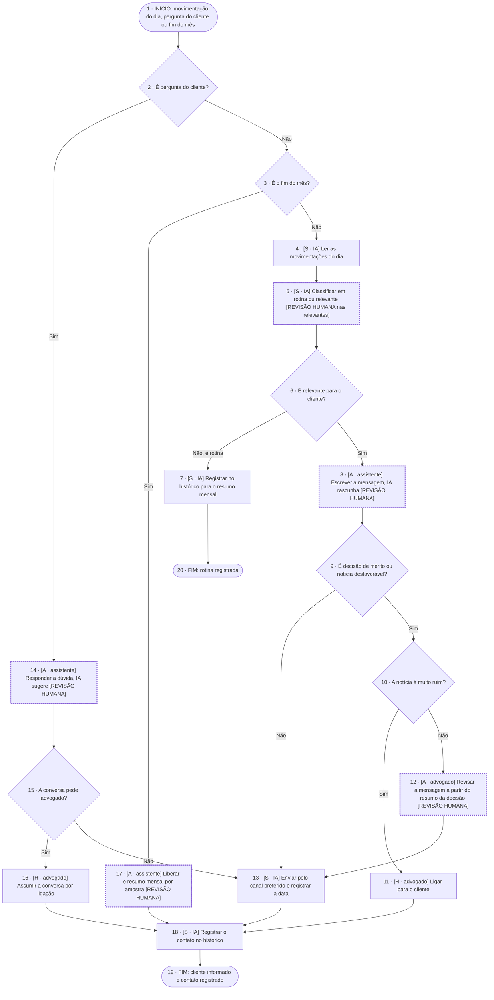

# POP: Atualização de andamento processual

Setor: Relacionamento com o cliente · Área: todas · Versão: biblioteca 1.0 · Atualizado em: [A DEFINIR ao adaptar] · Dono do POP: [A DEFINIR]

> POP de referência da biblioteca, escrito para um escritório genérico com equipe. 11 passos: 5 S, 4 A, 2 H. Prazos são exemplos e só valem depois que o escritório decidir. Para usar, adapte pela entrada B do `escrever-pop`. É o exemplo que o `escrever-pop` usa para mostrar o fluxograma, aqui na versão completa, com o resumo mensal e o passo de assumir a conversa.

## 1. Objetivo

Manter o cliente informado sobre o processo sem que ele precise cobrar pelo WhatsApp.

## 2. Gatilho

Movimentação relevante no processo (decisão, perícia, audiência, sentença); ou pergunta do cliente; ou fim do mês, para o resumo mensal.

## 3. Responsáveis

- Executa: assistente de relacionamento.
- Confere: assistente (relevantes e rascunhos); advogado (mensagens sobre decisões).
- Decide: advogado responsável (valida mensagens sobre decisões e assume conversas delicadas).

## 4. Entradas

- Movimentações do dia, vindas da controladoria.
- Ficha do cliente com o canal preferido.
- Critérios de relevância por área (o que é rotina, o que é relevante).
- Modelos de mensagem por categoria.
- FAQ do escritório.

## 5. Passo a passo com S, A e H

1. [S] Ler as movimentações do dia e entregar a lista. Executa: IA. Confere: assistente, junto com o passo 2.
2. [S] Classificar cada movimentação em rotina ou relevante pelos critérios escritos. Executa: IA. Confere: assistente, só as relevantes.
3. [S] Registrar a rotina no histórico, para o resumo mensal. Executa: IA. Confere: assistente, por amostra ao montar o resumo mensal.
4. [A] Escrever a mensagem da movimentação relevante: o que aconteceu, o que significa, o próximo passo. Executa: IA rascunha no tom do código do escritório. Confere: assistente ajusta e aprova.
5. [A] Revisar a mensagem sobre decisão de mérito ou notícia desfavorável antes do envio. Executa: IA faz o resumo da decisão. Confere: advogado lê a decisão e revisa a mensagem.
6. [H] Ligar quando a notícia é muito ruim; ela nunca vai por mensagem. Executa: advogado. Confere: não se aplica.
7. [S] Enviar pelo canal preferido e registrar a data, depois da aprovação. Executa: IA. Confere: assistente, no fim do dia, enviados × aprovados.
8. [A] Responder a dúvida do cliente com base no processo e na FAQ. Executa: IA sugere. Confere: assistente revisa e envia (exemplo: até 1 dia útil).
9. [H] Assumir a conversa que pede advogado (orientação nova, reclamação, insatisfação, desistência). Executa: advogado, por ligação. Confere: não se aplica.
10. [A] Montar e enviar o resumo mensal de cada cliente, inclusive de processo parado. Executa: IA. Confere: assistente confere por amostra e libera.
11. [S] Registrar todo contato no histórico (data, canal, assunto). Executa: IA. Confere: assistente, por amostra.

## 6. Prazo

Exemplo: até 24 horas depois da movimentação relevante; resumo mensal até o 5º dia útil; resposta a dúvida até 1 dia útil. No escritório: [A DEFINIR, do código do escritório].

## 7. Exceções

- Cliente sem WhatsApp: usar e-mail ou ligação, conforme a ficha.
- Notícia muito ruim: o advogado liga antes de qualquer mensagem.
- Cliente que pede para não receber o resumo mensal: registrar e respeitar.
- Dúvida que pede orientação nova, reclamação, insatisfação ou desistência: o advogado assume (passo 9).

## 8. Saída

Cliente informado e contato registrado.

## 9. Onde a IA entra

- Passos S: leitura, classificação, registro da rotina, envio após aprovação, registro do contato.
- Passos A: rascunhos de mensagem, resumo da decisão, resposta a dúvidas, resumo mensal.
- O que a IA consulta: critérios de relevância, modelos por categoria, FAQ, código do escritório (tom). "Só funciona porque os critérios de relevância, o tom e os modelos já estão escritos."
- Ambiente: Projeto no Claude com o código e os modelos do setor, em conta profissional.

## 10. Nunca sai sem revisão humana

- Mensagem sobre decisão.
- Notícia desfavorável.
- Resposta com orientação jurídica.

## 11. Dados pessoais e sensíveis

- Dados que aparecem: nome, canal de contato, número do processo, teor de decisões, às vezes dado de saúde (perícia, laudo).
- Anonimizar: [CLIENTE], [PROCESSO] e [CONTATO] em tudo que não for o envio em si; dado de saúde só no trecho que a mensagem exige.
- Nunca na IA sem autorização expressa do responsável: laudo completo, processo em segredo de justiça.
- Mensagem enviada sempre pelo canal oficial do escritório.

## 12. Indicador

- Mensagens "alguma novidade?" recebidas por semana.
- Tempo da movimentação relevante ao aviso (média do mês).

---

## Antes e com a IA

| Passo | Como era antes da IA | Como fica com a IA | Sigla |
|---|---|---|---|
| Conferir e classificar | A assistente abre processo por processo e decide de cabeça | Lista pronta e classificada pelos critérios escritos | S |
| Escrever a mensagem | Digitada do zero ou adaptada de outra | Rascunho no tom do escritório, ajustado pela pessoa | A |
| Revisar decisão ou notícia ruim | O advogado lê o processo e revisa a mensagem | O advogado revisa, partindo de um resumo da decisão feito pela IA | A |
| Responder a dúvida | Quem estiver livre responde, quando dá | A IA sugere a resposta com base no processo; a pessoa revisa e envia | A |
| Resumo mensal | Não existia; o cliente só sabia quando perguntava | Todo cliente recebe, inclusive quando nada mudou | A |
| Notícia muito ruim | O advogado liga | Continua sendo o advogado | H |

## Exemplo de adaptação

Escritório previdenciário com 4 pessoas, setor-alvo Relacionamento. Faltava o critério escrito de movimentação relevante e a sócia revisava tudo, inclusive a rotina. Ela escreveu a lista de movimentações relevantes, passou os passos A para a assistente e ficou só com as decisões e as ligações difíceis. Como a IA ainda rodava em conta pessoal, os passos 1, 2 e 3 subiram de S para A até a conta profissional e a regra de uso estarem no lugar.

## Na trilha solo

- O titular revisa todas as mensagens A. A pressão para virar S aumenta: mantenha A e use o checklist de tom num horário fixo do dia.
- Quando o titular está em audiência ou de férias, mensagens sobre decisão esperam; o cliente recebe só o aviso de que haverá retorno [A DEFINIR texto aprovado].

## Fluxograma

Fluxograma do material, acrescido do resumo mensal e do passo de assumir a conversa.

**Em texto:**
1. INÍCIO: movimentação do dia, pergunta do cliente ou fim do mês.
2. DECISÃO: é pergunta do cliente? Se sim, vá para 14. Se não, vá para 3.
3. DECISÃO: é o fim do mês? Se sim, vá para 17. Se não, vá para 4.
4. AÇÃO [S · IA] Ler as movimentações do dia. Vá para 5.
5. AÇÃO [S · IA] Classificar em rotina ou relevante [REVISÃO HUMANA nas relevantes]. Vá para 6.
6. DECISÃO: é relevante para o cliente? Se sim, vá para 8. Se não, vá para 7.
7. AÇÃO [S · IA] Registrar no histórico para o resumo mensal. Vá para 20.
8. AÇÃO [A · assistente] Escrever a mensagem, com rascunho da IA [REVISÃO HUMANA]. Vá para 9.
9. DECISÃO: é decisão de mérito ou notícia desfavorável? Se sim, vá para 10. Se não, vá para 13.
10. DECISÃO: a notícia é muito ruim? Se sim, vá para 11. Se não, vá para 12.
11. AÇÃO [H · advogado] Ligar para o cliente. Vá para 18.
12. AÇÃO [A · advogado] Revisar a mensagem a partir do resumo da decisão [REVISÃO HUMANA]. Vá para 13.
13. AÇÃO [S · IA] Enviar pelo canal preferido e registrar a data. Vá para 18.
14. AÇÃO [A · assistente] Responder a dúvida, com sugestão da IA [REVISÃO HUMANA]. Vá para 15.
15. DECISÃO: a conversa pede advogado? Se sim, vá para 16. Se não, vá para 13.
16. AÇÃO [H · advogado] Assumir a conversa por ligação. Vá para 18.
17. AÇÃO [A · assistente] Liberar o resumo mensal, conferido por amostra [REVISÃO HUMANA]. Vá para 18.
18. AÇÃO [S · IA] Registrar o contato no histórico. Vá para 19.
19. FIM: cliente informado e contato registrado.
20. FIM: rotina registrada, entra no resumo mensal.

Caminho principal: movimentação → classificação → relevante → mensagem → revisão → envio → registro.
