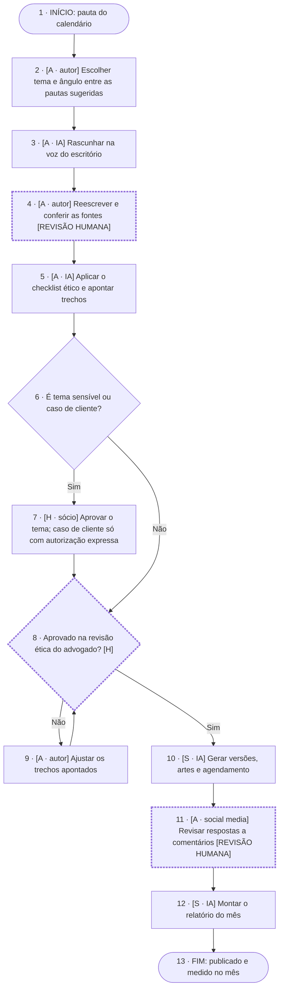

# POP: Produção de conteúdo com revisão ética

Setor: Marketing e conteúdo · Área: todas · Versão: biblioteca 1.0 · Atualizado em: [A DEFINIR ao adaptar] · Dono do POP: [A DEFINIR]

> POP de referência da biblioteca, escrito para um escritório genérico com equipe. 10 passos: 4 S, 5 A, 1 H. Prazos são exemplos e só valem depois que o escritório decidir. Para usar, adapte pela entrada B do `escrever-pop`. Norma de referência: Provimento 205/2021 do Conselho Federal da OAB (publicidade). Leia o texto do provimento ao montar o checklist ético do escritório [CONFERIR].

## 1. Objetivo

Publicar conteúdo informativo com regularidade, na voz do escritório e dentro das regras de publicidade da advocacia.

## 2. Gatilho

Calendário editorial do mês, ou mudança relevante na área de atuação.

## 3. Responsáveis

- Executa: social media (produz, agenda e acompanha).
- Confere: advogado autor (dono do conteúdo e da revisão ética).
- Decide: advogado autor; sócio aprova os temas sensíveis.

## 4. Entradas

- Calendário editorial.
- Código do escritório, com o tom de voz.
- Checklist ético baseado no Provimento 205/2021.
- Dúvidas de clientes anonimizadas.
- Conteúdos já publicados.
- Templates da marca.

## 5. Passo a passo com S, A e H

1. [A] Levantar pautas a partir das dúvidas do atendimento e do calendário. Executa: IA sugere. Confere: autor escolhe o tema e o ângulo.
2. [A] Organizar a base do conteúdo e conferir na fonte toda lei ou decisão mencionada. Executa: IA organiza. Confere: autor abre cada fonte citada.
3. [A] Escrever o rascunho (carrossel, vídeo curto, artigo) na voz do escritório. Executa: IA rascunha. Confere: autor reescreve com a experiência dele.
4. [A] Fazer a pré-checagem ética: promessa de resultado, captação, tom mercantil, exposição de caso ou cliente, sensacionalismo. Executa: IA aponta os trechos. Confere: autor decide cada apontamento.
5. [H] Fazer a revisão ética e a aprovação final. Executa: autor; nos temas sensíveis, também o sócio. Confere: não se aplica.
6. [S] Adaptar o texto aprovado para outros formatos e canais (legenda, versão curta, newsletter) sem mudar o sentido. Executa: IA. Confere: social media compara com o texto aprovado.
7. [S] Montar as artes nos templates. Executa: IA ou ferramenta de design. Confere: social media.
8. [S] Agendar nos canais. Executa: ferramenta de agendamento. Confere: social media, na fila semanal.
9. [A] Responder comentários e mensagens de forma informativa; pergunta sobre caso concreto vai para o Atendimento. Executa: IA sugere. Confere: social media revisa e publica.
10. [S] Montar o relatório do mês (salvos e compartilhamentos, pautas que geraram contato, sugestões). Executa: IA. Confere: autor lê e decide.

## 6. Prazo

Exemplo: conteúdo da semana aprovado até a sexta anterior. No escritório: [A DEFINIR, do código do escritório].

## 7. Exceções

- Tema sensível (crime, família com crianças, repercussão): exige o sócio.
- Caso de cliente: nunca vira conteúdo sem autorização expressa do cliente e revisão do sócio. Na dúvida, não publica.
- Anúncio pago: passa pela mesma revisão ética.
- Conteúdo reprovado na revisão ética: volta ao autor com os trechos apontados.
- Pergunta sobre caso concreto em comentário ou mensagem: vai para o Atendimento, sem resposta que pareça consultoria.

## 8. Saída

Conteúdo publicado, revisado, registrado no calendário e medido no mês.

## 9. Onde a IA entra

- Passos S: adaptação de formatos, artes, agendamento, relatório.
- Passos A: pauta, organização das fontes, rascunho, pré-checagem ética, respostas.
- O que a IA consulta: código do escritório (tom), checklist ético, banco de conteúdos publicados.
- Ambiente: Projeto no Claude com o código e o checklist ético. Dúvida de cliente só vira pauta anonimizada.

## 10. Nunca sai sem revisão humana

- Nada é publicado sem a revisão ética do advogado.
- Resposta que pareça consultoria em comentário público.

## 11. Dados pessoais e sensíveis

- Dados que aparecem: dúvidas de clientes, às vezes com detalhes do caso; dados de quem comenta ou manda mensagem.
- Anonimizar: toda dúvida de cliente antes de virar pauta; nenhum detalhe que permita identificar o caso.
- Nunca na IA nem no conteúdo: caso de cliente sem autorização expressa; dado de criança ou adolescente; dado de saúde de pessoa identificável.
- Mensagem privada com caso concreto vai para o Atendimento pelo canal oficial.

## 12. Indicador

- Semanas com publicação no ritmo combinado (semanas no ritmo ÷ semanas do mês).
- Contatos vindos do conteúdo (contagem no mês, pela origem registrada no CRM).

---

## Antes e com a IA

| Passo | Como era antes da IA | Como fica com a IA | Sigla |
|---|---|---|---|
| Pauta | "Sobre o que eu posto hoje?", às 22h | Pautas vindas das dúvidas reais dos clientes | A |
| Checagem ética | Feita de olho, quando lembrava | Checklist aplicado em todo conteúdo, decisão do advogado | A |
| Adaptar para outros canais | Reescrever tudo de novo | Versões geradas a partir do texto aprovado | S |
| Aprovar | Advogado | Continua com o advogado | H |

## Na trilha solo

- Sem sócio para temas sensíveis: regra escrita do que o escritório não publica, e pausa de 24 horas antes de aprovar tema sensível.
- O titular é autor e revisor: faça a revisão ética em outro momento, nunca logo depois de escrever, com o checklist aberto.

## Fluxograma

Fluxograma do material, completado com os passos do POP.

**Em texto:**
1. INÍCIO: pauta do calendário.
2. AÇÃO [A · autor] Escolher tema e ângulo entre as pautas sugeridas. Vá para 3.
3. AÇÃO [A · IA] Rascunhar na voz do escritório. Vá para 4.
4. AÇÃO [A · autor] Reescrever e conferir as fontes [REVISÃO HUMANA]. Vá para 5.
5. AÇÃO [A · IA] Aplicar o checklist ético e apontar trechos. Vá para 6.
6. DECISÃO: é tema sensível ou caso de cliente? Se sim, vá para 7. Se não, vá para 8.
7. AÇÃO [H · sócio] Aprovar o tema; caso de cliente só com autorização expressa. Vá para 8.
8. DECISÃO: aprovado na revisão ética do advogado? [REVISÃO HUMANA] Se sim, vá para 10. Se não, vá para 9.
9. AÇÃO [A · autor] Ajustar os trechos apontados. Volte para 8.
10. AÇÃO [S · IA] Gerar versões, artes e agendamento. Vá para 11.
11. AÇÃO [A · social media] Revisar respostas a comentários [REVISÃO HUMANA]. Vá para 12.
12. AÇÃO [S · IA] Montar o relatório do mês. Vá para 13.
13. FIM: publicado, revisado e medido no mês.

Caminho principal: pauta → rascunho → reescrita com fontes → checklist ético → aprovação → versões e agendamento → relatório.
