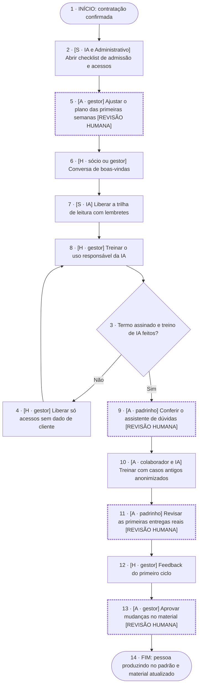

# POP: Integração de novo colaborador

Setor: Gestão de equipe · Área: todas · Versão: biblioteca 1.0 · Atualizado em: [A DEFINIR ao adaptar] · Dono do POP: [A DEFINIR]

> POP de referência da biblioteca, escrito para um escritório genérico com equipe. 10 passos: 2 S, 5 A, 3 H. Prazos são exemplos e só valem depois que o escritório decidir. Para usar, adapte pela entrada B do `escrever-pop`. É o teste mais honesto dos outros POPs: se a pessoa nova não consegue seguir, o POP precisa melhorar.

## 1. Objetivo

Fazer a pessoa nova produzir com autonomia e no padrão do escritório o quanto antes, sem que o aprendizado dependa só de alguém explicar.

## 2. Gatilho

Contratação confirmada (estagiário, assistente ou advogado).

## 3. Responsáveis

- Executa: Administrativo (acessos e documentos); padrinho ou madrinha (acompanha o dia a dia).
- Confere: padrinho ou madrinha (dúvidas e primeiras entregas); gestor (plano e material).
- Decide: sócio ou gestor (plano, conversas e avaliação).

## 4. Entradas

- Código do escritório.
- POPs do setor da pessoa.
- Regra de uso de IA.
- Base de conhecimento.
- Checklist de acessos.
- Termo de confidencialidade.
- Casos antigos anonimizados.

## 5. Passo a passo com S, A e H

1. [S] Abrir o checklist de admissão e acessos da função (e-mail, sistema, pastas, conta profissional de IA, termo de confidencialidade). Executa: IA gera o checklist da função; Administrativo executa os acessos. Confere: gestor confere que o termo foi assinado antes de qualquer acesso a dado de cliente.
2. [A] Montar o plano das primeiras semanas a partir dos POPs. Executa: IA rascunha. Confere: gestor ajusta e aprova.
3. [H] Fazer a conversa de boas-vindas: cultura, expectativas, como o escritório decide, o que nunca faz. Executa: sócio ou gestor. Confere: não se aplica.
4. [S] Liberar a trilha de leitura com prazos (código, regra de uso de IA, POPs). Executa: IA, com lembretes. Confere: padrinho acompanha a leitura.
5. [H] Treinar o uso responsável da IA (sigilo, anonimização, conta profissional, revisão humana) com exemplos do escritório. Executa: gestor ou responsável por IA. Confere: não se aplica.
6. [A] Abrir o assistente de dúvidas (Projeto no Claude com o código, os POPs e a base). Executa: IA responde. Confere: padrinho confere as respostas nas primeiras semanas.
7. [A] Treinar com casos antigos anonimizados: a pessoa executa o POP e a IA compara com o padrão. Executa: colaborador e IA. Confere: padrinho comenta as diferenças.
8. [A] Fazer as primeiras entregas reais com revisão dupla. Executa: colaborador, com a IA aplicando o checklist da entrega. Confere: padrinho revisa a entrega inteira.
9. [H] Dar o feedback do primeiro ciclo (exemplo: 30 dias). Executa: gestor. Confere: não se aplica.
10. [A] Atualizar o material com as dúvidas que apareceram ("dúvida repetida é sinal de POP confuso"). Executa: IA consolida e aponta. Confere: gestor aprova cada mudança em POP.

## 6. Prazo

Exemplo: acessos e termo no dia 1; trilha de leitura na semana 1; feedback em 30 dias. No escritório: [A DEFINIR, do código do escritório].

## 7. Exceções

- Contratação urgente: trilha mínima (código, regra de uso de IA, POP do setor) antes de qualquer acesso a dado de cliente.
- Advogado experiente: treino encurtado, mas código e regra de uso de IA obrigatórios.
- Termo não assinado ou treino de IA não feito: nenhum acesso a dado de cliente.

## 8. Saída

Acessos liberados, termo assinado, trilha concluída, primeiras entregas aprovadas, feedback registrado e material atualizado.

## 9. Onde a IA entra

- Passos S: checklist de acessos, trilha de leitura com lembretes.
- Passos A: plano das primeiras semanas, assistente de dúvidas, treino com casos anonimizados, checklist das primeiras entregas, consolidação das dúvidas.
- O que a IA consulta: código do escritório, POPs, regra de uso de IA, base de conhecimento, casos antigos anonimizados.
- Ambiente: Projeto no Claude com o código, os POPs e a base, em conta profissional ou de equipe.

## 10. Nunca sai sem revisão humana

- Acesso a dado de cliente antes do termo e do treino de IA.
- Avaliação de desempenho.
- Mudança em POP.

## 11. Dados pessoais e sensíveis

- Dados que aparecem: dados pessoais do colaborador (documentos de admissão); casos antigos usados no treino.
- Anonimizar: todo caso antigo usado no treino, sempre ([CLIENTE], [PROCESSO], [DOC]).
- Nunca na IA: documentos pessoais do colaborador; avaliação de desempenho identificada.
- O colaborador só recebe acesso a pastas restritas (saúde, criança, criminal) quando a função exige.

## 12. Indicador

- Tempo até a primeira entrega aprovada sem retrabalho (dias desde a contratação).
- Dúvidas repetidas sobre o mesmo POP (contagem no mês, por POP).

---

## Antes e com a IA

| Passo | Como era antes da IA | Como fica com a IA | Sigla |
|---|---|---|---|
| Tirar dúvidas | Interromper o titular a cada meia hora | Perguntar ao Projeto do escritório, com o padrinho conferindo no começo | A |
| Treinar | Aprender errando com cliente real | Treinar com casos antigos anonimizados antes | A |
| Cultura e feedback | Sócio | Continua com o sócio | H |

## Na trilha solo

- Só se aplica quando houver estagiário, secretária ou a primeira contratação. No solo, este POP vira a preparação para contratar: escreva antes o POP do setor que a pessoa vai assumir, para ela aprender pelo papel.
- O titular é padrinho e gestor ao mesmo tempo: o assistente de dúvidas (passo 6) é o que mais devolve tempo, porque responde sem ocupar a agenda dele.
- Depois da primeira contratação, troque a trilha no `perfil.md` para equipe.

## Fluxograma

Desenhado a partir dos passos (o material não trazia fluxograma deste POP).

**Em texto:**
1. INÍCIO: contratação confirmada.
2. AÇÃO [S · IA e Administrativo] Abrir checklist de admissão e acessos. Vá para 5.
3. DECISÃO: termo assinado e treino de IA feitos? Se sim, vá para 9. Se não, vá para 4.
4. AÇÃO [H · gestor] Liberar só acessos sem dado de cliente. Volte para 8.
5. AÇÃO [A · gestor] Ajustar o plano das primeiras semanas [REVISÃO HUMANA]. Vá para 6.
6. AÇÃO [H · sócio ou gestor] Conversa de boas-vindas. Vá para 7.
7. AÇÃO [S · IA] Liberar a trilha de leitura com lembretes. Vá para 8.
8. AÇÃO [H · gestor] Treinar o uso responsável da IA. Vá para 3.
9. AÇÃO [A · padrinho] Conferir o assistente de dúvidas [REVISÃO HUMANA]. Vá para 10.
10. AÇÃO [A · colaborador e IA] Treinar com casos antigos anonimizados. Vá para 11.
11. AÇÃO [A · padrinho] Revisar as primeiras entregas reais [REVISÃO HUMANA]. Vá para 12.
12. AÇÃO [H · gestor] Feedback do primeiro ciclo. Vá para 13.
13. AÇÃO [A · gestor] Aprovar mudanças no material [REVISÃO HUMANA]. Vá para 14.
14. FIM: pessoa produzindo no padrão e material atualizado.

O símbolo 4 vem da exceção "nenhum acesso a dado de cliente antes do termo e do treino".

Caminho principal: contratação → acessos → plano → boas-vindas → trilha → treino de IA → assistente de dúvidas → casos de treino → primeiras entregas → feedback → material atualizado.
