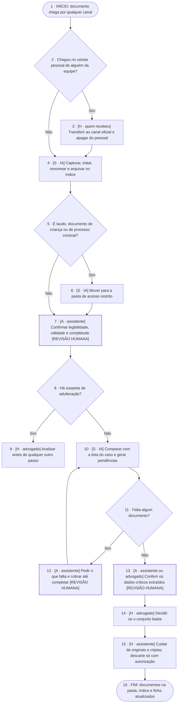

# POP: Recebimento e organização de documentos do cliente

Setor: Administrativo · Área: todas · Versão: biblioteca 1.0 · Atualizado em: [A DEFINIR ao adaptar] · Dono do POP: [A DEFINIR]

> POP de referência da biblioteca, escrito para um escritório genérico com equipe. 11 passos: 6 S, 3 A, 2 H. É o POP com mais S da biblioteca, porque organizar documento é regra pura, e o que mais pede cuidado com dado sensível. Prazos são exemplos e só valem depois que o escritório decidir. Para usar, adapte pela entrada B do `escrever-pop`.

## 1. Objetivo

Todo documento na pasta certa, com nome padrão e conferido, e pendências cobradas até completar.

## 2. Gatilho

Documento enviado por qualquer canal (WhatsApp, e-mail, portal, presencial).

## 3. Responsáveis

- Executa: assistente administrativo.
- Confere: assistente (legibilidade, completude, dados extraídos); advogado (documentos que sustentam a tese).
- Decide: advogado (a lista de documentos do caso, se o conjunto basta, autorização de descarte).

## 4. Entradas

- Lista de documentos por tipo de caso.
- Padrão de nomes e de pastas.
- Ficha do cliente.
- Política de dados (guarda, acesso e descarte).

## 5. Passo a passo com S, A e H

1. [S] Capturar o arquivo do canal para a pasta de entrada do cliente; nada fica só no WhatsApp. Executa: IA ou automação. Confere: assistente, no fim do dia.
2. [S] Converter e tratar o arquivo (PDF, páginas na ordem, imagem endireitada e legível). Executa: IA ou ferramenta de digitalização. Confere: assistente, no passo 5.
3. [S] Identificar o tipo e renomear no padrão (exemplo: `AAAA-MM-DD_CNIS_cliente0231.pdf`). Executa: IA. Confere: assistente, por amostra.
4. [S] Mover para a pasta do caso e registrar no índice. Executa: IA. Confere: assistente, por amostra.
5. [A] Conferir legibilidade, validade e completude (páginas, data, assinatura, titular). Executa: IA aponta. Confere: assistente confirma cada apontamento no arquivo.
6. [S] Comparar com a lista do caso e gerar as pendências. Executa: IA. Confere: assistente, junto com o passo 7.
7. [A] Pedir o que falta, explicando onde conseguir cada documento. Executa: IA rascunha. Confere: assistente revisa e envia.
8. [A] Extrair dados para a ficha (datas, vínculos, valores), com a página de origem. Executa: IA. Confere: assistente ou advogado confere os dados críticos na página citada.
9. [H] Conferir os documentos que sustentam o caso e decidir se o conjunto basta. Executa: advogado. Confere: não se aplica.
10. [S] Cobrar as pendências até completar, avisando o advogado se o caso travar (exemplo: lembretes D+3 e D+7). Executa: IA, com mensagens aprovadas. Confere: assistente, no relatório semanal de pendências.
11. [H] Cuidar de originais e cópias: devolver ou guardar com protocolo, descartar conforme a política. Executa: assistente, com autorização do advogado para descarte. Confere: advogado autoriza o descarte.

## 6. Prazo

Exemplo: documento arquivado e conferido até o fim do dia útil seguinte ao recebimento. No escritório: [A DEFINIR, do código do escritório].

## 7. Exceções

- Laudo médico, documento de criança ou adolescente e documento de processo criminal: vão para pasta de acesso restrito.
- Documento recebido no celular pessoal de alguém da equipe: transferir ao canal oficial e apagar do pessoal.
- Suspeita de adulteração: para tudo e vai ao advogado.
- Pendência que não se resolve depois das cobranças: o advogado é avisado e decide o próximo passo.

## 8. Saída

Documentos na pasta, índice atualizado, ficha preenchida, pendências zeradas ou em cobrança.

## 9. Onde a IA entra

- Passos S: captura, tratamento, identificação, renomeação, arquivamento, pendências, cobrança.
- Passos A: conferência de legibilidade e completude, pedido do que falta, extração de dados.
- O que a IA consulta: lista de documentos por tipo de caso, padrão de nomes e pastas, mensagens aprovadas.
- Ambiente: conta profissional, com a pasta do escritório; dado de saúde só quando necessário.

## 10. Nunca sai sem revisão humana

- Decisão de que os documentos bastam.
- Descarte de original ou cópia.
- Dados críticos extraídos.

## 11. Dados pessoais e sensíveis

- Dados que aparecem: documentos pessoais, CNIS, laudos, atestados, contracheques, extratos, certidões de filhos.
- Dado de saúde é sensível pela LGPD (Lei 13.709/2018): só em conta profissional e só quando necessário.
- Anonimizar: no índice e na ficha usados fora da pasta do caso, [CLIENTE], [DOC], [BENEFÍCIO].
- Nunca na IA sem autorização expressa do responsável: laudo completo, documento de criança ou adolescente, documento de processo em segredo de justiça.
- Senha e credencial do cliente que apareçam em print: não arquivar, avisar o advogado.

## 12. Indicador

- Tempo do recebimento ao arquivamento (média do mês).
- Casos parados por pendência (contagem no fim do mês).

---

## Antes e com a IA

| Passo | Como era antes da IA | Como fica com a IA | Sigla |
|---|---|---|---|
| Salvar e renomear | "WhatsApp Image ... at 22.04.jpg" esquecida na conversa | PDF com nome padrão na pasta do caso, no mesmo dia | S |
| Saber o que falta | Descobrir na hora de montar a peça | Lista de pendências gerada no recebimento e cobrada até completar | S |
| Conferir o essencial | Advogado | Continua com o advogado, com a ficha já preenchida | H |

## Na trilha solo

- Restrição de acesso pesa menos, mas continua valendo para estagiário, secretária e terceiros.
- Com estagiário ou secretária, ela é quem confere os passos S no fim do dia; sem ninguém, o titular confere num horário fixo da semana.

## Fluxograma

Desenhado a partir dos passos (o material não trazia fluxograma deste POP).

**Em texto:**
1. INÍCIO: documento chega por qualquer canal.
2. DECISÃO: chegou no celular pessoal de alguém da equipe? Se sim, vá para 3. Se não, vá para 4.
3. AÇÃO [H · quem recebeu] Transferir ao canal oficial e apagar do pessoal. Vá para 4.
4. AÇÃO [S · IA] Capturar, tratar, renomear e arquivar no índice. Vá para 5.
5. DECISÃO: é laudo, documento de criança ou de processo criminal? Se sim, vá para 6. Se não, vá para 7.
6. AÇÃO [S · IA] Mover para a pasta de acesso restrito. Vá para 7.
7. AÇÃO [A · assistente] Confirmar legibilidade, validade e completude [REVISÃO HUMANA]. Vá para 8.
8. DECISÃO: há suspeita de adulteração? Se sim, vá para 9 (o fluxo para até o advogado decidir). Se não, vá para 10.
9. AÇÃO [H · advogado] Analisar antes de qualquer outro passo.
10. AÇÃO [S · IA] Comparar com a lista do caso e gerar pendências. Vá para 11.
11. DECISÃO: falta algum documento? Se sim, vá para 12. Se não, vá para 13.
12. AÇÃO [A · assistente] Pedir o que falta e cobrar até completar [REVISÃO HUMANA]. Volte para 10 quando chegar.
13. AÇÃO [A · assistente ou advogado] Conferir os dados críticos extraídos [REVISÃO HUMANA]. Vá para 14.
14. AÇÃO [H · advogado] Decidir se o conjunto basta. Vá para 15.
15. AÇÃO [H · assistente] Cuidar de originais e cópias; descarte só com autorização. Vá para 16.
16. FIM: documentos na pasta, índice e ficha atualizados.

Ponto em aberto do desenho: depois da análise de adulteração (símbolo 9), o POP não diz para onde o fluxo volta. Decisão do advogado [A DEFINIR].

Caminho principal: recebimento → captura e arquivo → conferência → pendências → dados extraídos → decisão do advogado → originais.
