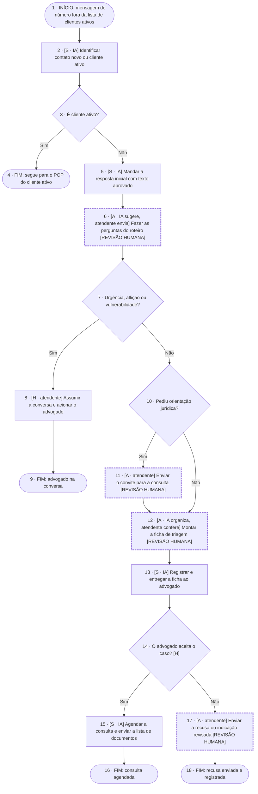

# POP-ATD-[NN] Primeiro contato e triagem pelo WhatsApp

Código: POP-ATD-[NN] · Setor: Atendimento e triagem · Área: todas · Canal: WhatsApp · Versão: referência · Atualizado em: [A DEFINIR ao adaptar] · Dono do POP: [A DEFINIR]

> POP de referência do canal, escrito para um escritório genérico com equipe. 8 passos: 4 S, 3 A, 1 H. Os prazos são exemplos e só valem depois que o escritório decidir. Ele aprofunda a parte que acontece dentro do WhatsApp. A consulta inicial (briefing, consulta, ata) continua no POP de triagem e consulta da biblioteca do `escrever-pop` (`../../escrever-pop/references/biblioteca/setor-01-atendimento-triagem.md`). Arquivo sugerido: `escritorio/03-pops/atendimento-e-triagem/pop-atd-[nn]-primeiro-contato-whatsapp.md`.

O contato que manda mensagem às 21h e só recebe resposta no meio da tarde seguinte já falou com outros dois escritórios. Só que a pressa aqui tem limite: quem escreveu ainda não é cliente, não assinou nada e muitas vezes quer uma resposta jurídica por mensagem. O POP garante resposta na hora sem que ninguém dê consulta pelo WhatsApp.

## 1. Objetivo

Nenhum contato novo fica sem resposta, e toda conversa chega ao advogado como ficha organizada, sem ele precisar rolar a conversa inteira.

## 2. Gatilho

Mensagem de um número que não está na lista de clientes ativos.

## 3. Responsáveis

- Executa: atendente (no escritório solo, é o titular com outro chapéu, ou a secretária).
- Confere: atendente, no fechamento do dia, o que a IA registrou e respondeu.
- Decide: advogado da área (aceite do caso e qualquer conversa que pede advogado).

## 4. Entradas

- Mensagem de resposta inicial ao contato novo e modelo 6 (fora do horário) da biblioteca de mensagens.
- Modelo de convite para a consulta (resposta à pergunta jurídica).
- Roteiro de triagem por área.
- Perguntas frequentes sobre o escritório (horário, endereço, como funciona a consulta).
- Lista de clientes ativos (por código).
- Regras de canal: o que conta como urgência, palavras de alerta, quem responde.
- Lista de documentos por tipo de caso (para o agendamento).

## 5. Passo a passo com S, A e H

1. [S] Identificar quem está escrevendo: contato novo ou cliente ativo. Cliente ativo sai deste fluxo e vai para o POP certo (andamento, documentos ou agenda). Executa: IA, comparando com a lista de clientes ativos. Confere: atendente, quando o número não bate com nenhum cadastro.
2. [S] Mandar a resposta inicial, dentro ou fora do horário: quem está falando, quando uma pessoa retorna e como sinalizar urgência. Executa: IA ou a mensagem automática da ferramenta do escritório, se ela tiver, sempre com texto aprovado. Se a resposta é automática, ela diz isso. Confere: atendente, por amostra no fechamento do dia [A DEFINIR tamanho da amostra].
3. [A] Fazer as perguntas do roteiro de triagem da área, uma por mensagem, por texto. Executa: IA sugere a próxima pergunta a partir do roteiro. Confere: atendente envia e acompanha a conversa; assume se ela sai do roteiro.
4. [H] Perceber aflição, urgência ou vulnerabilidade e assumir a conversa: violência doméstica, prisão, prazo correndo, luto, pessoa muito confusa. Executa: atendente, que aciona o advogado na hora. A IA pode sinalizar palavras de alerta, mas quem decide é a pessoa. Confere: não se aplica.
5. [A] Juntar textos, áudios e fotos numa ficha de triagem: fatos, datas, documentos que a pessoa tem e o que ela quer. Executa: IA organiza o que está escrito. Áudio: a atendente escuta e anota o essencial, ou usa a transcrição, se a ferramenta do escritório fizer. Confere: atendente, nomes e datas contra a conversa original.
6. [A] Responder pergunta jurídica ("eu tenho direito?", "quanto vou receber?", "dá para ganhar?") com o convite para a consulta. Nada de orientação por mensagem. Executa: IA rascunha a partir do modelo de convite. Confere: atendente lê o texto inteiro, confere que não há orientação, estimativa nem promessa, e envia.
7. [S] Registrar no CRM ou na planilha e entregar a ficha ao advogado. A partir daqui segue o POP de triagem e consulta do escritório, se houver: aceite, recusa ou indicação, decisão do advogado. Executa: IA. Confere: atendente, no fechamento do dia.
8. [S] Agendar a consulta pelo POP de agendamento e lembretes, com a lista de documentos daquele tipo de caso. Executa: IA, depois do aceite do advogado. Confere: atendente, por amostra.

## 6. Prazo

Exemplo: resposta inicial na hora, uma pessoa da equipe na conversa em até 2 horas úteis e ficha com o advogado no mesmo dia útil. No escritório: [A DEFINIR, do "Como atendemos" do código do escritório].

## 7. Exceções

- Pergunta de preço logo na primeira mensagem: resposta do modelo explicando como funciona a consulta. Valor de honorário segue o que o código do escritório define.
- Alguém escrevendo em nome de outra pessoa, como o filho pelo pai idoso: confirmar quem é o cliente antes de tratar dados dele.
- Parte contrária de um cliente atual: a triagem para e o advogado decide como responder.
- Contato que só manda áudio longo: a atendente propõe uma ligação curta em vez de pedir que digite tudo.
- Sinal de violência, coação ou risco em caso de Família: o advogado assume e nada daquela conversa entra em automação.

## 8. Saída

Ficha de triagem com o advogado, contato registrado e consulta agendada; ou resposta de recusa revisada, enviada e registrada.

## 9. Onde a IA entra

- Passos S: identificação do contato, resposta inicial, registro e agenda.
- Passos A: sugestão da próxima pergunta, montagem da ficha, rascunho do convite para a consulta.
- O que a IA consulta: roteiro de triagem, perguntas frequentes, modelos aprovados, regras de canal (urgência e palavras de alerta).
- Ambiente: Projeto no Claude com o código do escritório, em conta profissional (conferir na configuração da conta). A pessoa sabe que está falando com o atendimento do escritório, e a IA nunca se apresenta como advogado.

## 10. Nunca sai sem revisão humana

- Qualquer resposta a pergunta jurídica.
- Mensagem de recusa.
- Mensagem para quem está aflito ou em situação vulnerável.

## 11. Dados pessoais e sensíveis

- Dados que aparecem: nome, telefone, relato do problema, às vezes dado de saúde, de criança ou de violência.
- O que anonimizar antes da IA: nome pelo código do contato ou `[CLIENTE]`; telefone por `[CONTATO]`; CPF, RG e número de benefício saem.
- O que nunca entra na IA: relato de violência (vai direto ao advogado); senha e credencial. Documento sensível não é pedido por mensagem antes da consulta, salvo o que a lista da área prevê.
- Onde guardar: a conversa fica no número oficial; a ficha, no CRM ou na planilha do escritório.

## 12. Indicador

- Tempo entre a primeira mensagem e a primeira resposta de uma pessoa (a automática não conta).
- Contatos novos que ficaram sem retorno na semana (meta: zero).

---

## Fluxograma

**Em texto:**
1. INÍCIO: mensagem de número fora da lista de clientes ativos.
2. AÇÃO [S · IA] Identificar contato novo ou cliente ativo. Vá para 3.
3. DECISÃO: é cliente ativo? Se sim, vá para 4. Se não, vá para 5.
4. FIM: segue para o POP do cliente ativo (andamento, documentos ou agenda).
5. AÇÃO [S · IA] Mandar a resposta inicial com texto aprovado. Vá para 6.
6. AÇÃO [A · IA sugere, atendente envia] Fazer as perguntas do roteiro [REVISÃO HUMANA]. Vá para 7.
7. DECISÃO: urgência, aflição ou vulnerabilidade? Se sim, vá para 8. Se não, vá para 10.
8. AÇÃO [H · atendente] Assumir a conversa e acionar o advogado. Vá para 9.
9. FIM: advogado na conversa.
10. DECISÃO: pediu orientação jurídica? Se sim, vá para 11. Se não, vá para 12.
11. AÇÃO [A · atendente] Enviar o convite para a consulta [REVISÃO HUMANA]. Vá para 12.
12. AÇÃO [A · IA organiza, atendente confere] Montar a ficha de triagem [REVISÃO HUMANA]. Vá para 13.
13. AÇÃO [S · IA] Registrar e entregar a ficha ao advogado. Vá para 14.
14. DECISÃO: o advogado aceita o caso? Se sim, vá para 15. Se não, vá para 17.
15. AÇÃO [S · IA] Agendar a consulta e enviar a lista de documentos. Vá para 16.
16. FIM: consulta agendada.
17. AÇÃO [A · atendente] Enviar a recusa ou indicação revisada [REVISÃO HUMANA]. Vá para 18.
18. FIM: recusa enviada e registrada.

Caminho principal: mensagem nova → resposta inicial → roteiro → ficha → advogado aceita → consulta agendada.

## Na trilha solo

- "A atendente assume" vira "o advogado assume": urgência e aflição vão direto para o titular.
- Se houver secretária ou estagiário, essa pessoa é a atendente do POP. Sem ninguém, os passos 2, 7 e 8 são conferidos pelo titular num horário fixo do dia, nunca logo depois de a IA responder.
- O convite para a consulta (passo 6) é lido pelo titular antes de sair, com o checklist de tom.
