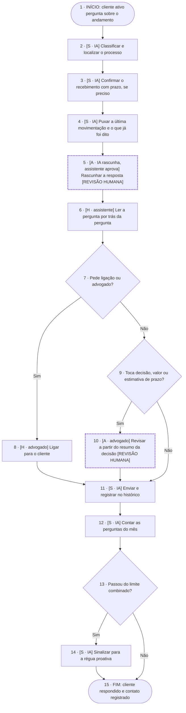

# POP-REL-[NN] Resposta à dúvida sobre andamento

Código: POP-REL-[NN] · Setor: Relacionamento com o cliente · Área: todas · Canal: WhatsApp · Versão: referência · Atualizado em: [A DEFINIR ao adaptar] · Dono do POP: [A DEFINIR]

> POP de referência do canal, escrito para um escritório genérico com equipe. 8 passos: 5 S, 2 A, 1 H. Os prazos são exemplos. O POP de atualização de andamento da biblioteca do `escrever-pop` (`../../escrever-pop/references/biblioteca/setor-07-relacionamento-cliente.md`) cuida do aviso que o escritório manda quando o processo se mexe. Este cuida do outro lado: a pergunta que chega mesmo assim. Arquivo sugerido: `escritorio/03-pops/relacionamento-com-o-cliente/pop-rel-[nn]-duvida-de-andamento.md`.

Cada "alguma novidade?" custa alguns minutos de alguém abrindo o processo. O objetivo vai além de responder bem: o fluxo também anota quem pergunta muito, para essa pessoa entrar na régua de atualização proativa e perguntar menos.

Compare. Resposta rápida: "Oi! Sem novidades por enquanto, assim que tiver a gente avisa." Saiu em um minuto, e na semana seguinte o cliente pergunta de novo, porque a dúvida continua lá. Resposta que informa: "Oi! O seu processo está com o juiz para decidir se marca a perícia médica. Isso costuma ser a próxima etapa nesse tipo de caso, e o tempo depende da vara. Você não precisa fazer nada agora. Assim que a perícia for marcada eu te aviso com data, local e o que levar. E no dia 5 você recebe o resumo do mês, como sempre." Levou mais tempo para escrever. Com a IA rascunhando a partir da movimentação, leva menos.

## 1. Objetivo

Responder a pergunta sobre o processo com informação de verdade, no mesmo dia, e reduzir a chance de a mesma pergunta voltar na semana seguinte.

## 2. Gatilho

Cliente ativo pergunta sobre o andamento, com qualquer palavra: "novidade?", "e aí?", "saiu alguma coisa?", áudio, figurinha de relógio.

## 3. Responsáveis

- Executa: assistente de relacionamento (ou a atendente).
- Confere: assistente, cada rascunho antes do envio.
- Decide: advogado responsável, que revisa quando a resposta toca decisão, valor ou estimativa de prazo e assume quando a conversa pede.

## 4. Entradas

- Última movimentação e histórico do processo, no software jurídico ou na planilha.
- Histórico de contatos com o cliente (o que já foi dito e prometido).
- Glossário de termos processuais em linguagem simples.
- Modelos 3 (atualização) e 4 ("nada mudou") da biblioteca de mensagens.
- Lista do que exige revisão do advogado (regras de canal).
- Limite de perguntas por mês que leva o cliente para a régua proativa.

## 5. Passo a passo com S, A e H

1. [S] Classificar a mensagem como dúvida de andamento e localizar o processo. Executa: IA. Confere: assistente, quando o cliente tem mais de um processo.
2. [S] Confirmar o recebimento com prazo, quando a resposta completa não sai na hora: "Recebi, te retorno até as 16h". Executa: IA, com modelo aprovado. Só vale se o prazo prometido for cumprido. Confere: assistente, no fechamento do dia, promessas feitas e cumpridas.
3. [S] Puxar a última movimentação e o que já foi dito ao cliente, para a resposta não contradizer a anterior. Executa: IA, a partir do histórico do processo e do histórico de contatos. Confere: assistente, junto com o passo 4.
4. [A] Rascunhar a resposta em linguagem simples: o que aconteceu, o que significa, o que vem agora e se o cliente precisa fazer algo. Quando nada mudou, explicar o que está sendo esperado, sem prometer data. Executa: IA rascunha no tom do código do escritório. Confere: assistente ajusta e aprova, conferindo etapa, datas e ausência de promessa.
5. [H] Ler a pergunta por trás da pergunta (ansiedade, aperto financeiro, desconfiança, vontade de desistir) e decidir se responde por mensagem ou se liga. Executa: assistente. Se perceber insatisfação, passa ao advogado. Confere: não se aplica.
6. [A] Levar ao advogado a resposta que toca decisão, valor ou estimativa de prazo. Executa: IA faz o resumo da decisão. Confere: advogado revisa o rascunho, partindo do resumo.
7. [S] Enviar e registrar no histórico do cliente: data, assunto e o que foi dito. Executa: IA, depois da aprovação. Confere: assistente, no fim do dia, enviados contra aprovados.
8. [S] Contar quantas vezes o cliente perguntou no mês e sinalizar quem passou do limite combinado, para entrar na régua proativa. Executa: IA. Exemplo de limite: duas perguntas de andamento no mesmo mês. Confere: assistente, na montagem do resumo mensal.

## 6. Prazo

Exemplo: recebimento confirmado em até 1 hora útil, resposta completa no mesmo dia útil e, se depender do advogado, até o dia útil seguinte, avisando o cliente. No escritório: [A DEFINIR, do código do escritório].

## 7. Exceções

- Cliente com mais de um processo: responder sobre todos ou perguntar de qual ele fala.
- Pergunta que carrega reclamação ("está demorando demais, vou procurar outro advogado"): o advogado liga.
- Pergunta sobre valor a receber ou data de pagamento: nenhuma estimativa sai por mensagem sem o advogado.
- Cliente que pergunta várias vezes no mesmo dia: uma resposta completa e a data da próxima atualização, sem responder cada mensagem isoladamente.
- Movimentação desfavorável ainda não comunicada: nada sai por mensagem; o advogado liga primeiro (modelo 8).

## 8. Saída

Cliente respondido em linguagem simples, contato registrado e frequência de perguntas atualizada.

## 9. Onde a IA entra

- Passos S: classificação, localização do processo, confirmação de recebimento, leitura do histórico, registro e contagem.
- Passos A: rascunho da resposta e resumo da decisão para o advogado.
- O que a IA consulta: movimentação e histórico, glossário de termos, modelos 3 e 4, regras de canal.
- Ambiente: Projeto no Claude com o código do escritório, em conta profissional. Para rascunhar, a IA precisa da movimentação e do histórico, e dispensa nome, CPF e número do processo.

## 10. Nunca sai sem revisão humana

- Mensagem com conteúdo do processo (toda resposta deste POP passa pela leitura de alguém).
- Resposta sobre decisão, valor, estimativa de prazo ou chance de êxito: advogado.
- Resposta para cliente insatisfeito: advogado.

## 11. Dados pessoais e sensíveis

- Dados que aparecem: nome, número do processo, teor de decisões, às vezes dado de saúde (perícia, laudo) e situação financeira.
- O que anonimizar antes da IA: nome pelo código do cliente (ex.: "Cliente 0231") ou `[CLIENTE]`; número do processo por "Processo do Cliente 0231" ou `[PROCESSO]`; CPF e número de benefício saem.
- O que nunca entra na IA: laudo completo e processo em segredo de justiça, sem autorização expressa do responsável; senha e credencial.
- Envio sempre pelo número oficial do escritório.

## 12. Indicador

- Mensagens "e aí, como está meu processo?" por semana (é o número que a régua proativa deve derrubar).
- Tempo entre a pergunta e a resposta completa.

---

## Fluxograma

**Em texto:**
1. INÍCIO: cliente ativo pergunta sobre o andamento.
2. AÇÃO [S · IA] Classificar e localizar o processo. Vá para 3.
3. AÇÃO [S · IA] Confirmar o recebimento com prazo, se preciso. Vá para 4.
4. AÇÃO [S · IA] Puxar a última movimentação e o que já foi dito. Vá para 5.
5. AÇÃO [A · IA rascunha, assistente aprova] Rascunhar a resposta [REVISÃO HUMANA]. Vá para 6.
6. AÇÃO [H · assistente] Ler a pergunta por trás da pergunta. Vá para 7.
7. DECISÃO: pede ligação ou advogado? Se sim, vá para 8. Se não, vá para 9.
8. AÇÃO [H · advogado] Ligar para o cliente. Vá para 11 (registrar o que foi conversado).
9. DECISÃO: toca decisão, valor ou estimativa de prazo? Se sim, vá para 10. Se não, vá para 11.
10. AÇÃO [A · advogado] Revisar a partir do resumo da decisão [REVISÃO HUMANA]. Vá para 11.
11. AÇÃO [S · IA] Enviar e registrar no histórico. Vá para 12.
12. AÇÃO [S · IA] Contar as perguntas do mês. Vá para 13.
13. DECISÃO: passou do limite combinado? Se sim, vá para 14. Se não, vá para 15.
14. AÇÃO [S · IA] Sinalizar para a régua proativa. Vá para 15.
15. FIM: cliente respondido e contato registrado.

Caminho principal: pergunta → processo localizado → histórico → rascunho → aprovação → envio e registro → contagem.

## Na trilha solo

- O titular revisa todos os rascunhos (passo 4). A pressão para virar S aumenta: mantenha A e revise num horário fixo do dia, com o checklist de tom.
- Em audiência ou de férias, resposta que toca decisão espera; o cliente recebe só a confirmação de recebimento com o prazo real de retorno [A DEFINIR texto aprovado].
