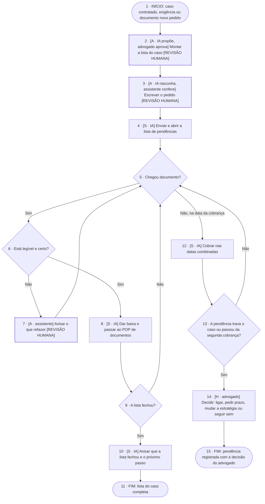

# POP-REL-[NN] Pedido e cobrança de documentos

Código: POP-REL-[NN] · Setor: Relacionamento com o cliente · Área: todas · Canal: WhatsApp · Versão: referência · Atualizado em: [A DEFINIR ao adaptar] · Dono do POP: [A DEFINIR]

> POP de referência do canal, escrito para um escritório genérico com equipe. 8 passos: 4 S, 3 A, 1 H. Os prazos são exemplos. Este POP cuida da conversa: o pedido, a cobrança e o retorno sobre o que veio errado. O que acontece com o arquivo depois que chega (salvar, renomear, conferir, arquivar) está no POP de recebimento e organização de documentos da biblioteca do `escrever-pop` (`../../escrever-pop/references/biblioteca/setor-10-administrativo.md`). Arquivo sugerido: `escritorio/03-pops/relacionamento-com-o-cliente/pop-rel-[nn]-pedido-de-documentos.md`.

"Me manda o CNIS" funciona para quem sabe o que é CNIS. Para o resto, vira três mensagens de dúvida e uma foto da carteira de trabalho no lugar.

## 1. Objetivo

Pedir documento de um jeito que o cliente entenda e consiga cumprir, e cobrar sem desgaste até a lista fechar.

## 2. Gatilho

Caso contratado (lista inicial), exigência do juízo ou do órgão administrativo, ou documento novo que o advogado pediu.

## 3. Responsáveis

- Executa: assistente.
- Confere: assistente (textos e documentos recebidos); advogado (lista final do caso).
- Decide: advogado responsável, que define o que o caso precisa e decide quando a falta de um documento trava o caso.

## 4. Entradas

- Lista padrão de documentos por tipo de caso, com onde conseguir cada um.
- Orientação de como fotografar ou enviar.
- Modelos 2 (pedido) e 7 (cobrança gentil) da biblioteca de mensagens, e a mensagem de "lista fechada".
- Ficha do cliente (canal preferido, familiaridade com o celular).
- Lista de pendências do cliente.

## 5. Passo a passo com S, A e H

1. [A] Montar a lista do caso a partir da lista padrão e da ficha. Executa: IA propõe. Confere: advogado responsável ajusta e aprova.
2. [A] Escrever o pedido em linguagem simples: o que é cada documento, onde conseguir, como mandar e até quando. Executa: IA rascunha a partir do modelo 2. Confere: assistente, nome de cada documento, onde conseguir e data.
3. [S] Enviar o pedido e abrir a lista de pendências do cliente, com a data do pedido. Executa: IA. Confere: assistente, por amostra.
4. [S] Dar baixa no que chegou e passar o arquivo para o POP de documentos do Administrativo. Nada fica só na conversa do WhatsApp. Executa: IA. Confere: assistente, no fechamento do dia.
5. [A] Avisar o que chegou ilegível, cortado ou errado, dizendo exatamente o que refazer. Executa: IA aponta o problema. Confere: assistente confirma e envia.
6. [S] Cobrar com gentileza nas datas combinadas. Executa: IA, com o modelo 7 aprovado. Exemplo: 3 e 7 dias depois do pedido. Confere: assistente, a lista de cobranças da semana.
7. [H] Decidir o que fazer quando a pendência trava o caso: ligar, mudar a estratégia, pedir prazo, seguir sem o documento. Executa: advogado responsável. Confere: não se aplica.
8. [S] Avisar que a lista fechou e qual é o próximo passo do caso. Executa: IA, com o texto aprovado. Se a mensagem precisar dizer algo do caso que o modelo não traz, o passo vira A e alguém lê antes. Confere: assistente, por amostra.

## 6. Prazo

Exemplo: pedido enviado em até 1 dia útil da contratação ou da exigência. Cobranças em 3 e 7 dias. Sem resposta na segunda cobrança, o advogado é avisado. No escritório: [A DEFINIR].

## 7. Exceções

- Exigência com prazo processual ou administrativo correndo: a cobrança segue o prazo, e o advogado acompanha desde o primeiro dia. Cobrança com prazo correndo não sai sem revisão.
- Documento que o cliente não sabe como conseguir, como o PPP de uma empresa que fechou: vira conversa com o advogado.
- Cliente idoso ou com pouca familiaridade com o celular: alguém liga e combina outro jeito de entregar.
- Documento sensível (laudo médico, documento de criança ou adolescente): orientar a mandar só pelo número oficial e seguir para a pasta de acesso restrito.
- Cliente que manda documento para o celular pessoal de alguém da equipe: o arquivo vai para o canal oficial e é apagado do celular.

## 8. Saída

Lista do caso completa, ou pendência registrada com a decisão do advogado.

## 9. Onde a IA entra

- Passos S: envio do pedido, controle de pendências, baixa, cobranças e aviso de lista fechada.
- Passos A: proposta de lista, texto do pedido, apontamento de documento ilegível.
- O que a IA consulta: lista padrão por tipo de caso, explicações de onde conseguir cada documento, orientação de como fotografar, modelos 2 e 7.
- Ambiente: Projeto no Claude com o código do escritório, em conta profissional. Laudo e dado de saúde são dado pessoal sensível pela LGPD (Lei 13.709/2018): só em conta profissional e só quando forem necessários.

## 10. Nunca sai sem revisão humana

- A lista final do caso.
- Cobrança quando existe prazo correndo.
- Qualquer conversa sobre documento que o cliente diz não existir.

## 11. Dados pessoais e sensíveis

- Dados que aparecem: documentos pessoais, CTPS, extratos, laudos, documentos de filhos.
- O que anonimizar antes da IA: para montar a lista e o pedido, a IA precisa só do tipo de caso; nome por `[CLIENTE]`, documentos por `[DOC]`. Para apontar documento ilegível, só a descrição do problema ("página 3 cortada").
- O que nunca entra na IA: laudo completo e documento de criança ou adolescente, sem autorização expressa do responsável; senha e credencial (gov.br, Meu INSS, banco), que nunca são pedidas por mensagem.
- Onde guardar: pasta do caso; laudo, documento de criança e de processo criminal na pasta de acesso restrito.

## 12. Indicador

- Dias entre o pedido e a lista completa.
- Casos parados por falta de documento no fim do mês.

---

## Fluxograma

**Em texto:**
1. INÍCIO: caso contratado, exigência ou documento novo pedido.
2. AÇÃO [A · IA propõe, advogado aprova] Montar a lista do caso [REVISÃO HUMANA]. Vá para 3.
3. AÇÃO [A · IA rascunha, assistente confere] Escrever o pedido [REVISÃO HUMANA]. Vá para 4.
4. AÇÃO [S · IA] Enviar e abrir a lista de pendências. Vá para 5.
5. DECISÃO: chegou documento? Se sim, vá para 6. Se não, na data da cobrança, vá para 12.
6. DECISÃO: está legível e certo? Se sim, vá para 8. Se não, vá para 7.
7. AÇÃO [A · assistente] Avisar o que refazer [REVISÃO HUMANA]. Volte para 5.
8. AÇÃO [S · IA] Dar baixa e passar ao POP de documentos. Vá para 9.
9. DECISÃO: a lista fechou? Se sim, vá para 10. Se não, volte para 5.
10. AÇÃO [S · IA] Avisar que a lista fechou e o próximo passo. Vá para 11.
11. FIM: lista do caso completa.
12. AÇÃO [S · IA] Cobrar nas datas combinadas. Vá para 13.
13. DECISÃO: a pendência trava o caso ou passou da segunda cobrança? Se sim, vá para 14. Se não, volte para 5.
14. AÇÃO [H · advogado] Decidir: ligar, pedir prazo, mudar a estratégia ou seguir sem. Vá para 15.
15. FIM: pendência registrada com a decisão do advogado.

Caminho principal: gatilho → lista aprovada → pedido → documentos chegam → baixa → lista fechada.

## Na trilha solo

- O titular aprova a lista do caso (passo 1) e lê o pedido (passo 2) em outro momento do dia, com a lista padrão aberta ao lado.
- As cobranças (passo 6) rodam com o modelo aprovado; o titular olha a lista de pendências uma vez por semana, no bloco fixo.
