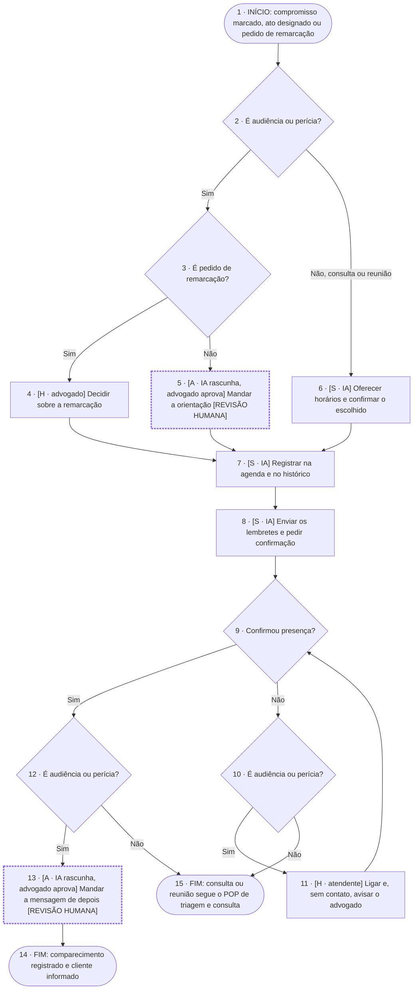

# POP-REL-[NN] Agendamento, orientação e lembretes

Código: POP-REL-[NN] (ou POP-ATD-[NN], veja a nota) · Setor: Relacionamento com o cliente · Área: todas · Canal: WhatsApp · Versão: referência · Atualizado em: [A DEFINIR ao adaptar] · Dono do POP: [A DEFINIR]

> POP de referência do canal, escrito para um escritório genérico com equipe. 8 passos: 4 S, 2 A, 2 H. Os prazos são exemplos. O fluxo atravessa os dois setores do canal: serve à consulta de quem ainda é contato novo e aos compromissos de quem já é cliente. **Nota sobre o setor:** grave em Relacionamento com o cliente (`pop-rel-[nn]-agenda-e-lembretes.md`) quando o fluxo cuidar de audiência e perícia, que é onde estão as consequências processuais. Se o escritório usar o fluxo só para consulta inicial, grave em Atendimento e triagem (`pop-atd-[nn]-agenda-e-lembretes.md`). Um código só: o POP não fica duplicado nas duas pastas.

O cliente que falta à perícia porque achou que era na semana seguinte custa meses de processo. E a equipe que liga um por um na véspera para confirmar gasta uma tarde que poderia estar em outra coisa. Este é um dos fluxos com mais S, porque lembrete é regra pura. O que continua humano é o que tem consequência processual.

## 1. Objetivo

Cliente no lugar certo, na hora certa, sabendo o que levar e o que vai acontecer, sem a equipe ligar um por um.

## 2. Gatilho

Consulta ou reunião marcada, audiência ou perícia designada (informada pela controladoria), ou pedido de remarcação do cliente.

## 3. Responsáveis

- Executa: atendente (agenda e lembretes).
- Confere: atendente (agenda e confirmações); advogado responsável (orientação de audiência e perícia, mensagem de depois).
- Decide: advogado responsável, sobre qualquer pedido de redesignação de ato processual.

## 4. Entradas

- Agenda do escritório e, se houver, link de agendamento da ferramenta.
- Pauta de audiências e perícias vinda da controladoria.
- Modelos de orientação por tipo de compromisso e por área (variações do modelo 5).
- Modelo 5 da biblioteca de mensagens e os textos de lembrete e confirmação.
- Endereço e link de cada local.
- Ficha do cliente (canal preferido; cliente sem WhatsApp).

## 5. Passo a passo com S, A e H

1. [S] Oferecer horários livres e confirmar o escolhido, para consulta e reunião. Executa: IA, consultando a agenda. Se a ferramenta do escritório tiver link de agendamento, ele entra aqui. Confere: atendente, a agenda do dia seguinte.
2. [S] Registrar o compromisso na agenda e no histórico do cliente. Executa: IA. Confere: atendente, junto com o passo 1.
3. [A] Mandar a orientação de audiência ou perícia em linguagem simples: o que é, onde é, o que levar e a que horas chegar. Executa: IA rascunha a partir do modelo da área. Confere: advogado responsável aprova antes de sair.
4. [S] Enviar os lembretes na cadência combinada. Executa: IA. Exemplo: audiência e perícia 7 dias antes, na véspera e no dia; consulta na véspera e no dia. Confere: atendente, por amostra.
5. [S] Pedir confirmação de presença e registrar a resposta. Executa: IA. Confere: atendente, a lista de quem não confirmou.
6. [H] Ligar para quem não confirmou presença em audiência ou perícia. Executa: atendente. Se não localizar o cliente, avisa o advogado no mesmo dia. Confere: não se aplica.
7. [H] Decidir sobre pedido de remarcação de audiência ou perícia. Consulta e reunião do escritório a IA remarca sozinha, pelo passo 1. Executa: advogado responsável. Confere: não se aplica.
8. [A] Mandar a mensagem de depois do compromisso: o que aconteceu e o próximo passo. Executa: IA rascunha a partir da anotação do advogado. Confere: advogado aprova.

## 6. Prazo

Exemplo: orientação enviada assim que a audiência ou a perícia é designada e repetida 7 dias antes. Mensagem de depois do compromisso no mesmo dia. No escritório: [A DEFINIR].

## 7. Exceções

- Audiência por videoconferência: teste de link, câmera e áudio com o cliente na véspera.
- Perícia médica: a orientação explica como funciona e o que levar. Ela nunca diz ao cliente o que falar ao perito.
- Testemunha: a orientação é conversa do advogado, fora deste fluxo.
- Cliente sem WhatsApp: lembrete por ligação, conforme a ficha.
- Resultado desfavorável na audiência: o advogado liga antes da mensagem de depois; a mensagem só registra o que foi conversado (modelo 8).

## 8. Saída

Comparecimento confirmado e registrado, e cliente informado do resultado e do próximo passo.

## 9. Onde a IA entra

- Passos S: agenda, registro, lembretes e confirmação.
- Passos A: rascunho das orientações e da mensagem de depois.
- O que a IA consulta: agenda, pauta da controladoria, modelos de orientação por área, modelo 5.
- Ambiente: Projeto no Claude com o código do escritório, em conta profissional. O lembrete repete só o que a orientação aprovada já disse.

## 10. Nunca sai sem revisão humana

- Orientação de audiência ou perícia.
- Mensagem de depois da audiência.
- Resposta a pedido de remarcação de ato processual.

## 11. Dados pessoais e sensíveis

- Dados que aparecem: nome, data e local do compromisso, tipo de perícia (às vezes dado de saúde), número do processo.
- O que anonimizar antes da IA: nome por `[CLIENTE]`, processo por `[PROCESSO]`; o tipo de perícia fica só no trecho que a orientação exige.
- O que nunca entra na IA: laudo completo, sem autorização expressa do responsável; senha e credencial.
- Link de videoconferência sai só pelo número oficial, para o próprio cliente.

## 12. Indicador

- Faltas em consulta, audiência e perícia por mês.
- Horas por semana gastas confirmando presença por telefone.

---

## Fluxograma

**Em texto:**
1. INÍCIO: compromisso marcado, ato designado ou pedido de remarcação.
2. DECISÃO: é audiência ou perícia? Se sim, vá para 3. Se não (consulta ou reunião), vá para 6.
3. DECISÃO: é pedido de remarcação? Se sim, vá para 4. Se não, vá para 5.
4. AÇÃO [H · advogado] Decidir sobre a remarcação. Vá para 7.
5. AÇÃO [A · IA rascunha, advogado aprova] Mandar a orientação [REVISÃO HUMANA]. Vá para 7.
6. AÇÃO [S · IA] Oferecer horários e confirmar o escolhido (inclusive remarcação de consulta ou reunião). Vá para 7.
7. AÇÃO [S · IA] Registrar na agenda e no histórico. Vá para 8.
8. AÇÃO [S · IA] Enviar os lembretes e pedir confirmação. Vá para 9.
9. DECISÃO: confirmou presença? Se sim, vá para 12. Se não, vá para 10.
10. DECISÃO: é audiência ou perícia? Se sim, vá para 11. Se não, vá para 15.
11. AÇÃO [H · atendente] Ligar; sem contato, avisar o advogado no mesmo dia. Volte para 9.
12. DECISÃO: é audiência ou perícia? Se sim, vá para 13. Se não, vá para 15.
13. AÇÃO [A · IA rascunha, advogado aprova] Mandar a mensagem de depois [REVISÃO HUMANA]. Vá para 14.
14. FIM: comparecimento registrado e cliente informado.
15. FIM: consulta ou reunião segue o POP de triagem e consulta (ou fica registrada a falta).

Caminho principal: ato designado → orientação aprovada → registro → lembretes → confirmação → mensagem de depois.

## Na trilha solo

- Quem liga para quem não confirmou (passo 6) é a secretária ou o próprio titular; com audiência no mesmo dia, o plano de ausência diz quem faz.
- A orientação e a mensagem de depois são aprovadas pelo titular; a mensagem de depois sai no mesmo dia, a partir da anotação feita na saída da audiência.
