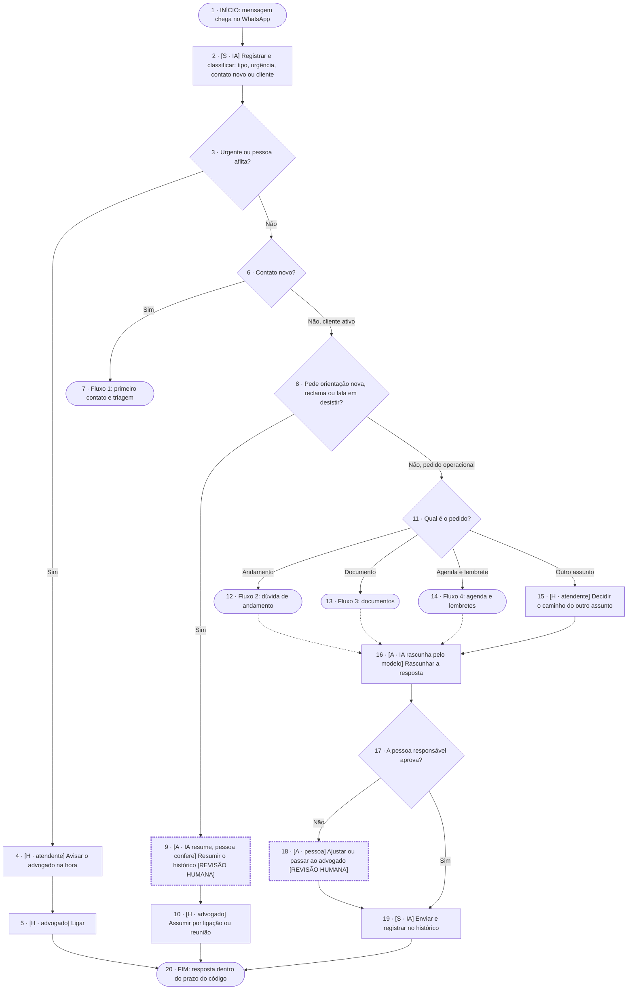

# O caminho de cada mensagem que chega

Leia no passo 3 (para escrever as palavras de alerta) e no passo 8 (para testar a triagem). Um único desenho para o WhatsApp inteiro: toda mensagem passa por ele, e cada saída leva a um dos quatro fluxos ou a uma pessoa. O texto numerado vai para o documento de regras de canal na base (`escritorio/04-base/comum/regras-de-canal.md`). Para o desenho em raias e a revisão com a equipe, use a `desenhar-fluxograma`.

## Fluxograma

**Em texto:**
1. INÍCIO: mensagem chega no WhatsApp.
2. AÇÃO [S · IA] Registrar e classificar: tipo, urgência, contato novo ou cliente ativo. Vá para 3.
3. DECISÃO: urgente ou pessoa aflita (palavra de alerta, sinal de vulnerabilidade)? Se sim, vá para 4. Se não, vá para 6.
4. AÇÃO [H · atendente] Avisar o advogado na hora. Vá para 5.
5. AÇÃO [H · advogado] Ligar. Vá para 20.
6. DECISÃO: contato novo? Se sim, vá para 7. Se não (cliente ativo), vá para 8.
7. Segue o fluxo 1 (primeiro contato e triagem).
8. DECISÃO: pede orientação nova, reclama ou fala em desistir? Se sim, vá para 9. Se não (pedido operacional), vá para 11.
9. AÇÃO [A · IA resume, pessoa confere] Resumir o histórico [REVISÃO HUMANA]. Vá para 10.
10. AÇÃO [H · advogado] Assumir por ligação ou reunião. Vá para 20.
11. DECISÃO: qual é o pedido? Andamento, vá para 12. Documento, vá para 13. Agenda e lembrete, vá para 14. Outro assunto, vá para 15.
12. Segue o fluxo 2 (dúvida de andamento); a resposta passa pelo 16.
13. Segue o fluxo 3 (documentos); a resposta passa pelo 16.
14. Segue o fluxo 4 (agenda e lembretes); a resposta passa pelo 16.
15. AÇÃO [H · atendente] Decidir o caminho do outro assunto. Vá para 16.
16. AÇÃO [A · IA rascunha pelo modelo] Rascunhar a resposta. Vá para 17.
17. DECISÃO: a pessoa responsável aprova? Se sim, vá para 19. Se não, vá para 18.
18. AÇÃO [A · pessoa] Ajustar ou passar ao advogado [REVISÃO HUMANA]. Vá para 19.
19. AÇÃO [S · IA] Enviar e registrar no histórico. Vá para 20.
20. FIM: resposta dentro do prazo do código.

Caminho principal: mensagem → classificação → cliente ativo com pedido operacional → fluxo do tipo → rascunho → aprovação → envio e registro.

## Como usar o desenho

1. **Escrever as palavras de alerta da área.** A primeira decisão depende de saber o que é urgente para o escritório. Em Família, "medida protetiva" e "não me deixa ver meu filho". Em Previdenciário, "benefício cortado" e "perícia amanhã". A lista vai para as regras de canal na base.
2. **Testar com uma semana de mensagens reais, anonimizadas.** Passe cada mensagem pelo desenho, no papel ou com o prompt de classificação (`prompts-do-canal.md`, prompt 2). Anote as que não couberam em nenhuma saída: elas mostram o fluxo que está faltando.
3. **Ajustar a caixa "outro assunto" até ela quase sumir.** Se muita coisa cai ali, existe um quinto fluxo no escritório. Financeiro e cobrança costuma ser o candidato, e tem POP de referência na biblioteca do `escrever-pop` (`setor-06-financeiro-cobranca.md`).
4. **Levar o desenho para a `desenhar-fluxograma`** para redesenhar em raias (IA, Equipe, Advogado) e revisar com quem atende.

## Ficha do teste da triagem (passo 8 do fluxo)

| Código do remetente | Contato novo ou cliente | Tipo | Urgência | Sinal de alerta | Fluxo indicado | Quem responde | Coube no desenho? |
|---|---|---|---|---|---|---|---|
| (exemplo) C-014 | cliente | andamento | normal | nenhum | 2 | assistente | sim |
| (exemplo) N-203 | contato novo | orientação jurídica nova | normal | nenhum | 1 | atendente | sim |
| (exemplo) C-031 | cliente | financeiro | baixa | nenhum | outro assunto | [A DEFINIR] | não: candidato a quinto fluxo |

Depois do teste, conte: quantas mensagens por fluxo, quantas em "outro assunto", quantas com sinal de alerta e se alguma com sinal de alerta foi parar numa resposta pronta (esta conta precisa dar zero).
