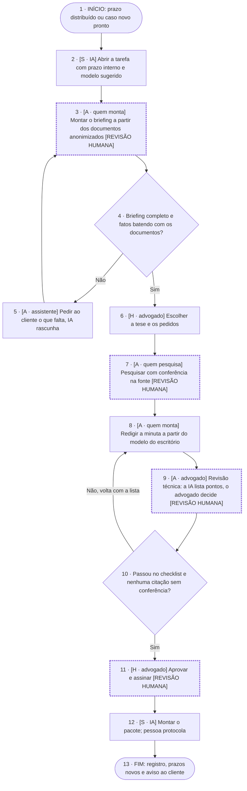

# O ciclo da peça em onze etapas

Referência do passo 2 da skill `organizar-producao-de-pecas`. Do momento em que a peça nasce até o momento em que ela vira prazo cumprido no sistema. A ordem das etapas importa tanto quanto a sigla de cada uma.

## Os quatro grupos

| Grupo | Etapas | O que acontece |
|---|---|---|
| Antes da minuta | 1 a 4 | Gatilho, briefing, documentos e tese. É aqui que a peça é decidida. A IA organiza, o advogado escolhe. |
| Produção | 5 e 6 | Pesquisa e minuta. A IA trabalha a partir do que o advogado decidiu e do modelo do escritório, nunca do zero. |
| Portões | 7 a 9 | Revisão técnica, revisão de forma com checagem de citações e assinatura. Nada passa sem alguém conferir com critério escrito. |
| Saída | 10 e 11 | Protocolo, registro, prazo seguinte e aviso ao cliente. O trabalho braçal que mais some com a IA. |

## As onze etapas

| # | Etapa | O que acontece | Sigla | Quem responde | O que sai |
|---|---|---|---|---|---|
| 1 | Gatilho | A controladoria distribui a tarefa com prazo fatal e prazo interno já conferidos, ou o caso novo chega com contrato e documentos. A IA abre a tarefa e sugere o tipo de peça e o modelo do banco. | S | Controller confere o prazo antes da distribuição | Tarefa aberta com prazo e modelo sugerido |
| 2 | Briefing do caso | A IA monta a ficha de briefing a partir da ata e dos documentos anonimizados, com a fonte de cada fato e o que falta. | A | Quem monta a minuta confere campo por campo | Ficha de briefing |
| 3 | Triagem de documentos | Organizar, nomear e indexar é S. Extrair fatos e apontar contradição entre documentos é A. | S e A | Assistente ou estagiário | Pasta indexada e lista de pendências |
| 4 | Escolha da tese | Tese principal e subsidiária, pedidos, urgência e o que fica de fora de propósito. A IA pode listar caminhos a partir do caderno de teses. Quem escolhe é o advogado. | H | Advogado responsável | Campo "tese escolhida" preenchido na ficha |
| 5 | Pesquisa | A IA sugere linhas de pesquisa e candidatos a citação, todos marcados `[CONFERIR]`. Uma pessoa abre cada um na fonte oficial e registra o que conferiu. | A | Quem pesquisa, revisado pelo advogado | Tabela de citações conferidas |
| 6 | Minuta | A IA escreve a partir do modelo do banco, da ficha e da tese escolhida, por blocos: fatos, fundamentos, pedidos. Só usa citação que está na tabela. | A | Quem monta a minuta | Minuta v1 com campos e marcações |
| 7 | Revisão técnica | A IA lê a minuta como a parte contrária leria e lista pontos fracos. O advogado faz a leitura jurídica e decide o que muda. | H e A | Advogado responsável, e revisor sênior nas peças de risco | Minuta v2 com as decisões |
| 8 | Revisão de forma e citações | Checklist de revisão aplicado pela IA: nomes, números, valores, anexos, português. Toda citação da minuta é cruzada com a tabela da etapa 5. | A | IA aponta, quem montou corrige | Checklist marcado e nenhum `[CONFERIR]` sobrando |
| 9 | Aprovação e assinatura | Leitura integral, do começo ao fim, por quem assina. | H | Advogado responsável | Peça final assinada |
| 10 | Protocolo | A IA prepara o pacote: anexos nomeados, na ordem em que aparecem na peça, e confere se todo documento citado está lá. O protocolo com certificado é feito por pessoa. | S e A | Quem protocola | Comprovante de protocolo |
| 11 | Registro e prazo | A IA lê o comprovante, atualiza o sistema, arquiva a versão final, rascunha o aviso ao cliente e sugere o que vale atualizar no banco de modelos. | S | Confere: quem protocolou. Prazos novos: controladoria | Processo atualizado e cliente avisado |

**Etapas com duas siglas (3, 7 e 10).** No ciclo, uma etapa junta tarefas de natureza diferente. No POP, cada uma vira passos separados com uma sigla só, pela regra do glossário (a sigla diz quem é dono do resultado do passo). Exemplo: a etapa 7 vira "fazer a leitura crítica" (A: a IA lista, o advogado decide) e a revisão final com assinatura (H). A etapa 10 vira "montar o pacote" (S) e o protocolo com certificado, feito por pessoa.

## A ordem que muda tudo

A tese está na etapa 4, antes da pesquisa e antes da minuta. No jeito que muita gente usa a IA, a ordem está invertida: pede a peça, lê o que veio e decide a tese em cima do texto pronto. Parece mais rápido, e é aí que a máquina passa a escolher pelo advogado, porque ninguém tem energia para desmontar uma minuta de quinze páginas que já parece boa.

Com a ordem certa, a IA trabalha a partir do que o advogado decidiu. A minuta já nasce com a tese, os pedidos e citações que alguém abriu na fonte. E a revisão volta a ser revisão.

**Todo H do ciclo é um portão:** a peça só passa quando alguém com nome e OAB abre. A etapa 8 tem um portão a mais, escondido dentro de um A: a IA aponta as citações, mas ninguém marca uma citação como conferida sem ter aberto a fonte com os próprios olhos.

## O ciclo em fluxograma

O mesmo ciclo, com as duas decisões que mais fazem a peça voltar para trás. Serve de base para o fluxograma do POP adaptado (`desenhar-fluxograma`).

**Em texto:**
1. INÍCIO: prazo distribuído ou caso novo pronto.
2. AÇÃO [S · IA] Abrir a tarefa com prazo interno e modelo sugerido. Vá para 3.
3. AÇÃO [A · quem monta] Montar o briefing a partir dos documentos anonimizados [REVISÃO HUMANA]. Vá para 4.
4. DECISÃO: o briefing está completo e os fatos batem com os documentos? Se sim, vá para 6. Se não, vá para 5.
5. AÇÃO [A · assistente] Pedir ao cliente o que falta, com rascunho da IA. Volte para 3.
6. AÇÃO [H · advogado] Escolher a tese e os pedidos. Vá para 7.
7. AÇÃO [A · quem pesquisa] Pesquisar com conferência na fonte [REVISÃO HUMANA]. Vá para 8.
8. AÇÃO [A · quem monta] Redigir a minuta a partir do modelo do escritório. Vá para 9.
9. AÇÃO [A · advogado] Revisão técnica: a IA lista pontos, o advogado decide [REVISÃO HUMANA]. Vá para 10.
10. DECISÃO: passou no checklist e nenhuma citação ficou sem conferência? Se sim, vá para 11. Se não, volte para 8 com a lista.
11. AÇÃO [H · advogado] Aprovar e assinar [REVISÃO HUMANA]. Vá para 12.
12. AÇÃO [S · IA] Montar o pacote; uma pessoa protocola. Vá para 13.
13. FIM: registro, prazos novos e aviso ao cliente.

## Onde o fluxo do escritório costuma ser diferente

| Situação | O que muda | O que nunca muda |
|---|---|---|
| **Escritório solo** | Quem monta, revisa e assina é a mesma pessoa. Os passos continuam existindo, só mudam de momento: a revisão técnica acontece em outro horário, de preferência no dia seguinte, com o checklist na mão. "Logo depois de escrever, você lê o que quis dizer. No dia seguinte, lê o que está escrito." | Tese, conferência de citação, leitura integral, assinatura |
| **Peça urgente** (tutela de urgência, prazo de horas) | A sequência encurta: o briefing vira dez linhas e a pesquisa fica restrita ao que já está conferido no caderno de teses. | A tese escolhida pelo advogado, a citação conferida, a leitura integral e a assinatura |
| **Peça de massa** (muitos casos iguais com modelo-mestre) | O ciclo é o mesmo, com o enquadramento na tese antes do briefing. POP completo: `../../escrever-pop/references/biblioteca/area-civel-massa.md`. | Cada petição revisada por um advogado, com os fatos e documentos do próprio cliente |
| **Peça que volta do cliente** (documento novo depois da minuta pronta) | A tentação é encaixar no texto. O caminho certo é voltar ao briefing, atualizar a ficha e só depois mexer na minuta, para a ficha continuar sendo a fonte da verdade. | A ficha como fonte da verdade |

## Quem faz o quê: o ciclo em raias

Versão curta, em dez passos, de uma petição inicial. Cada linha é um passo; a coluna mostra quem executa e, nos passos A, quem revisa antes de seguir. Toda decisão e toda assinatura ficam na coluna do advogado. Use para mostrar o ciclo à equipe ou para desenhar o fluxograma em raias com a `desenhar-fluxograma`.

| # | IA | Equipe | Advogado |
|---|---|---|---|
| 1 | [S] Conferir documentos pelo checklist do tipo de caso | Confere por amostra | |
| 2 | [A] Montar o briefing e a linha do tempo dos fatos | | Revisa os fatos |
| 3 | | | [H] Definir a tese e os pedidos |
| 4 | [A] Sugerir caminhos de pesquisa, marcados `[CONFERIR]` | | Confere cada fonte |
| 5 | [A] Escrever a minuta no modelo do escritório | | Recebe a minuta |
| 6 | | | [H] Revisão técnica com leitura integral |
| 7 | [A] Conferir forma: nomes, datas, valores, pedidos contra fatos | Corrige os apontamentos | |
| 8 | | | [H] Assinar |
| 9 | [S] Registrar número e prazos a partir do comprovante | Protocola | |
| 10 | [A] Rascunhar o aviso ao cliente no tom do escritório | Revisa e envia | |

Dez passos: dois S, cinco A e três H. A IA participa de sete deles, e nenhum passo de decisão ou de assinatura sai das mãos do advogado. No solo, a coluna da equipe também é do titular: as revisões vão para outro momento do dia, com olhar descansado.

A versão completa, em 12 passos, é o `pop-pec-01-peticao-inicial.md`. A diferença está no passo 6 das raias: aqui a revisão técnica inteira é H; no POP completo, a leitura crítica da IA é um passo A e a revisão final com assinatura é H.
