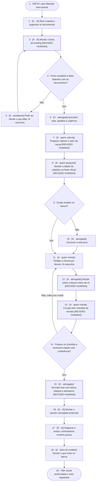

# POP: Petição inicial a partir de modelo

Código: POP-PEC-01 · Setor: Produção de peças · Área: todas (exemplos por área no fim) · Versão: referência 1.0 · Atualizado em: [A DEFINIR ao adaptar] · Dono do POP: [A DEFINIR]

> POP de referência, escrito para um escritório genérico com equipe. 12 passos: 3 S, 7 A, 2 H. O portão que mais pesa: **tese escolhida antes da minuta**. É a versão aprofundada do POP de produção de peças da biblioteca do `escrever-pop` (`setor-03-producao-pecas.md`): ficha de briefing conferida antes de qualquer minuta, tabela de citações antes da redação e leitura crítica da IA antes da revisão final. Prazos são exemplos. Prazo processual é o que a controladoria lançou e conferiu na fonte: a IA não calcula prazo de peça. Para usar, adapte pelo passo 3 da skill `organizar-producao-de-pecas`.

## 1. Objetivo

Protocolar uma inicial no padrão do escritório, com cada fato apoiado em documento, a tese que o advogado escolheu e toda citação conferida na fonte oficial.

## 2. Gatilho

Caso liberado para ajuizar: contrato assinado, viabilidade decidida e documentação completa ou com pendências conhecidas.

## 3. Responsáveis

- Executa: advogado júnior ou estagiário (ficha de briefing e minuta); assistente (documentos e pacote de protocolo).
- Confere: quem monta a minuta (fatos contra documentos); quem calcula (valores); quem pesquisa (citações na fonte oficial); revisor sênior nas peças de maior risco.
- Decide: advogado responsável (tese, pedidos, urgência, o que muda depois da leitura crítica, assinatura).
- Responde pelo que a IA entregou: advogado responsável.

## 4. Entradas

- Ata da consulta.
- Documentos do cliente, anonimizados para uso na IA.
- Modelo do banco para aquele tipo de ação, com a ficha do modelo (`04-base/producao-de-pecas/modelos/INDICE.md`).
- Caderno de teses (`04-base/producao-de-pecas/teses/caderno-de-teses.md`).
- Memória de cálculo, quando houver.
- Ficha de briefing em branco e tabela de citações do caso.
- Checklist de revisão de peça (`04-base/producao-de-pecas/checklist-revisao-peca.md`).

## 5. Passo a passo com S, A e H

1. [S] Abrir a tarefa e organizar os documentos: tipo de ação, modelo sugerido do banco, prazo interno e pasta indexada com nome padrão e ordem cronológica. Executa: IA, usando só a data que a controladoria conferiu. Confere: assistente, no índice da pasta.
2. [A] Montar a ficha de briefing com os fatos e a fonte de cada um, as lacunas e as contradições entre documentos. Executa: IA, com o prompt 1. Confere: quem monta a minuta, fato por fato contra o documento e a página.
3. [H] Escolher a tese, os pedidos e se há pedido de urgência, registrando também as teses descartadas e o que fica de fora de propósito. Executa: advogado responsável, assinando os campos 6 e 7 da ficha com nome e data. Confere: não se aplica.
4. [A] Preparar valores e valor da causa a partir da memória de cálculo, com a origem de cada número. Executa: IA organiza os dados. Confere: quem calcula, no software ou planilha do escritório. Aprova: advogado.
5. [A] Pesquisar e montar a tabela de citações. Cada candidato entra com `[CONFERIR]` e só vira "conferido" depois que alguém abre a fonte oficial e registra link e data. Executa: IA sugere, com o prompt 2. Confere: quem pesquisa, na fonte oficial. Escolhe o que entra: advogado.
6. [A] Redigir a minuta por blocos a partir do modelo do banco: qualificação com campos, fatos, fundamentos, pedidos. Executa: IA, com o prompt 3, usando só a ficha e as citações conferidas. Confere: quem monta a minuta reescreve o que precisa, bloco a bloco.
7. [A] Fazer a leitura crítica: a IA lê a minuta como a parte contrária leria e lista pedidos sem fato, fatos sem prova e pontos fáceis de atacar. Executa: IA, com o prompt 4. Confere: advogado responsável decide o que muda.
8. [A] Revisar a forma pelo checklist de revisão: nomes, números, valores, endereçamento, anexos citados, português, e cada citação cruzada com a tabela. Executa: IA aponta. Confere: quem monta a minuta corrige cada apontamento.
9. [H] Fazer a revisão final e assinar, com leitura integral da peça e a qualificação real das partes trazida do cadastro. Executa: advogado responsável. Confere: revisor sênior, nas peças de maior risco.
10. [S] Montar o pacote de protocolo: anexos nomeados na ordem em que aparecem na peça, conferindo que todo documento citado está lá. Executa: IA. Confere: advogado, que protocola com o certificado (o certificado nunca entra na IA).
11. [S] Registrar e avisar: comprovante lido, processo cadastrado, versão final arquivada, mensagem ao cliente encaminhada ao Relacionamento para revisão. Executa: IA. Confere: controladoria, que confere audiência e prazos no sistema do tribunal.
12. [A] Alimentar o banco de modelos com o trecho que ficou melhor que o modelo ou com o pedido que faltava nele. Executa: IA sugere. Confere: dono do modelo decide o que entra.

## 6. Prazo

- Exemplo: ficha conferida em até 2 dias úteis depois da documentação completa, minuta em mais 2 e revisão final em 1. No escritório: [A DEFINIR, do código do escritório].
- Se o advogado apontar risco de prescrição ou decadência, o prazo é o dele e vem antes de qualquer meta `[CONFERIR]`.

## 7. Exceções

- Caso sem modelo no banco: o advogado escreve a estrutura e a peça já nasce candidata a modelo.
- Pedido de urgência: o advogado assume desde o passo 3 e a sequência encurta. A conferência de citações e a leitura integral nunca saem.
- Documento novo depois da minuta pronta: volta ao passo 2, atualiza a ficha e só depois mexe no texto.
- Fato que só o cliente afirma: entra na peça só por decisão do advogado, já com a prova que será pedida.
- Citação que não abre na fonte oficial, ou não diz o que a peça afirma: sai da peça ou o argumento é reescrito.
- Família: sinal de violência doméstica, coação ou risco faz o POP parar. O advogado assume pessoalmente e nada daquele caso entra em automação.

## 8. Saída

Inicial protocolada, ficha e tabela de citações arquivadas na pasta do caso, processo cadastrado, cliente avisado e sugestão para o banco registrada.

## 9. Onde a IA entra

- Passos S: abertura e organização dos documentos, pacote de protocolo, registro e aviso.
- Passos A: ficha de briefing, valores, sugestão de pesquisa, minuta por blocos, leitura crítica, conferência de forma, curadoria do banco.
- O que a IA consulta: código do escritório, modelos vigentes com a ficha, caderno de teses, checklist de revisão, ficha de briefing.
- Ambiente: Projeto de peças no Claude. Documento de cliente só em conta profissional e anonimizado (conferir na configuração da conta).

## 10. Nunca sai sem revisão humana

- A tese e os pedidos.
- Toda citação de lei, súmula, precedente ou doutrina.
- O valor da causa.
- A peça inteira, lida do começo ao fim por quem assina.

## 11. Dados pessoais e sensíveis

- Dados que aparecem: qualificação das partes, documentos do caso, às vezes dado de saúde, de criança ou de processo criminal.
- Anonimizar antes da IA: nomes por `[CLIENTE]`, `[PARTE CONTRÁRIA]`, `[EMPRESA]`, `[FILHO 1]`, `[TESTEMUNHA 1]`; CPF, RG e NIT por `[DOC]`; processo por `[PROCESSO]`; endereço por `[ENDEREÇO]`; telefone e e-mail por `[CONTATO]`; dados bancários e de cartão fora.
- Nunca na IA sem autorização expressa do responsável: laudo completo, dado de criança ou adolescente, processo em segredo de justiça. Senha e certificado nunca.
- A tabela que diz quem é quem fica na pasta do caso, fora da IA. A qualificação real entra no passo 9, a partir do cadastro.

## 12. Indicador

- Rodadas de revisão por peça (média do mês, no registro de peças).
- Erros pegos na revisão final, por tipo: citação, fato, valor, pedido, dado do cliente.

---

## Exemplos por área

- **Previdenciário:** ação depois do indeferimento, partindo do parecer de viabilidade (`../../escrever-pop/references/biblioteca/area-previdenciario-viabilidade.md`). A ficha separa o que o INSS analisou e o que ficou de fora.
- **Trabalhista:** reclamatória com cálculo preliminar (`area-trabalhista-reclamatoria.md` na mesma biblioteca). A matriz de prova vira o campo de fatos da ficha.
- **Família:** ação de alimentos (`area-familia-alimentos.md`). A planilha de gastos é a memória de cálculo, e o campo "o que não pode aparecer" protege a criança.
- **Consumidor:** indenizatória de consumo (`area-consumidor-indenizatoria.md`), como no exemplo de ficha em `exemplo-ficha-de-briefing.md`.

## Antes e com a IA

| Passo | Como era antes da IA | Como fica com a IA | Sigla |
|---|---|---|---|
| Conferir documentos recebidos | A assistente abre arquivo por arquivo | A IA lista o que chegou e o que falta, pelo checklist do tipo de caso; a assistente confere | S |
| Montar o briefing | O advogado lê tudo e anota | A IA extrai fatos, datas e fontes dos documentos anonimizados; quem monta confere | A |
| Definir tese e pedidos | O advogado decide | Continua com o advogado. A IA pode listar caminhos do caderno de teses | H |
| Pesquisar fundamentos | Busca manual em várias fontes | A IA sugere caminhos e marca `[CONFERIR]`; uma pessoa abre cada fonte | A |
| Escrever a minuta | Copiar uma peça antiga e adaptar | A IA preenche o modelo do escritório com a ficha e a tese decidida | A |
| Conferir forma | Leitura final, quando dá tempo | A IA aplica o checklist em toda peça; a pessoa corrige | A |
| Assinar | O advogado assina | O advogado assina. Não se delega | H |

## Na trilha solo

Quem monta, revisa e assina é a mesma pessoa. Os passos 2, 7, 8 e 9 continuam existindo e mudam de momento: a revisão final acontece em outro horário, de preferência no dia seguinte, com o checklist na mão. Nas peças de maior risco, revisor externo no lugar do sênior.

## Fluxograma

**Em texto:**
1. INÍCIO: caso liberado para ajuizar.
2. AÇÃO [S · IA] Abrir a tarefa e organizar os documentos. Vá para 3.
3. AÇÃO [A · IA] Montar a ficha de briefing [REVISÃO HUMANA]. Vá para 4.
4. DECISÃO: a ficha está completa e os fatos batem com os documentos? Se sim, vá para 6. Se não, vá para 5.
5. AÇÃO [A · assistente] Pedir ao cliente o que falta, com rascunho da IA. Volte para 3 quando chegar.
6. AÇÃO [H · advogado] Escolher tese, pedidos e urgência. Vá para 7.
7. AÇÃO [A · quem calcula] Preparar valores e valor da causa [REVISÃO HUMANA]. Vá para 8.
8. AÇÃO [A · quem pesquisa] Montar a tabela de citações na fonte oficial [REVISÃO HUMANA]. Vá para 9.
9. DECISÃO: existe modelo no banco? Se sim, vá para 11. Se não, vá para 10.
10. AÇÃO [H · advogado] Escrever a estrutura. Vá para 11.
11. AÇÃO [A · quem monta] Redigir a minuta por blocos, com rascunho da IA. Vá para 12.
12. AÇÃO [A · advogado] Decidir sobre a leitura crítica da IA [REVISÃO HUMANA]. Vá para 13.
13. AÇÃO [A · quem monta] Corrigir pelo checklist de revisão [REVISÃO HUMANA]. Vá para 14.
14. DECISÃO: passou no checklist e nenhuma citação ficou sem conferência? Se sim, vá para 15. Se não, volte para 11 com a lista.
15. AÇÃO [H · advogado] Revisão final com leitura integral e assinatura [REVISÃO HUMANA]. Vá para 16.
16. AÇÃO [S · IA] Montar o pacote; o advogado protocola. Vá para 17.
17. AÇÃO [S · IA] Registrar e avisar; a controladoria confere os prazos. Vá para 18.
18. AÇÃO [A · dono do modelo] Decidir o que entra no banco. Vá para 19.
19. FIM: inicial protocolada, caso registrado, cliente avisado.

O símbolo 5 vem do fluxograma do ciclo da peça (`ciclo-da-peca.md`) e é tratado no POP de recebimento de documentos do Administrativo, se o escritório tiver. O símbolo 10 é a exceção "caso sem modelo".

Caminho principal: caso liberado → documentos → ficha → tese → valores → citações → minuta → leitura crítica → checklist → revisão final e assinatura → protocolo → registro.
