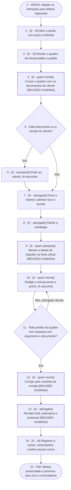

# POP: Contestação ou defesa

Código: POP-PEC-02 · Setor: Produção de peças · Área: todas (exemplos por área no fim) · Versão: referência 1.0 · Atualizado em: [A DEFINIR ao adaptar] · Dono do POP: [A DEFINIR]

> POP de referência, escrito para um escritório genérico com equipe. 12 passos: 3 S, 6 A, 3 H. O portão que mais pesa: **nenhum pedido da inicial sem resposta**. Na defesa, o prazo corre desde o primeiro dia e a pauta é da outra parte. O ganho da IA está na leitura: transformar a inicial num quadro pedido a pedido em minutos. O risco também: um pedido esquecido no quadro vira um pedido sem impugnação na peça. Por isso há um passo só para conferir a cobertura. Prazos são exemplos. A IA não calcula prazo de peça. Para usar, adapte pelo passo 3 da skill `organizar-producao-de-pecas`.

## 1. Objetivo

Protocolar a defesa dentro do prazo interno, respondendo a cada pedido da inicial com argumento e documento, na estratégia que o advogado e o cliente definiram.

## 2. Gatilho

Citação ou intimação para defesa registrada pela controladoria, com prazo fatal conferido e prazo interno lançado.

## 3. Responsáveis

- Executa: quem monta a minuta (quadro, ficha e redação); assistente (pede e organiza os documentos do cliente).
- Confere: quem monta a minuta (quadro e cruzamento com documentos); quem pesquisa (citações na fonte oficial); controladoria (prazos novos).
- Decide: advogado responsável (conversa com o cliente, estratégia, o que se reconhece, faixa de acordo, assinatura).
- Responde pelo que a IA entregou: advogado responsável.

## 4. Entradas

- Inicial e documentos da outra parte (anonimizados antes de subir: também têm dado pessoal).
- Documentos do cliente e a versão dele sobre os fatos.
- Modelo de defesa do banco para aquele tipo de pedido.
- Caderno de teses.
- Ficha de briefing e tabela de citações do caso.
- Checklist de revisão de peça.

## 5. Passo a passo com S, A e H

1. [S] Abrir a tarefa com o prazo conferido pela controladoria, o prazo interno e o modelo de defesa sugerido. Executa: IA, usando só a data que o controller conferiu. Confere: quem monta a minuta, ao receber a tarefa.
2. [S] Montar o quadro da inicial pedido a pedido: fato alegado, pedido, fundamento indicado, documento juntado e valor, com a página. Executa: IA. Uso interno. Confere: quem monta a minuta lê a inicial inteira mesmo assim.
3. [A] Cruzar o quadro com os documentos do cliente, marcando onde a defesa tem documento, onde é fraca e onde não tem nada. Executa: IA. Confere: quem monta a minuta.
4. [A] Pedir ao cliente o que falta e a versão dele, com perguntas específicas por pedido e data-limite interna. Executa: IA rascunha. Confere: assistente ajusta e envia.
5. [H] Ouvir o cliente sobre os pontos sensíveis e alinhar risco e expectativa, inclusive sobre acordo. Executa: advogado responsável, por ligação ou reunião. Confere: não se aplica.
6. [H] Definir a estratégia: o que impugnar, o que reconhecer, se há matéria preliminar a levantar, se há pedido próprio do cliente a fazer e qual a faixa de acordo, quando couber. Executa: advogado, com o cliente, registrando na ficha de briefing. Confere: não se aplica.
7. [A] Pesquisar e montar a tabela de citações, focada nos pontos que a estratégia decidiu enfrentar. Executa: IA sugere, com o prompt 2. Confere: quem pesquisa, na fonte oficial.
8. [A] Redigir a minuta a partir do modelo de defesa, impugnando ponto a ponto na ordem do quadro e apontando o documento de cada argumento. Executa: IA, com o prompt 3. Confere: quem monta a minuta reescreve o que precisa.
9. [A] Conferir a cobertura: todo pedido do quadro tem resposta na minuta, e toda resposta aponta argumento e documento. Executa: IA lista os pedidos sem resposta. Confere: advogado decide.
10. [A] Revisar a forma pelo checklist de revisão. Executa: IA aponta. Confere: quem monta a minuta corrige.
11. [H] Fazer a revisão final, assinar e protocolar dentro do prazo interno. Executa: advogado responsável. Confere: revisor sênior, nas defesas de maior risco.
12. [S] Registrar e avisar: comprovante arquivado, cliente informado em linguagem simples, próximos atos (audiência, réplica, provas) encaminhados à controladoria. Executa: IA. Confere: controladoria, os prazos novos; a mensagem ao cliente passa pelo Relacionamento.

## 6. Prazo

- O prazo da defesa é processual: quem diz é a controladoria, conferido na fonte `[CONFERIR]`.
- Exemplo de prazos internos: documentos pedidos ao cliente no dia da abertura e minuta pronta para revisão 3 dias úteis antes do prazo fatal. No escritório: [A DEFINIR, do código do escritório].

## 7. Exceções

- Cliente que não manda documento: o advogado avisa por escrito sobre o risco e decide com o que tem.
- Prazo curto: os passos 4 e 5 viram uma ligação só. Os passos 9 e 11 continuam.
- Proposta de acordo no meio do caminho: o advogado leva ao cliente, e o prazo da defesa segue correndo.
- Decisão de urgência já concedida contra o cliente: o advogado avalia no mesmo dia a medida própria, fora deste POP.
- Família: o passo 5 é longo e presencial. Qualquer sinal de violência, coação ou risco tira o caso deste POP na hora: o advogado assume e nada entra em automação.

## 8. Saída

Defesa protocolada no prazo interno, quadro e ficha arquivados na pasta do caso, cliente informado e próximos atos com a controladoria.

## 9. Onde a IA entra

- Passos S: abertura, quadro da inicial, registro e aviso.
- Passos A: cruzamento com documentos, mensagem ao cliente, sugestão de pesquisa, minuta, conferência de cobertura, revisão de forma.
- O que a IA consulta: modelos de defesa por tipo de pedido, caderno de teses, checklist de revisão, código do escritório.
- Ambiente: Projeto de peças no Claude, em conta profissional (conferir na configuração da conta).

## 10. Nunca sai sem revisão humana

- A estratégia e o que se reconhece.
- A faixa de acordo.
- Toda citação.
- A peça inteira, lida por quem assina.

## 11. Dados pessoais e sensíveis

- Dados que aparecem: qualificação das partes nos dois lados, documentos internos do cliente (no lado da empresa, documentos de RH com dados de empregados), às vezes dado de saúde.
- Anonimizar antes da IA: a inicial da outra parte e os documentos do cliente, pela tabela padrão (`[CLIENTE]`, `[PARTE CONTRÁRIA]`, `[EMPRESA]`, `[TESTEMUNHA 1]`, `[DOC]`, `[PROCESSO]`, `[ENDEREÇO]`, `[CONTATO]`).
- Nunca na IA sem autorização expressa do responsável: laudo completo, dado de criança ou adolescente, processo em segredo de justiça. Senha e certificado nunca.
- A tabela que diz quem é quem fica na pasta do caso, fora da IA.

## 12. Indicador

- Pedidos sem impugnação específica encontrados na revisão (meta: nenhum).
- Dias de folga entre a minuta pronta e o prazo fatal.

---

## Exemplos por área

- **Trabalhista, lado da empresa:** o quadro pedido a pedido cruza com os documentos do RH. POP completo do lado da empresa: `../../escrever-pop/references/biblioteca/area-trabalhista-defesa-empresa.md`.
- **Consumidor, lado do fornecedor:** contrato aceito, registros de atendimento e telas do sistema viram os documentos de cada resposta.
- **Família:** contestação em alimentos ou guarda. O passo 5 é longo e presencial, e qualquer sinal de violência tira o caso deste POP na hora.
- **Previdenciário:** do lado do segurado, a peça mais comum depois da defesa do INSS é a réplica, que segue o POP-PEC-04 (manifestação e impugnação).

## Na trilha solo

O quadro da inicial (passo 2) é o que mais devolve tempo. A conferência de cobertura (passo 9) é feita em outro momento do dia, nunca logo depois de escrever a minuta, e a revisão final de preferência no dia seguinte.

## Fluxograma

Desenhado a partir dos passos (o material de origem não trazia fluxograma deste POP).

**Em texto:**
1. INÍCIO: citação ou intimação para defesa registrada.
2. AÇÃO [S · IA] Abrir a tarefa com o prazo conferido. Vá para 3.
3. AÇÃO [S · IA] Montar o quadro da inicial pedido a pedido. Vá para 4.
4. AÇÃO [A · quem monta] Cruzar o quadro com os documentos do cliente [REVISÃO HUMANA]. Vá para 5.
5. DECISÃO: falta documento ou a versão do cliente? Se sim, vá para 6. Se não, vá para 7.
6. AÇÃO [A · assistente] Pedir ao cliente, com rascunho da IA. Vá para 7.
7. AÇÃO [H · advogado] Ouvir o cliente e alinhar risco e acordo. Vá para 8.
8. AÇÃO [H · advogado] Definir a estratégia. Vá para 9.
9. AÇÃO [A · quem pesquisa] Montar a tabela de citações na fonte oficial [REVISÃO HUMANA]. Vá para 10.
10. AÇÃO [A · quem monta] Redigir a minuta ponto a ponto, com rascunho da IA. Vá para 11.
11. DECISÃO: todo pedido do quadro tem resposta com argumento e documento? Se sim, vá para 12. Se não, o advogado decide e volte para 10.
12. AÇÃO [A · quem monta] Corrigir pelo checklist de revisão [REVISÃO HUMANA]. Vá para 13.
13. AÇÃO [H · advogado] Revisão final, assinatura e protocolo [REVISÃO HUMANA]. Vá para 14.
14. AÇÃO [S · IA] Registrar e avisar; a controladoria confere os prazos novos. Vá para 15.
15. FIM: defesa protocolada e próximos atos com a controladoria.

Caminho principal: citação → quadro da inicial → cruzamento → conversa com o cliente → estratégia → citações → minuta → cobertura → checklist → revisão final e protocolo → registro.
