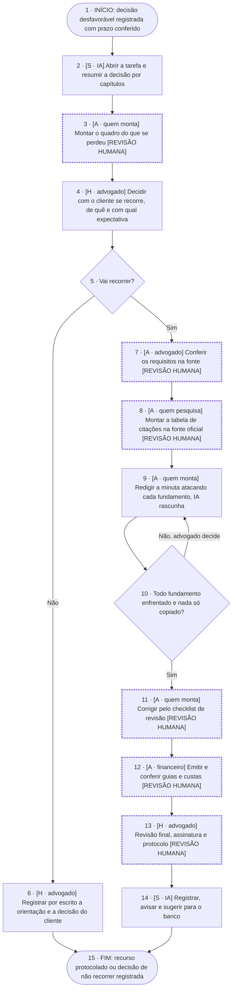

# POP: Recurso

Código: POP-PEC-03 · Setor: Produção de peças · Área: todas (exemplos por área no fim) · Versão: referência 1.0 · Atualizado em: [A DEFINIR ao adaptar] · Dono do POP: [A DEFINIR]

> POP de referência, escrito para um escritório genérico com equipe. 12 passos: 3 S, 7 A, 2 H. O portão que mais pesa: **decidir com o cliente se recorre**. O erro clássico do recurso feito com IA é a minuta que repete a inicial com outras palavras: longa, bem escrita e sem enfrentar o que o juiz decidiu. Este POP força o caminho contrário: primeiro o quadro do que se perdeu e por quê, depois a minuta atacando cada fundamento. Prazos são exemplos. A IA não calcula prazo de peça. Para usar, adapte pelo passo 3 da skill `organizar-producao-de-pecas`.

## 1. Objetivo

Decidir com o cliente se vale recorrer e, se valer, protocolar um recurso que enfrenta cada fundamento da decisão, com os requisitos conferidos.

## 2. Gatilho

Decisão desfavorável, total ou parcial, registrada pela controladoria com o prazo conferido. Ou recurso da outra parte, para as contrarrazões.

## 3. Responsáveis

- Executa: quem monta a minuta (quadro, ficha e redação); assistente ou financeiro (guias e custas, quando houver).
- Confere: quem monta a minuta (quadro contra a decisão e os autos); advogado (requisitos na fonte); quem pesquisa (citações na fonte oficial).
- Decide: advogado responsável, com o cliente (se recorre, de quê, com qual expectativa); advogado (assinatura).
- Responde pelo que a IA entregou: advogado responsável.

## 4. Entradas

- Decisão na íntegra.
- Peças anteriores do processo e prova dos autos.
- Modelo de recurso do banco.
- Checklist de requisitos do escritório para aquele recurso (cabimento, prazo, preparo, representação), com cada item `[CONFERIR]`.
- Caderno de teses.
- Ficha de briefing, tabela de citações e checklist de revisão de peça.

## 5. Passo a passo com S, A e H

1. [S] Abrir a tarefa com o prazo conferido pela controladoria e o prazo interno. Executa: IA, usando só a data conferida. Confere: quem monta a minuta, ao receber a tarefa.
2. [S] Resumir a decisão por capítulos: o que foi decidido em cada pedido e com qual fundamento, com a página. Executa: IA. Uso interno. Confere: quem recorre lê a decisão inteira mesmo assim.
3. [A] Montar o quadro do que se perdeu: capítulo, fundamento da decisão, o que temos contra ele e onde está a prova nos autos. Executa: IA. Confere: quem monta a minuta, contra a decisão e os autos.
4. [H] Decidir se recorre, de quê e com qual expectativa, e conversar com o cliente sobre custo, risco e tempo. Notícia ruim vai por voz antes de qualquer mensagem. Executa: advogado, com o cliente, com a decisão registrada por escrito. Confere: não se aplica.
5. [A] Conferir os requisitos do recurso pelo checklist do escritório: cabimento, prazo, preparo, representação. Cada item fica `[CONFERIR]` até alguém conferir. Executa: IA monta a lista. Confere: advogado, na fonte.
6. [A] Pesquisar e montar a tabela de citações, focada nos fundamentos da decisão que serão atacados. Executa: IA sugere, com o prompt 2. Confere: quem pesquisa, na fonte oficial.
7. [A] Redigir a minuta atacando cada fundamento do quadro, na ordem dos capítulos, sem repetir a inicial. Executa: IA, a partir do modelo do banco e do quadro do passo 3, com o prompt 3. Confere: quem monta a minuta reescreve o que precisa.
8. [A] Conferir a cobertura: todo fundamento do quadro foi enfrentado, e nenhum trecho só copia peça anterior. Executa: IA lista. Confere: advogado decide.
9. [A] Revisar a forma pelo checklist de revisão. Executa: IA aponta. Confere: quem monta a minuta corrige.
10. [A] Preparar guias e custas, quando houver, e conferir valor e comprovante de pagamento. Executa: IA lista o que é preciso. Confere: assistente ou financeiro emite e confere.
11. [H] Fazer a revisão final, assinar e protocolar. Executa: advogado responsável. Confere: revisor sênior, nos recursos de maior risco.
12. [S] Registrar, avisar e alimentar o banco: comprovante arquivado, cliente avisado do que acontece agora, argumento que funcionou sugerido para o caderno de teses. Executa: IA. Confere: quem protocolou; o dono do modelo decide o que entra no banco.

## 6. Prazo

- Prazo processual pela controladoria, conferido na fonte `[CONFERIR]`.
- Exemplo de prazos internos: conversa com o cliente em até 2 dias úteis depois da decisão e minuta pronta para revisão 3 dias úteis antes do prazo fatal. No escritório: [A DEFINIR, do código do escritório].

## 7. Exceções

- Decisão com ponto omisso ou contraditório: o advogado avalia antes se cabe pedir esclarecimento ao próprio juízo, e o POP recomeça depois.
- Cliente decide não recorrer: a orientação do advogado e a decisão do cliente ficam registradas por escrito.
- Contrarrazões ao recurso da outra parte: o POP roda a partir do passo 2, com o recurso dela no lugar da decisão.
- Família: o passo 4 é a conversa mais delicada do POP e nunca vai por mensagem. Sinal de violência, coação ou risco tira o caso de qualquer automação.

## 8. Saída

Recurso protocolado com requisitos conferidos, ou decisão de não recorrer registrada, e cliente informado nos dois casos.

## 9. Onde a IA entra

- Passos S: abertura, resumo por capítulos, registro e aviso.
- Passos A: quadro do que se perdeu, lista de requisitos, sugestão de pesquisa, minuta, conferência de cobertura, revisão de forma, guias.
- O que a IA consulta: modelo de recurso, checklist de requisitos do escritório, caderno de teses, checklist de revisão.
- Ambiente: Projeto de peças no Claude, em conta profissional (conferir na configuração da conta).

## 10. Nunca sai sem revisão humana

- A decisão de recorrer.
- Cada requisito do recurso.
- Toda citação.
- A peça inteira.
- A mensagem ao cliente sobre a decisão desfavorável.

## 11. Dados pessoais e sensíveis

- Dados que aparecem: os mesmos dos autos (qualificação, documentos, às vezes laudo, dado de saúde ou de criança).
- Anonimizar antes da IA: decisão e peças anteriores pela tabela padrão; laudo só no trecho que a tarefa exige.
- Nunca na IA sem autorização expressa do responsável: laudo completo, dado de criança ou adolescente, processo em segredo de justiça. Senha e certificado nunca.

## 12. Indicador

- Recursos com requisitos conferidos por checklist (meta: todos).
- Fundamentos da decisão não enfrentados, encontrados na revisão.

---

## Exemplos por área

- **Previdenciário:** sentença apoiada em laudo desfavorável. O quadro separa o que é discussão de prova e o que é fundamento jurídico, porque o ataque muda.
- **Trabalhista:** sentença de procedência parcial. Cada pedido vira um capítulo do quadro, e o passo 4 decide de quais vale recorrer.
- **Família:** decisão sobre guarda ou alimentos. O passo 4 é a conversa mais delicada do POP e nunca vai por mensagem.
- **Consumidor:** recurso no Juizado ou na vara comum. Os requisitos mudam conforme o rito, então o checklist do passo 5 é conferido na fonte para cada um.

## Na trilha solo

O quadro do passo 3 é feito num dia e a minuta no outro, para a decisão do passo 4 não ser tomada em cima de um texto pronto. A conferência de cobertura e a revisão final ficam para outro momento, com o checklist na mão.

## Fluxograma

Desenhado a partir dos passos (o material de origem não trazia fluxograma deste POP).

**Em texto:**
1. INÍCIO: decisão desfavorável registrada com prazo conferido.
2. AÇÃO [S · IA] Abrir a tarefa e resumir a decisão por capítulos. Vá para 3.
3. AÇÃO [A · quem monta] Montar o quadro do que se perdeu [REVISÃO HUMANA]. Vá para 4.
4. AÇÃO [H · advogado] Decidir com o cliente se recorre, de quê e com qual expectativa. Vá para 5.
5. DECISÃO: vai recorrer? Se sim, vá para 7. Se não, vá para 6.
6. AÇÃO [H · advogado] Registrar por escrito a orientação e a decisão do cliente. Vá para 15.
7. AÇÃO [A · advogado] Conferir os requisitos na fonte [REVISÃO HUMANA]. Vá para 8.
8. AÇÃO [A · quem pesquisa] Montar a tabela de citações na fonte oficial [REVISÃO HUMANA]. Vá para 9.
9. AÇÃO [A · quem monta] Redigir a minuta atacando cada fundamento, com rascunho da IA. Vá para 10.
10. DECISÃO: todo fundamento foi enfrentado e nada só copia peça anterior? Se sim, vá para 11. Se não, o advogado decide e volte para 9.
11. AÇÃO [A · quem monta] Corrigir pelo checklist de revisão [REVISÃO HUMANA]. Vá para 12.
12. AÇÃO [A · financeiro] Emitir e conferir guias e custas, quando houver [REVISÃO HUMANA]. Vá para 13.
13. AÇÃO [H · advogado] Revisão final, assinatura e protocolo [REVISÃO HUMANA]. Vá para 14.
14. AÇÃO [S · IA] Registrar, avisar e sugerir para o banco. Vá para 15.
15. FIM: recurso protocolado ou decisão de não recorrer registrada, cliente informado.

O símbolo 6 é a exceção "cliente decide não recorrer".

Caminho principal: decisão → capítulos → quadro do que se perdeu → decisão com o cliente → requisitos → citações → minuta → cobertura → checklist → guias → revisão final e protocolo → registro.
