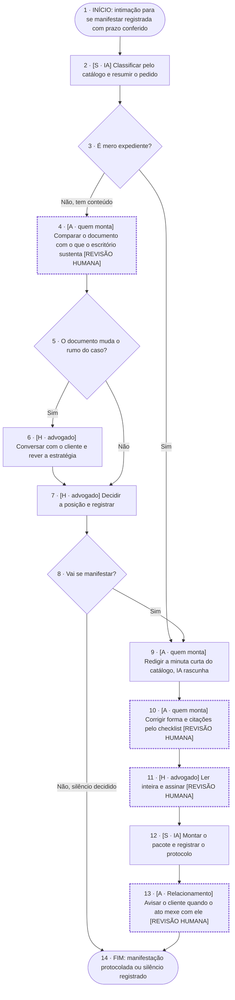

# POP: Manifestação e impugnação

Código: POP-PEC-04 · Setor: Produção de peças · Área: todas (exemplos por área no fim) · Versão: referência 1.0 · Atualizado em: [A DEFINIR ao adaptar] · Dono do POP: [A DEFINIR]

> POP de referência, escrito para um escritório genérico com equipe. 10 passos: 3 S, 5 A, 2 H. O portão que mais pesa: **posição decidida e registrada**. É a peça que mais aparece e a que menos gente coloca no papel: manifestação sobre documento, sobre laudo, sobre cálculo, réplica, ciência, juntada. Por ser curta, é a mais tentadora de deixar inteira com a IA. E é onde uma frase mal colocada concorda com um laudo que você queria impugnar. O POP separa o que é mero expediente do que tem conteúdo. Prazos são exemplos. A IA não calcula prazo de peça. Para usar, adapte pelo passo 3 da skill `organizar-producao-de-pecas`.

## 1. Objetivo

Responder a toda intimação para manifestação no prazo interno, com posição decidida pelo advogado e apoio no documento a que se responde.

## 2. Gatilho

Intimação para se manifestar registrada pela controladoria, com prazo conferido: documento juntado, laudo pericial, cálculo, contestação para réplica, proposta da outra parte.

## 3. Responsáveis

- Executa: quem monta a minuta (comparação e texto); controladoria (classifica e acompanha).
- Confere: quem recebe a tarefa (classificação); quem monta a minuta (comparação); Relacionamento (aviso ao cliente).
- Decide: advogado responsável (posição e assinatura).
- Responde pelo que a IA entregou: advogado responsável.

## 4. Entradas

- O ato a que se responde.
- A ficha de briefing do caso.
- Os quesitos ou o cálculo do escritório, quando houver.
- O catálogo de peças curtas do banco de modelos (um modelo por tipo de manifestação).
- Checklist de revisão de peça (pode ser a versão reduzida, com citações, fatos e dados do cliente).

## 5. Passo a passo com S, A e H

1. [S] Classificar a intimação pelo catálogo: mero expediente (ciência, juntada, endereço, custas) ou com conteúdo (laudo, cálculo, documento novo, réplica, proposta). Na dúvida, com conteúdo. Executa: IA. Confere: quem recebe a tarefa.
2. [S] Resumir o que foi pedido, por quem, com qual prazo conferido e qual documento está sendo respondido, com a página. Executa: IA, usando só a data que a controladoria conferiu. Confere: quem monta a minuta, ao abrir o ato.
3. [A] Comparar o documento com o que o escritório sustenta: laudo contra quesitos e prova do cliente, cálculo da outra parte contra o nosso, documento novo contra a linha do tempo da ficha. Executa: IA lista as divergências com página. Confere: quem monta a minuta.
4. [H] Decidir a posição: concordar, impugnar, pedir esclarecimento ou não se manifestar. Ficar em silêncio também é decisão, e fica registrada com o nome de quem decidiu. Executa: advogado responsável. Confere: não se aplica.
5. [A] Redigir a minuta curta a partir do modelo do catálogo, com os pontos decididos e a referência a cada página. Executa: IA, com o prompt 3. Confere: quem monta a minuta ajusta.
6. [A] Revisar forma e citações pelo checklist de revisão. Peça curta também cita, e citação curta também precisa de fonte. Executa: IA aponta. Confere: quem monta a minuta corrige.
7. [H] Ler inteira e assinar. Peça de uma página é lida do começo ao fim como a de vinte. Executa: advogado responsável. Confere: não se aplica.
8. [S] Montar o pacote e registrar o protocolo no sistema, com o comprovante na pasta. Executa: IA. Confere: pessoa autorizada, que protocola com o certificado.
9. [A] Avisar o cliente quando o ato mexe com ele: perícia marcada, laudo desfavorável, documento a providenciar. Executa: IA rascunha. Confere: Relacionamento revisa e envia. Notícia ruim, o advogado liga antes.
10. [A] Atualizar o catálogo: manifestação que se repete e ainda não tem modelo vira candidata. Executa: IA sugere. Confere: dono do banco de modelos decide.

## 6. Prazo

- Exemplo: mero expediente tratado no mesmo dia útil da intimação. Com conteúdo, minuta pronta 2 dias úteis antes do prazo interno. No escritório: [A DEFINIR, do código do escritório].
- Prazo fatal sempre pela controladoria, conferido na fonte `[CONFERIR]`.

## 7. Exceções

- Laudo ou documento que muda o rumo do caso: vira conversa com o cliente e revisão da estratégia antes da manifestação.
- Impugnação de cálculo complexo: vai para quem calcula no escritório, e a IA só organiza os dados.
- Manifestação sobre estudo social ou psicológico em Família: leitura integral pelo advogado desde o passo 3, com a IA só organizando. Sinal de violência, coação ou risco: o advogado assume e nada daquele caso entra em automação.

## 8. Saída

Manifestação protocolada ou decisão de não se manifestar registrada, cliente avisado quando for o caso e catálogo atualizado.

## 9. Onde a IA entra

- Passos S: classificação, resumo, pacote e registro.
- Passos A: comparação com página, minuta curta, revisão, aviso ao cliente, curadoria do catálogo.
- O que a IA consulta: catálogo de peças curtas, ficha do caso, checklist de revisão (reduzido).
- Ambiente: Projeto de peças no Claude, em conta profissional (conferir na configuração da conta).

## 10. Nunca sai sem revisão humana

- A posição sobre o laudo, o cálculo ou o documento.
- A decisão de não se manifestar.
- A peça inteira, por curta que seja.

## 11. Dados pessoais e sensíveis

- Dados que aparecem: laudo médico (dado de saúde, dado pessoal sensível pela LGPD, Lei 13.709/2018), estudo social ou psicológico, cálculos com dados financeiros.
- Anonimizar antes da IA: o ato e os documentos comparados, pela tabela padrão; laudo só no trecho que a manifestação exige.
- Nunca na IA sem autorização expressa do responsável: laudo completo, dado de criança ou adolescente, processo em segredo de justiça. Senha e certificado nunca.

## 12. Indicador

- Tempo entre a intimação e a minuta pronta.
- Manifestações com conteúdo que saíram de modelo do catálogo.

---

## Exemplos por área

- **Previdenciário:** manifestação sobre o laudo pericial médico, comparando conclusão, quesitos e documentos médicos do cliente. A réplica à contestação do INSS também segue este POP.
- **Trabalhista:** impugnação aos cálculos de liquidação, com a planilha do escritório lado a lado.
- **Família:** manifestação sobre estudo psicossocial. A IA organiza, a leitura e a posição são do advogado do começo ao fim.
- **Consumidor:** réplica à contestação do fornecedor e manifestação sobre telas e registros que a empresa juntou.

## Na trilha solo

O passo 1 é o que mais alivia: o mero expediente sai do caminho no mesmo dia, e o que tem conteúdo ganha hora marcada. A leitura do passo 7 continua integral, mesmo no fim do dia.

## Fluxograma

Desenhado a partir dos passos (o material de origem não trazia fluxograma deste POP).

**Em texto:**
1. INÍCIO: intimação para se manifestar registrada com prazo conferido.
2. AÇÃO [S · IA] Classificar pelo catálogo e resumir o pedido. Vá para 3.
3. DECISÃO: é mero expediente? Se sim, vá para 9. Se não, vá para 4.
4. AÇÃO [A · quem monta] Comparar o documento com o que o escritório sustenta [REVISÃO HUMANA]. Vá para 5.
5. DECISÃO: o documento muda o rumo do caso? Se sim, vá para 6. Se não, vá para 7.
6. AÇÃO [H · advogado] Conversar com o cliente e rever a estratégia. Vá para 7.
7. AÇÃO [H · advogado] Decidir a posição e registrar. Vá para 8.
8. DECISÃO: vai se manifestar? Se sim, vá para 9. Se não, vá para 14 (silêncio registrado com o nome de quem decidiu).
9. AÇÃO [A · quem monta] Redigir a minuta curta a partir do catálogo, com rascunho da IA. Vá para 10.
10. AÇÃO [A · quem monta] Corrigir forma e citações pelo checklist [REVISÃO HUMANA]. Vá para 11.
11. AÇÃO [H · advogado] Ler inteira e assinar [REVISÃO HUMANA]. Vá para 12.
12. AÇÃO [S · IA] Montar o pacote e registrar o protocolo. Vá para 13.
13. AÇÃO [A · Relacionamento] Avisar o cliente quando o ato mexe com ele [REVISÃO HUMANA]. Vá para 14.
14. FIM: manifestação protocolada ou decisão de não se manifestar registrada.

Ponto em aberto para o escritório: o mero expediente também passa pela leitura e assinatura do advogado (símbolo 11). Se o escritório quiser um caminho mais curto para ciência e juntada, isso é decisão dele, escrita no POP: [A DEFINIR].

Caminho principal: intimação → classificação → comparação → posição → minuta curta → checklist → leitura e assinatura → protocolo → aviso ao cliente.
