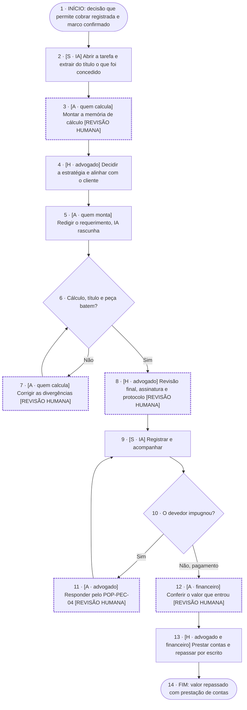

# POP: Cumprimento de sentença

Código: POP-PEC-05 · Setor: Produção de peças · Área: todas (exemplos por área no fim) · Versão: referência 1.0 · Atualizado em: [A DEFINIR ao adaptar] · Dono do POP: [A DEFINIR]

> POP de referência, escrito para um escritório genérico com equipe. 11 passos: 3 S, 5 A, 3 H. O portão que mais pesa: **cálculo batendo com o título**. É a fase em que o cliente mais pergunta "quando eu recebo?" e em que um número errado aparece rápido. A IA rende muito na leitura do título e na organização do cálculo. A conferência do cálculo contra o título é o portão deste POP, e o repasse ao cliente fecha com pessoa. Prazos são exemplos. A IA não calcula prazo de peça. Para usar, adapte pelo passo 3 da skill `organizar-producao-de-pecas`.

## 1. Objetivo

Cobrar exatamente o que a decisão concedeu, com cálculo que bate com o título, acompanhar até o pagamento e prestar contas ao cliente.

## 2. Gatilho

A controladoria registra a decisão que permite cobrar, e o advogado confirma o marco, conferido na fonte.

## 3. Responsáveis

- Executa: quem monta a minuta (requerimento); quem calcula no escritório (memória de cálculo); financeiro (valor recebido e repasse).
- Confere: quem calcula (cálculo contra título e peça); financeiro e advogado (valor que entrou); controladoria (prazos novos).
- Decide: advogado responsável (estratégia de cobrança, assinatura, prestação de contas).
- Responde pelo que a IA entregou: advogado responsável.

## 4. Entradas

- Decisão ou acórdão na íntegra.
- Ficha do caso.
- Contrato de honorários.
- Modelo de requerimento do banco.
- Software ou planilha de cálculo do escritório.
- Premissas de cálculo que o escritório adota (na base, com tudo `[CONFERIR]`).

## 5. Passo a passo com S, A e H

1. [S] Abrir a tarefa a partir do registro da controladoria, com o marco confirmado pelo advogado. Executa: IA. Confere: advogado, que confirma o marco na fonte.
2. [S] Extrair do título o que foi concedido: cada condenação, os parâmetros de correção e juros como estão escritos na decisão, marcos e honorários, com a página. Executa: IA. Uso interno. Parâmetro que não está claro no título fica `[CONFERIR]`. Confere: quem calcula, ao montar a memória.
3. [A] Montar a memória de cálculo com cada premissa escrita e a página do título de onde ela saiu. Executa: IA organiza. Confere: quem calcula, no software ou planilha do escritório.
4. [H] Decidir a estratégia (o que cobrar agora, de quem e por qual caminho) e alinhar com o cliente o valor esperado e o tempo, sem promessa de data. Executa: advogado responsável. Confere: não se aplica.
5. [A] Redigir o requerimento a partir do modelo do banco, com a memória de cálculo como anexo. Executa: IA, com o prompt 3. Confere: quem monta a minuta ajusta.
6. [A] Conferir cálculo contra título e contra a peça: mesmos valores, mesmas datas, mesmos parâmetros nos três lugares. Executa: IA aponta divergências. Confere: quem calcula corrige.
7. [H] Fazer a revisão final, assinar e protocolar. Executa: advogado responsável. Confere: não se aplica.
8. [S] Registrar e acompanhar: intimação do devedor, pagamento, impugnação, avisando o responsável quando algo muda. Executa: IA. Confere: controladoria, os prazos novos.
9. [A] Responder à impugnação do devedor, quando houver, pelo POP-PEC-04 (manifestação e impugnação). Executa: IA, dentro do POP-PEC-04. Confere: advogado decide a posição.
10. [A] Conferir o valor que entrou: depósito, alvará ou requisição de pagamento, comparando com o cálculo e com o que a decisão mandou pagar. Executa: IA compara. Confere: financeiro e advogado validam.
11. [H] Prestar contas e repassar ao cliente conforme o contrato de honorários, por escrito. Executa: advogado e financeiro. Confere: não se aplica.

## 6. Prazo

- Exemplo: requerimento protocolado em até 10 dias úteis depois do marco confirmado. Prestação de contas em até 5 dias úteis depois do valor disponível na conta do escritório. Ajuste ao contrato de honorários. No escritório: [A DEFINIR, do código do escritório].
- Prazo processual pela controladoria, conferido na fonte `[CONFERIR]`.

## 7. Exceções

- Cobrança contra o poder público, como o INSS: segue regras próprias de pagamento, que o advogado confere na fonte antes do passo 4 `[CONFERIR]`.
- Cálculo com controvérsia relevante: vai para quem calcula ou para calculista externo, e a IA só organiza.
- Devedor que não paga e não tem bem conhecido: o advogado decide as medidas e conversa com o cliente.
- Cliente perguntando "quando eu recebo?": resposta com o status real, sem estimativa de data que o escritório não controla.
- Família (alimentos atrasados): a escolha do caminho é do advogado e a conversa com o cliente é sensível. Sinal de violência, coação ou risco: o advogado assume e nada daquele caso entra em automação.

## 8. Saída

Valor recebido, conferido e repassado com prestação de contas por escrito, ou medidas seguintes decididas e registradas.

## 9. Onde a IA entra

- Passos S: abertura, leitura do título, acompanhamento.
- Passos A: organização do cálculo, requerimento, conferência cálculo x título x peça, resposta à impugnação, conferência do valor recebido.
- O que a IA consulta: modelo de requerimento, premissas de cálculo do escritório, ficha do caso.
- Ambiente: Projeto de peças no Claude. Dado financeiro do cliente só em conta profissional (conferir na configuração da conta).

## 10. Nunca sai sem revisão humana

- O cálculo.
- A estratégia de cobrança.
- O requerimento.
- O valor repassado ao cliente e a prestação de contas.

## 11. Dados pessoais e sensíveis

- Dados que aparecem: dados bancários do cliente e do devedor, valores, às vezes dado de saúde (Previdenciário) ou de criança (alimentos).
- Anonimizar antes da IA: partes pela tabela padrão, número do benefício por `[BENEFÍCIO]`, processo por `[PROCESSO]`; dados bancários e de conta fora da IA.
- Nunca na IA sem autorização expressa do responsável: laudo completo, dado de criança ou adolescente, processo em segredo de justiça. Senha, certificado e credencial (gov.br, Meu INSS) nunca.

## 12. Indicador

- Tempo entre o marco e o requerimento protocolado.
- Divergências entre cálculo e título pegas antes do protocolo.

---

## Exemplos por área

- **Previdenciário:** cumprimento contra o INSS, com requisição de pagamento. O caminho e os marcos são conferidos na fonte antes do cálculo.
- **Trabalhista:** liquidação e execução, com verbas e reflexos conferidos por quem calcula no escritório.
- **Família:** cobrança de alimentos atrasados. A escolha do caminho é do advogado, e a conversa com o cliente é sensível.
- **Consumidor:** cumprimento contra o fornecedor, com o valor atualizado pelos parâmetros que a própria decisão fixou.

## Na trilha solo

Quem calcula e quem confere costuma ser a mesma pessoa: a conferência do passo 6 é feita em outro dia, ou por calculista externo nos casos de valor alto. Prestação de contas sempre por escrito, mesmo quando o cliente "só quer saber quanto vai cair".

## Fluxograma

Desenhado a partir dos passos (o material de origem não trazia fluxograma deste POP).

**Em texto:**
1. INÍCIO: decisão que permite cobrar registrada e marco confirmado.
2. AÇÃO [S · IA] Abrir a tarefa e extrair do título o que foi concedido. Vá para 3.
3. AÇÃO [A · quem calcula] Montar a memória de cálculo [REVISÃO HUMANA]. Vá para 4.
4. AÇÃO [H · advogado] Decidir a estratégia e alinhar com o cliente. Vá para 5.
5. AÇÃO [A · quem monta] Redigir o requerimento, com rascunho da IA. Vá para 6.
6. DECISÃO: cálculo, título e peça batem? Se sim, vá para 8. Se não, vá para 7.
7. AÇÃO [A · quem calcula] Corrigir as divergências [REVISÃO HUMANA]. Volte para 6.
8. AÇÃO [H · advogado] Revisão final, assinatura e protocolo [REVISÃO HUMANA]. Vá para 9.
9. AÇÃO [S · IA] Registrar e acompanhar. Vá para 10.
10. DECISÃO: o devedor impugnou? Se sim, vá para 11. Se não e houve pagamento, vá para 12.
11. AÇÃO [A · advogado] Responder pelo POP-PEC-04 [REVISÃO HUMANA]. Volte para 9.
12. AÇÃO [A · financeiro] Conferir o valor que entrou [REVISÃO HUMANA]. Vá para 13.
13. AÇÃO [H · advogado e financeiro] Prestar contas e repassar por escrito. Vá para 14.
14. FIM: valor repassado com prestação de contas.

Ponto em aberto: o caminho de quem não paga e não tem bem conhecido (exceção) não está desenhado. Ele sai do símbolo 10 para uma decisão do advogado, fora deste POP: [A DEFINIR].

Caminho principal: marco → título → memória de cálculo → estratégia → requerimento → conferência cálculo x título x peça → protocolo → acompanhamento → valor conferido → prestação de contas.
